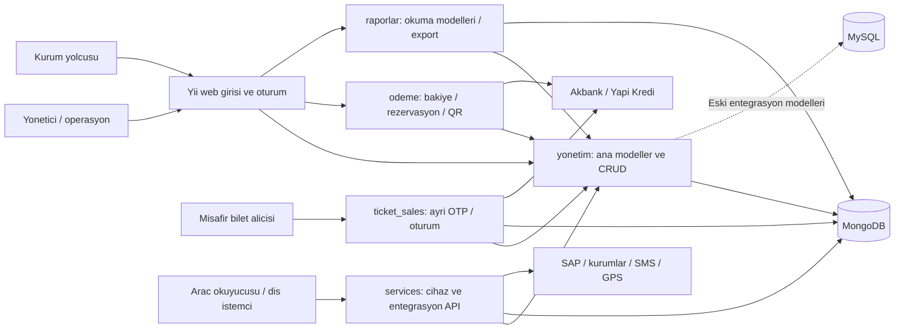

# AYShuttleGursel - Proje Analizi ve Mevcut Sistem Dokümantasyonu

**İnceleme tarihi:** 2026-10-29  
**Kaynak proje:** [AYShuttleGursel](../php/AYShuttleGursel/)  
**Kaynak HEAD:** `0956c9be6bea96a849e198d9785b35c4f7590608` (2026-07-24)  
**Belge türü:** Kaynak koddan çıkarılmış mevcut-durum analizi; canlıya uygunluk veya tamamlanmış geçiş raporu değildir.  
**Teknik ek:** [Controller, servis ve koleksiyon envanteri](./AYSHUTTLEGURSEL_TEKNIK_ENVANTER_TR.md)

## İçindekiler

1. [Kapsam ve kanıt sınırları](#kapsam)
2. [Yönetici özeti](#ozet)
3. [Mimari ve teknoloji](#mimari)
4. [Kullanıcılar, yetki ve kurum bağlamı](#kimlik)
5. [İş alanları ve veri ilişkileri](#is-alanlari)
6. [Temel iş akışları](#akislar)
7. [Servis sözleşmeleri](#servisler)
8. [Dış entegrasyonlar](#entegrasyonlar)
9. [Kurulum ve işletim](#isletim)
10. [Doğrulanan tutarsızlıklar ve teknik borç](#bulgular)
11. [Test ve kabul matrisi](#test)
12. [AYSTEK Core ile ilişki ve geçiş sınırları](#gecis)
13. [Öncelikli çalışma sırası ve açık sorular](#sonraki-adimlar)
14. [Önceki envanterle farklar](#onceki-envanter)

<a id="kapsam"></a>
## 1. Kapsam ve kanıt sınırları

Bu çalışma uygulamanın yapılandırmasını, bağımlılıklarını, controller/action yüzeyini, MongoDB koleksiyon bildirimlerini, başlıca iş kurallarını, ödeme/rezervasyon/QR akışlarını ve mevcut test düzenini inceler. Controller ve koleksiyon adları tam envanterlenmiştir; her CRUD action'ının gövdesi ve her görünüm satırı ayrı ayrı denetlenmemiştir.

Kanıt etiketleri:

- **KOD:** Dosya içeriğinden veya kapsamı belirtilen statik sayımdan doğrulandı.
- **ÇIKARIM:** Kod akışından türetilen etki; çalışma zamanında yeniden üretilmedi.
- **DOĞRULANACAK:** Canlı veri, gerçek cihaz, banka test ortamı veya işletmeci bilgisi gerektirir.

İnceleme anında çalışma ağacında önceden var olan dört değişiklik bulunuyordu:

- [Türkçe mesajlar](../php/AYShuttleGursel/messages/tr/app.php)
- [Ödeme controller'ı](../php/AYShuttleGursel/modules/odeme/controllers/DefaultController.php)
- [Sanal POS formu](../php/AYShuttleGursel/modules/odeme/models/SanalPosForm.php)
- [Bakiye seçim görünümü](../php/AYShuttleGursel/modules/odeme/views/default/bakiye_secme.php)

Analiz bu dosyaların diskteki halini de kapsar; yalnızca HEAD içeriğinin analizi olarak yorumlanmamalıdır. PHP uygulaması değiştirilmedi.

İş mantığı incelemesinde üçüncü taraf kütüphane gövdeleri, üretilmiş dosyalar, çalışma zamanı kayıtları ve kişisel veri içerebilecek veri dökümleri kapsam dışıdır. Bağımlılıklar için [manifest](../php/AYShuttleGursel/composer.json) ve [kilit dosyası](../php/AYShuttleGursel/composer.lock) kullanılmıştır.

**Yapılmayanlar:** Uygulama başlatma, banka/SAP/üniversite/SMS çağrısı, MongoDB veya MySQL sorgusu, gerçek tahsilat/iade, penetrasyon testi, yedekten dönüş ve performans ölçümü. İnceleme ortamında `php` ve `composer` çalıştırılabilirleri bulunmadığından PHP testleri de çalıştırılmadı. Belgelerde parola, bağlantı dizgisi, anahtar veya gerçek kişi/kart bilgisi yayımlanmamıştır.

<a id="ozet"></a>
## 2. Yönetici özeti

AYShuttleGursel, uygulama adı **K-Ulaşım** olan bir **Yii2/PHP modüler monolitidir**. Ana işi kurumlara bağlı kişilerin kart/QR ile ulaşımı, ücret çekimi, bakiye ve abonelik yüklemesi, araç/sefer planlaması ve operasyonel-finansal raporlamadır.

Temel sonuçlar:

1. **İş çekirdeği yönetim modülündedir.** Kart, kişi, kurum, SUL, ücret, indirim, rezervasyon ve mali hareket modelleri burada toplanır. API ve kullanıcı ekranları aynı modelleri kullanır.
2. **Ana veri deposu MongoDB'dir.** Üç eski entegrasyon modeli SQL ActiveRecord kullanır; tüm sistem için “MySQL tabanlı” veya “hiç SQL yok” demek yanlıştır.
3. **Kart bakiyesi hareketlerden hesaplanır.** Ancak kayıt güncelleme/silme yolları da vardır; değiştirilemez event store veya çift taraflı muhasebe defteri garantisi yoktur.
4. **İki ayrı ödeme kullanım alanı vardır.** Kart/abonelik yüklemesi ile misafir QR bilet satışı aynı ürün değildir. Yapı Kredi mantığı bu iki alanda tekrar eder; Akbank kodu bakiye yükleme tarafındadır. BKM Express action'ı boştur.
5. **Çalıştırma tanımları birbiriyle uyumlu değildir.** Manifest PHP `>=7.4.0`, Docker PHP 7.4 derken kilitli çalışma zamanı bağımlılıkları PHP 8.1 gerektirir. Başarılı temiz kurulum doğrulanmış değildir.
6. **Finansal ve operasyonel regresyon testleri eksiktir.** Mevcut testler ağırlıkla Yii başlangıç şablonunu kapsar; kart çekimi, banka callback'i, rezervasyon iadesi ve QR tüketimi için ayrı kabul testleri gerekir.

### 2.1 Ölçülen uygulama yüzeyi

Sayım yalnızca kök controller/model/view dizinleri ile beş iş modülündeki PHP dosyalarını kapsar. `vendor`, `web` altındaki kütüphaneler, testler, runtime, config ve asset bundle dosyaları bu tabloya dahil değildir.

| Alan | PHP dosyası | Controller | Inline action | Model dosyası | Görünüm |
|---|---:|---:|---:|---:|---:|
| Kök controller/model/view | 48 | 3 | 19 | 20 | 25 |
| `yonetim` | 719 | 80 | 443 | 157 | 481 |
| `odeme` | 47 | 7 | 29 | 3 | 36 |
| `raporlar` | 76 | 6 | 40 | 13 | 56 |
| `services` | 61 | 16 | 85 | 13 | 31 |
| `ticket_sales` | 17 | 4 | 17 | 2 | 8 |
| **Toplam** | **968** | **116** | **633** | **208** | **637** |

Model dosyalarına arama/form/yardımcı modeller de dahildir; 208 ayrı koleksiyon anlamına gelmez. Model dizinlerinde literal dönüş değeri olan **93 farklı `collectionName()` bildirimi** saptandı; bu sayı canlı MongoDB koleksiyon sayısı değildir. Inline action sayımı yorumlar ve `actions()` metodu dışlanarak `actionX...` metotlarından yapılmıştır; 633 yayınlanmış veya yetkisi doğrulanmış API endpoint'i anlamına gelmez. Modül içindeki temel controller bileşeni ayrıca controller olarak sayılmamıştır.

<a id="mimari"></a>
## 3. Mimari ve teknoloji

### 3.1 Sistem sınırları



Kaynak başlangıç noktaları: [web entrypoint](../php/AYShuttleGursel/web/index.php), [web yapılandırması](../php/AYShuttleGursel/config/web.php), [modül dizini](../php/AYShuttleGursel/modules/).

İş kuralları önemli ölçüde ActiveRecord modellerinde, entegrasyon ve yönlendirme kararları controller'larda bulunur. Katmanlı repository/service ayrımı uygulama geneline yayılmış değildir. Bilet modülündeki [AuthService](../php/AYShuttleGursel/modules/ticket_sales/services/AuthService.php) ayrı bir servis örneğidir; uygulamanın tamamının servis katmanına ayrıldığı anlamına gelmez.

### 3.2 Bağımlılıklar

| Bileşen | Kodda görülen durum |
|---|---|
| Yii2 | Manifest `~2.0.45`; kilitli sürüm `2.0.49.3` |
| PHP | Manifest `>=7.4.0`; kilitli Symfony 6.4 bileşenleri, Doctrine Lexer 3 ve email validator 4 nedeniyle alt sınır en az 8.1 |
| Bootstrap | `yiisoft/yii2-bootstrap5`, kilitli `2.0.4` |
| MongoDB | `yiisoft/yii2-mongodb`, kilitli `3.0.1`; MongoDB PHP extension gerekir |
| SQL | `yii\db\Connection`; üç eski üniversite entegrasyon modeli |
| Ekran bileşenleri | Kartik Grid/DynaGrid/Select2/Export ve diğer widget'lar; birçok manifest kısıtı `dev-master` |
| E-posta | Yii Symfony Mailer `2.0.4`, SMTP transport; web ayarında dosya transport'u kapalı |
| Excel/PDF kütüphaneleri | PhpSpreadsheet `1.29.0`, mPDF `8.2.2` kilit dosyasında mevcut; incelenen rapor export menülerinde PDF seçeneği kapalı |
| JWT | `firebase/php-jwt` `6.11.0` bağımlılığı var; incelenen kimlik akışları Yii/PHP oturumu kullanır |
| Test | Codeception ve PHPUnit geliştirme bağımlılıkları |

**Önemli ayrım:** `dev-master` kısıtları güncelleme sırasında hareketli bağımlılık seçimine yol açar; mevcut kilit dosyası varken `composer install` yine kilitli referansları kullanır. “Kilit dosyası yok / her kurulum rastgele sürüm alıyor” sonucu çıkarılmamalıdır.

Kilitli bazı bağımlılıkların PHP aralığı 8.3'e kadar açıkça sınırlandırılmıştır. Bu yüzden yalnızca alt sınıra bakıp PHP 8.4+ uyumluluğu ilan edilmemelidir. Desteklenecek runtime, kilit dosyası ve extension'larla ayrıca doğrulanmalıdır.

### 3.3 URL, dil, önbellek ve kayıt

- [URL yöneticisi](../php/AYShuttleGursel/config/web.php#L83) pretty URL kullanır, script adını gizler; özel route kuralı listesi boştur.
- Controller/action adlandırması Yii kurallarına bağlıdır. Örneğin `actionGetPrice` → `get-price`; `actionBakiyeyukle` → `bakiyeyukle`. Action adlarını keyfi olarak yeniden tirelemek istemciyi bozar.
- [Web rewrite tanımı](../php/AYShuttleGursel/web/.htaccess) mevcut dosya/dizin dışındaki istekleri front controller'a iletir.
- Varsayılan dil Türkçedir; istek öncesinde oturumdaki `language` değeri okunur. [Dil değiştirme action'ı](../php/AYShuttleGursel/controllers/SiteController.php#L72) ve [mesaj dizini](../php/AYShuttleGursel/messages/) ilgili yüzeylerdir.
- Dosya tabanlı cache ve `error`/`warning` seviyesinde Yii dosya log hedefi yapılandırılmıştır.
- [Haftalık plan](../php/AYShuttleGursel/modules/odeme/controllers/HaftalikPlanController.php#L44), SUL listesini **yerel modelden** alıp 60 saniye cache'ler; yorumdaki “remote JSON/cURL proxy” ifadesine rağmen bu metotta HTTP çağrısı yoktur. Gün/saat filtrelemesi `Europe/Istanbul` ile yapılır.

<a id="kimlik"></a>
## 4. Kullanıcılar, yetki ve kurum bağlamı

| Kullanıcı/istemci | Kimlik doğrulama | Bağlam |
|---|---|---|
| Sistem yöneticisi/operasyon | Yii user, `Kullanicilar`, hash'li parola | Yetki grupları ve seçili kurum |
| Kurum yolcusu | Kurum giriş/kayıt ekranları; yine `Kullanicilar` kimliği | `Kisiler`, kişi-kart bağı, kurum sistem numarası |
| Misafir bilet alıcısı | SMS/e-posta OTP; `customer_id` oturum alanı | `ticket_buyers`, `i_number`, `i_name` |
| Araç/cihaz | Bazı controller'larda kullanıcı/parola veya plaka/parola | Araç, açık iş, SUL |
| Kurum entegrasyon istemcisi | Servis kullanıcısı → bağlantı anahtarı | Web servis kullanıcı/bağlantı koleksiyonları |
| AYSTEK validator istemcisi | Yii `HttpBasicAuth` | `Kullanicilar` doğrulaması |

Kaynaklar: [web identityClass](../php/AYShuttleGursel/config/web.php#L25), [parola doğrulama](../php/AYShuttleGursel/models/Kullanicilar.php#L204), [kurum yolcusu girişi](../php/AYShuttleGursel/controllers/SiteController.php#L250), [bilet BaseController](../php/AYShuttleGursel/modules/ticket_sales/components/BaseController.php), [servis kimlik kontrolü](../php/AYShuttleGursel/modules/services/controllers/KartbakiyeislemleriController.php#L75), [Basic Auth](../php/AYShuttleGursel/modules/services/controllers/AystekvalidatorController.php#L29).

### 4.1 Özel yetki modeli

Yii RBAC yerine aşağıdaki ilişkiler kullanılır:

```text
kullanicilar.kullanici_eposta
    -> kullanici_yetki_gruplari.kullanici / yetki_grubu
    -> yetkiler.yetki_grubu / yetki
```

[Yetkiler::getYetkiGruplari](../php/AYShuttleGursel/modules/yonetim/models/Yetkiler.php#L144), kullanıcının gruplarıyla istenen yetki anahtarının eşleşmesini arar. Controller'lar bunu `AccessControl` kurallarına taşır. Menüde bir seçeneğin görünmesi, bütün action'lar için yetkinin doğrulandığı anlamına gelmez.

### 4.2 Kurum kapsamı

[Kurumlar](../php/AYShuttleGursel/modules/yonetim/models/Kurumlar.php#L60) ve [KullaniciKurumAyarlari](../php/AYShuttleGursel/modules/yonetim/models/KullaniciKurumAyarlari.php#L155) kurum seçimini ve ürün davranışlarını etkiler:

- Bakiye alt sınırı, azami yükleme limiti ve iade süresi.
- Abonelik, rezervasyon ve rezervasyonda bakiye çekme.
- Hızlı kartsız geçiş, misafir kaydı, QR şifreleme modu.
- Kampanyalı yükleme, online yayın ve hatalı iş düzeltme.

**ÇIKARIM:** Bu, kurum bazlı iş ayrımıdır; AYSTEK Core'daki zorunlu `tenant_id` + `site_id` repository izolasyonuyla eşdeğer kabul edilmemelidir. Kurum kapsamı ekran/model sorgularında ayrıca uygulanır; bu çalışmada tüm sorgular için izolasyon kanıtı çıkarılmamıştır.

<a id="is-alanlari"></a>
## 5. İş alanları ve veri ilişkileri

### 5.1 Sözlük

| Kavram | Anlam |
|---|---|
| Kurum | Yolcunun bağlı olduğu üniversite/işletme ve ürün ayarlarının sahibi |
| Kişi | Yolcu; kurum numarası, iletişim bilgisi, sınıf ve grup üyelikleri |
| Kart | RFID/kart numarası ile tanımlı ulaşım aracı; para bakiyesi alanı değildir |
| SUL | Saatli Ulaşım Listesi; güzergah, geçerlilik tarihleri ve günlere göre saat listeleri |
| İş ataması | Belirli gün/saat için SUL + plaka + sürücü operasyon kaydı |
| Ücret | Geçerlilik aralığı olan SUL tarifesi; kartlı/kartsız/kupon ayrımı |
| İndirim kümesi | Oran, gün, saat aralığı, kullanım limiti ve zaman aşımı kuralları |
| Abonelik | Kişiye süreli indirim grubu/hak tanımlayan ücretli yükleme |
| Seyahat rezervasyonu | Kişi ve sefer zamanı için yer ayırma; kurum ayarına göre ön tahsilat |
| QR bilet | Ayrı misafir alıcısına ait, rota/SUL ile bağlı bilet kaydı |

SUL gün alanları yalnızca boolean değildir: [getScheduleList](../php/AYShuttleGursel/modules/yonetim/models/SaatliUlasimListesi.php#L569) bunları saat listeleri olarak okur ve sıralar. Rezervasyon için ayrıca `*_rz` alanları vardır.

### 5.2 Ana ilişkiler

```text
Kurum -> Kisi -> KisiKartlari -> Kart
Kisi -> KisiGruplari / KisiGrubuGecerlilikSureleri
Kisi grubu + Guzergah -> KisiGrupGuzergahIndirimi -> GrupIndirimleriKumesi
Kurum -> Guzergah -> SUL -> UlasimUcretleri
SUL + Arac + Sofor + Tarih/Saat -> AracIsAtama
AracIsAtama + Kart -> KartCekimHareketleri
Kart -> Yukleme / Cekim / Iade -> hesaplanan bakiye
Kisi + SUL + Tarih/Saat -> SeyahatRezervasyonlari veya YedekRezervasyonlar
TicketBuyers -> Tickets -> QR dogrulama/kullanim
```

İlişkilerin önemli bir bölümü ObjectID yerine kart numarası, e-posta, plaka, SUL adı ve grup adı gibi iş anahtarlarına bağlıdır. Örneğin [kart numarası değiştirme](../php/AYShuttleGursel/modules/yonetim/models/KartYuklemeHareketleri.php#L726) geçmiş hareketleri de günceller. Veri taşıma sırasında salt belge kopyalamak yerine anahtar eşleme tablosu gerekir.

### 5.3 Mali kayıtların ayrımı

- **Kart hareketleri:** Yükleme, çekim, iade ve devir. Kaynak bakiye bunlardan hesaplanır.
- **Abonelik yüklemeleri:** Kişiye grup ve geçerlilik süresi kazandırır; kart nakit bakiyesiyle aynı kayıt türü değildir.
- **Ödeme işlem kaydı:** Banka/sipariş/aşama bilgilerini tutan `payment_transaction`; tek başına tahsilat defteri değildir.
- **Faturalı yükleme kaydı:** Sipariş, tutar, fatura türü ve gönderim durumu; muhasebe/e-fatura altyapısının tümünü temsil etmez.
- **Rapor koleksiyonları:** Kaynak hareketlerden üretilen okuma modelleri; mutabakatın tek gerçek kaynağı kabul edilmemelidir.
- **Yazar kasa POS raporları/kasa dekontları:** Günlük nakit/kart operasyon kaydı; web sanal POS callback'iyle karıştırılmamalıdır.

Tam koleksiyon listesi ve ana alanlar [teknik envanterde](./AYSHUTTLEGURSEL_TEKNIK_ENVANTER_TR.md#koleksiyonlar) yer alır.

<a id="akislar"></a>
## 6. Temel iş akışları

### 6.1 Kart okutma ve ücret çekimi

Kaynak: [cihaz endpoint'i](../php/AYShuttleGursel/modules/services/controllers/KartbakiyeislemleriController.php#L208) → [bakiyeCekmeIslemi](../php/AYShuttleGursel/modules/yonetim/models/KartCekimHareketleri.php#L208).

1. Servis controller'ı kullanıcı/plaka kimliğini kontrol eder; QR/kurum özel işleme dalları bulunur.
2. İstekten SUL okunur, geçerli ücret ve kart bilgisi çözülür.
3. Tanınmayan kart için kurum servisiyle kişi çözümleme/devir işlemi denenebilir.
4. Rezervasyonda önceden tahsilat yapılan kurumlarda eşleşen rezervasyon kontrol edilir; varlığı yeniden çekimi engelleyen bir sonuç üretir.
5. Kart kurumu ile güzergah kurumu karşılaştırılır.
6. Normal kartta kişinin geçerli grupları, güzergah indirimi, gün/saat, kullanım limiti ve zaman aşımı değerlendirilir.
7. Kart türüne göre kartlı, kartsız veya kupon ücreti seçilir.
8. Kurum bakiye alt sınırı kontrol edilir.
9. [bakiyeCek](../php/AYShuttleGursel/modules/yonetim/models/KartCekimHareketleri.php#L629) çekim belgesini kaydeder; yanıt tutar, kalan bakiye ve işteki okutma sayısını içerebilir.

```text
hesaplanan_tutar = ucret - (ucret * indirim_orani / 100)
izin kosulu      = mevcut_bakiye - hesaplanan_tutar >= kurum_bakiye_alt_siniri
```

**Sınırlar:** İndirimler için aday sorguları ve erken `return` içeren seçim akışı vardır; bütün adaylar arasında matematiksel olarak en yüksek indirimin her durumda seçildiği varsayılmamalıdır. Ücret hesabı `floatval`/`doubleval` kullanır. Okuma-kontrol-kayıt dizisinin atomik olduğu gösterilmemiştir.

### 6.2 Bakiye, iade ve kart devri

Kaynaklar: [kartToplamTutari](../php/AYShuttleGursel/modules/yonetim/models/Kartlar.php#L221), [kartIadeToplami](../php/AYShuttleGursel/modules/yonetim/models/KartIadeHareketleri.php#L161).

```text
bakiye = SUM(yukleme.islem_tutari)
       - SUM(cekim.hesaplanan_tutar)
       + net_iade

net_iade = KARTAYUKLEME
         - (NAKITODEME + KKIODEME + BKMIADE + TOSLAIADE)
```

İade türleri koleksiyondaki tür adlarına çözümlenerek toplanır. İsteğe bağlı tarih sınırıyla geçmiş bakiye hesaplama yolları vardır.

Hareket tabanlı tasarım, bakiye alanını doğrudan değiştirmemeyi sağlar; **kayıtların salt-eklemeli olarak zorlandığı anlamına gelmez**. Örneğin [yükleme güncelleme/silme action'ları](../php/AYShuttleGursel/modules/yonetim/controllers/KartyuklemehareketleriController.php#L180) mevcuttur. Geçmiş bakiye ve rapor tutarlılığı değişikliklerden etkilenebilir.

### 6.3 Online yükleme ve abonelik

Kaynak: [actionBakiyeyukle](../php/AYShuttleGursel/modules/odeme/controllers/DefaultController.php#L173), [SanalPosForm](../php/AYShuttleGursel/modules/odeme/models/SanalPosForm.php), [Yapı Kredi dönüş işleme](../php/AYShuttleGursel/modules/odeme/controllers/DefaultController.php#L1025).

1. Kullanıcı/KVKK, kişi ve kart bilgileri bulunur; gerekirse kurum kimlik/kart eşlemesi yenilenir.
2. Sipariş numarası oluşturulur, kart bakiyesi ve fatura iletişim bilgisi hazırlanır.
3. `BAKIYE_YUKLE`, `ABONELIK_YUKLE` veya `DONEMLIK_YUKLE` ekranı seçilir.
4. Kart bilgileri/form akışı, etkin sanal POS tanımına göre Akbank veya Yapı Kredi'ye yönlenir.
5. Banka dönüşü ilgili banka akışında doğrulama/provizyon aşamalarından geçer.
6. Bakiye yüklemesinde [gurselEYukleme](../php/AYShuttleGursel/modules/yonetim/models/KartYuklemeHareketleri.php#L427), abonelikte [yuklemeYap](../php/AYShuttleGursel/modules/yonetim/models/AbonelikYuklemeleri.php#L214) çağrılır.
7. Abonelik tamamlaması kişiye indirim grubu ve süre kaydı ekler; fatura bilgisi ayrıca tutulur.

Formda 50-6000 TL aralığında sabit tutar seçenekleri vardır; rezervasyondan gelen `yGtutar` görünümde ek seçenek olabilir. Bu menü tek başına sunucu tarafı tutar doğrulaması veya tüm kurumlar için ortak finansal limit değildir.

**Banka ayrımı:** Akbank `CC5Request`, Yapı Kredi POSNET `oosRequestData` → `oosResolveMerchantData` → `oosTranData` akışlarını kullanır. BKM action'ı [uygulanmamış iskelettir](../php/AYShuttleGursel/modules/odeme/controllers/DefaultController.php#L1232).

### 6.4 Rezervasyon, yedek liste ve iptal

Kaynaklar: [rezervasyon controller'ı](../php/AYShuttleGursel/modules/odeme/controllers/RezervasyonController.php#L78), [iptal modeli](../php/AYShuttleGursel/modules/yonetim/models/SeyahatRezervasyonlari.php#L329).

1. Kurum rezervasyon özelliği ve kullanıcı bilgileri okunur.
2. Kullanıcının kayıtlı ek yolcuları ve kendisi bir başvuru grubu oluşturur.
3. SUL/tarih/saat için kalan koltuk sayısı ve kimlik zorunluluğu değerlendirilir.
4. Yer varsa ve ön ödeme gerekiyorsa bakiye ön kontrolü yapılır.
5. `P...` biçimli sanal plaka ile iş bulunur/oluşturulur; uygulama kendi bakiye çekme servisine HTTP çağrısı yapar.
6. Çekim başarılıysa mobil çekim ve rezervasyon kayıtları yazılır; ödeme gerekmeyen kurumda doğrudan kayıt yolu vardır.
7. Kapasite yetersizse kişiler yedek listeye alınır.
8. İptal, SUL/kimlik zorunluluğuna bağlı süre kontrolünden sonra rezervasyon durumunu kapatır; ön tahsilat varsa iade kaydı oluşturmayı dener.
9. Servis action'ları rezervasyon bildirimi ve yedekten geçiş için ayrıca kullanılabilir.

**ÇIKARIM:** Koltuk okuma, çoklu yolcu tahsilatı, rezervasyon ve iade farklı yazımlardır. Tüm grup için tek transaction/rollback garantisi gösterilmemiştir. Kısmi başarı ve eşzamanlı son koltuk senaryoları test edilmelidir.

### 6.5 QR ve misafir bilet satışı

İki yerel QR ailesi vardır; üniversitelere özgü harici QR dalları bunlardan ayrıca değerlendirilir.

| Aile | Amaç | Kodda görülen ömür ve davranış |
|---|---|---|
| `01TCK` | Mevcut kişinin kartına bağlanan QR | Üretimde 300 saniye, milisaniye zaman damgası; geçerli mevcut kod tekrar döndürülebilir |
| `02TCK` | Misafir müşterinin satın aldığı rota/SUL bileti | `EXP_TIME = 24`; üretimde 24 saat hedeflenir, ancak tarih biçimi tutarsızlığı vardır |

Kaynaklar: [kişisel QR üretimi](../php/AYShuttleGursel/modules/odeme/controllers/QrCodeController.php#L21), [QR yönlendirici](../php/AYShuttleGursel/modules/odeme/models/QrCode.php#L32), [bilet modeli](../php/AYShuttleGursel/modules/ticket_sales/models/Tickets.php#L66), [bilet ödeme controller'ı](../php/AYShuttleGursel/modules/ticket_sales/controllers/PaymentController.php).

Misafir bilet akışı:

1. Kurum bağlamı ve telefon/e-posta ile OTP gönderimi.
2. Doğrulama sonrası `customer_id` oturum alanı.
3. Rota/SUL ve ücret seçimi; Yapı Kredi üzerinden ödeme başlatma.
4. Banka dönüşünden sipariş kaydı okunur, bilet ve fatura bilgisi yazılır.
5. Bilet listesi istemciye döner; QR resmi URL'si harici QR görselleştirme servisine gider.
6. Cihazdan `02TCK` geldiğinde bilet doğrulayıcısına yönlenir. `use=true` yolunda yükleme hareketi oluşturma ve bileti `used` durumuna geçirme kodu vardır.

**Mevcut davranış uyarıları:** Ödeme başlatmada ücret yerine sabit `1 * 100` kullanılması, callback'te string tarih yazılıp doğrulamada milisaniye ile karşılaştırılması ve `use=false` yolunun geçerli aktif bilette kimlik döndürmemesi nedeniyle bu modül “24 saat tek kullanımlık bilet satışı doğrulandı” şeklinde sunulamaz. Ayrıntılar §10'dadır.

### 6.6 Offline işlemler, iş kapatma ve rapor üretimi

- [Çevrimdışı hareket modeli](../php/AYShuttleGursel/modules/yonetim/models/CevrimdisiKartHareketleri.php), iş/kart/SUL, çekim zamanı ve aktarım durumunu tutar.
- Servis ve yönetim controller'larında çevrimdışı bakiye aktarım action'ları bulunur. Bu, cihazın kalıcı kuyruğunu veya tekrar gönderimde tekilleştirmeyi kanıtlamaz.
- Araç iş açma/kapatma, günlük plan ve iş devri ayrı controller/modellerdedir.
- [ExternalShuttle](../php/AYShuttleGursel/modules/yonetim/models/ExternalShuttle.php#L40), harici servis başlangıç/bitişini ve yolcu sınıfı adetlerini tutar; kart çekimiyle aynı kayıt değildir.
- [Kart raporunu yeniden oluşturma](../php/AYShuttleGursel/modules/raporlar/models/KartHareketRaporu.php#L294), kaynak hareket kimliklerinden raporda eksik olanları ekler; adı “yeniden oluştur” olsa da bu metotta bütün tabloyu silip sıfırdan kurma yapılmaz.
- Diğer raporlar kalıcı Mongo okuma modeli veya anlık hesaplanan `ArrayDataProvider` kullanabilir. Rapor tazeliği, kaynak hareket ile aynı şey değildir.
- SAP kazanç gönderimi ve fatura gönderim bildirimi ayrıca takip edilir.

<a id="servisler"></a>
## 7. Servis sözleşmeleri

[Services modülü](../php/AYShuttleGursel/modules/services/) tek biçimli REST API değildir. Form/`$_REQUEST` parametreleri, JSON gövdeler, elle JSON yazımı ve Yii JSON response kullanımı birlikte bulunur. Başarısız iş sonucu sıklıkla HTTP 200 içinde `processCode`, `error` veya `uyari` alanlarıyla bildirilir.

### 7.1 Merkezî çekim çağrısı

[VerbFilter](../php/AYShuttleGursel/modules/services/controllers/KartbakiyeislemleriController.php#L34), aşağıdaki merkezi çekim action'ı için POST tanımlar. Yer tutuculu sözleşme örneği; çalıştırılmış istek değildir:

```http
POST /services/kartbakiyeislemleri/bakiyecekmeislemi
Content-Type: application/x-www-form-urlencoded

kullanici=TEST_READER&sifre=TEST_SECRET&plaka=TEST_PLATE&kart_num=TEST_CARD&sul=TEST_SUL&is_numarasi=TEST_JOB&sofor=TEST_DRIVER&islemXY=0,0
```

Kısaltılmış başarılı sonuç şekli:

```json
{
  "sistemGirisi": true,
  "bakiyeCekmeIslemi": {
    "uyariVarMi": false,
    "bakiyeIslemi": {
      "cekmeIslemi": true,
      "cekilenTutar": 10,
      "kalanBakiye": 90,
      "cekilenKartSayisi": 1,
      "cekimTuru": "NORMAL"
    }
  }
}
```

Başarısızlık veya önceden ücretli rezervasyon sonucu farklı alanlar içerebilir. İstemci yalnızca HTTP 200'e ya da tek bir boolean'a bakmamalıdır.

### 7.2 Bağlantı anahtarı ve harici yükleme

[Anahtar endpoint'i](../php/AYShuttleGursel/modules/services/controllers/BaglantianahtariController.php#L37), `username` + `pass` alır; başarılı yanıtta `token` ve `processCode: 1` bulunur.

[Harici yükleme](../php/AYShuttleGursel/modules/services/controllers/EntegrebakiyeislemleriController.php#L164) başlıca `token`, `customerName`, `persNum`, `amount`, `payType`, `email`, `responseText` ve işlem kodu için `opCode` kullanır. Başarı yanıtında `recNum`, `processCode` ve kişi/bakiye bilgisi içeren `info` olabilir.

**KOD:** [Anahtar etkinlik kontrolü](../php/AYShuttleGursel/modules/services/models/WebServisBaglantiListesi.php#L152) yalnızca anahtar ve etkinlik durumunu sorgular; otomatik son kullanma tarihi karşılaştırması yapmaz. IP güvenli listesi anahtar üretim sıklığı kontrolünü atlar; kullanıcı doğrulamasını atladığı sonucu çıkarılamaz.

### 7.3 Entegrasyon kapsamı sınırları

- Yeni kart bildirimi action'ında Sabancı dalı uygulanmıştır; Özyeğin ve Koç dalları boştur.
- `PaymentController` bilet `BaseController`'ından değil doğrudan Yii controller'ından türemektedir; bütün bilet action'larının ortak oturum filtresinden geçtiği varsayılmamalıdır.
- Versiyonlu OpenAPI sözleşmesi bu inceleme kapsamındaki uygulama dosyalarında saptanmadı.
- Tüm servis controller'ları ve action adları [teknik ekte](./AYSHUTTLEGURSEL_TEKNIK_ENVANTER_TR.md#servis-envanteri) listelenmiştir. Liste, her action'ın aynı HTTP yöntemi veya auth sözleşmesini kullandığı anlamına gelmez.

<a id="entegrasyonlar"></a>
## 8. Dış entegrasyonlar

| Sistem | Yön/amaç | Kaynak ve sınır |
|---|---|---|
| Akbank | Uygulamadan banka 3D/provizyon akışı | [Ödeme controller'ı](../php/AYShuttleGursel/modules/odeme/controllers/DefaultController.php#L507); canlı çalışırlık bu görevde doğrulanmadı |
| Yapı Kredi POSNET | Bakiye/abonelik yükleme ve ayrı bilet satışı | [Ödeme](../php/AYShuttleGursel/modules/odeme/controllers/DefaultController.php#L854), [bilet ödeme](../php/AYShuttleGursel/modules/ticket_sales/controllers/PaymentController.php#L41); iki ayrı uygulama |
| BKM Express | SDK/asset kalıntısı | [Boş action](../php/AYShuttleGursel/modules/odeme/controllers/DefaultController.php#L1232); çalışan ödeme sağlayıcısı sayılmamalı |
| SAP Teacher/Student SOAP | Araç/SUL kazanç gönderimi ve güzergah/vardiya ücret verisi alımı | [SAP controller'ı](../php/AYShuttleGursel/modules/services/controllers/SapentegrasyonislemleriController.php); `EDolumGuncelle`, `EDolumFiyatGuncelleme` |
| Sabancı/Özyeğin/Koç/İstinye | Kart/kişi çözümleme, kurum özel veri alışverişi | [Kurum dispatch'i](../php/AYShuttleGursel/modules/yonetim/models/Kurumlar.php#L372); kurum adına göre sabit dallar |
| Eski üniversite veri kaynakları | SQL model/tablo erişimi ve veri aktarımı | [Işık](../php/AYShuttleGursel/modules/yonetim/models/IsikUniversitesiKisiListesi.php), [Özyeğin kişi](../php/AYShuttleGursel/modules/yonetim/models/OzyeginKisiListesi.php), [Özyeğin bakiye](../php/AYShuttleGursel/modules/yonetim/models/OzyeginKartBakiyeleri.php); güncel kullanım doğrulanacak |
| Trio Mobil | Araç konumu/GPS sorgusu | [Triomobil](../php/AYShuttleGursel/modules/services/models/Triomobil.php) |
| Google Maps/Directions | Araç izleme ve rota/durak haritaları | [Google modeli](../php/AYShuttleGursel/modules/services/models/Google.php), [asset bundle'lar](../php/AYShuttleGursel/assets/) |
| SMS gateway | OTP ve operasyonel bildirim | [BilgiGonderimi](../php/AYShuttleGursel/modules/services/models/BilgiGonderimi.php), [ConverterObject](../php/AYShuttleGursel/models/ConverterObject.php) |
| SMTP | Parola/kod/operasyon mesajları | [Web mailer ayarı](../php/AYShuttleGursel/config/web.php#L32); mesaj gövdeleri kod içinde de oluşturulur |
| Harici QR resim servisi | Bilet QR'sini resme dönüştürme | [TicketController](../php/AYShuttleGursel/modules/ticket_sales/controllers/TicketController.php#L41); QR içeriği harici URL parametresine girer |
| Invisible reCAPTCHA | Form doğrulama bileşeni | [Web yapılandırması](../php/AYShuttleGursel/config/web.php#L102) |

**DOĞRULANACAK:** UETDS isimli rapor/export action'ları vardır; bu varlık, resmî sisteme otomatik gönderim veya mevzuata tam uyum kanıtı değildir. Banka/SAP/kurum uçlarının erişilebilirliği ve yetkileri bu çalışmada denenmemiştir.

<a id="isletim"></a>
## 9. Kurulum ve işletim

### 9.1 Depoda bulunan çalıştırma yüzeyleri

| Yüzey | Mevcut durum |
|---|---|
| [Kök README](../php/AYShuttleGursel/README.md) | Yii başlangıç şablonu; PHP 5.6 metni güncel bağımlılıkla uyumlu değil |
| [Docker Compose](../php/AYShuttleGursel/docker-compose.yml) | `yiisoftware/yii2-php:7.4-apache`, host port 8000, proje mount'u; MongoDB/MySQL/worker servisi tanımlı değil |
| [Web giriş dosyası](../php/AYShuttleGursel/web/index.php#L3) | Daha önce tanımlanmadıysa `YII_DEBUG=true`, `YII_ENV=dev` tanımlar |
| [Web config](../php/AYShuttleGursel/config/web.php) | DB/MongoDB, gerçek SMTP, cache, modüller, i18n |
| [Console config](../php/AYShuttleGursel/config/console.php) | DB tanımı var; web'deki MongoDB bileşeni yok |
| [Test config](../php/AYShuttleGursel/config/test.php) | Şablon `User` kimliği ve SQL test bağlantısı; MongoDB tanımı yok |
| [Console komutu](../php/AYShuttleGursel/commands/HelloController.php) | Örnek `hello` komutu; iş alanı batch komutu değil |

### 9.2 Güvenli kurulum hazırlığı

Bu liste doğrulanmış tek-komut kurulum reçetesi değil, izole test ortamı için hazırlık sırasıdır:

1. Kaynak HEAD'i ve gerekiyorsa yerel patch'leri kayıt altına al; üretim verisi içermeyen ayrı ortam hazırla.
2. Kilitli paketlerin PHP aralıklarını karşılayan runtime seç; PHP 7.4 Docker tanımını olduğu gibi kullanma.
3. Composer platform kontrolü ve gerekli extension'ları doğrula. Kilit dosyasında MongoDB, mbstring, XML/DOM, GD, ZIP vb. gereksinimler vardır; uygulamanın cURL/SOAP çağrıları için ilgili extension'lar da gerekir.
4. Ortama özel MongoDB/SQL, mail, captcha, banka ve kurum bağlantılarını güvenli biçimde sağla. Kaynakta otomatik `.env` yükleyen ortak bir yapılandırma katmanı varsayma.
5. Composer bağımlılıklarını **kilit dosyasından** kur; bu işlem bağımlılık güncellemesi değildir.
6. Web root/rewrite düzenini, `runtime` ve `web/assets` yazma izinlerini ve geliştirme modunun kapalı olduğunu doğrula.
7. Kurum, kullanıcı/yetki, SUL, tarife, kart türleri ve mali hareket türleri gibi başlangıç verilerini tanımla. İncelenen kaynakta bunları tamamlayan projeye özgü kurulum/migration zinciri saptanmadı.
8. Banka/SMS/e-posta/kurum dış çağrılarını test uçları veya kontrollü taklitlerle sınırla.
9. §11'deki kabul senaryolarını çalıştırmadan gerçek kart, yolcu veya mali işlem alma.

### 9.3 Periyodik işler ve izleme

Depoda iş alanına özgü console worker, cron tanımı veya scheduler yapılandırması saptanmadı. Buna karşılık zamanlı iş kapatma, günlük iş atama, rapor üretimi, offline aktarım ve bildirim için web action'ları vardır.

**Bu iki sonuç birlikte okunmalıdır:** Kodun içinde scheduler bulunmaması, üretimde harici cron/cihaz/operasyon sistemi tarafından çağrı yapılmadığını göstermez. Tetikleyici, sıklık, kimlik, yeniden deneme ve başarısızlık kaydı işletmeciden doğrulanmalıdır.

Önerilen izleme alanları: banka onayı ile yükleme/fatura farkı, yinelenen sipariş/referans, offline aktarım kuyruğu, açık kalan işler, rapor gecikmesi, rezervasyon-tahsilat-iade tutarlılığı, kurum kimlik çözümleme hataları ve SMS/SMTP başarısızlığı. Bunlar öneridir; mevcut izleme hizmeti olarak sunulmaz.

<a id="bulgular"></a>
## 10. Doğrulanan tutarsızlıklar ve teknik borç

Aşağıdaki sıra operasyonel önem içindir; resmî güvenlik derecelendirmesi veya exploit doğrulaması değildir. Hiçbiri bu dokümantasyon çalışmasında düzeltilmedi.

| ID | Kanıt | Etki / yapılması gereken doğrulama |
|---|---|---|
| AYG-01 | **KOD:** [Docker](../php/AYShuttleGursel/docker-compose.yml) PHP 7.4; [kilitli paketler](../php/AYShuttleGursel/composer.lock) en az PHP 8.1 ister | Temiz kurulum uyumsuzluğu; runtime/extension matrisi belirlenmeli |
| AYG-02 | **KOD:** [bilet ödemesi](../php/AYShuttleGursel/modules/ticket_sales/controllers/PaymentController.php#L59) tarifeyi okuduğu halde tutarı `1 * 100` yapar | **ÇIKARIM:** Gösterilen tarife ile bankaya giden tutar farklılaşabilir; para birimi ve kuruş/TL sözleşmesi test edilmeli |
| AYG-03 | **KOD:** [callback](../php/AYShuttleGursel/modules/ticket_sales/controllers/PaymentController.php#L214) string `expires_at` yazar; [doğrulama](../php/AYShuttleGursel/modules/ticket_sales/models/Tickets.php#L66) `time()*1000` ile karşılaştırır | **ÇIKARIM:** 24 saat sınırı güvenilir kabul edilemez; tek zaman tipiyle sınır testleri gerekir |
| AYG-04 | **KOD:** [Tickets doğrulayıcı](../php/AYShuttleGursel/modules/ticket_sales/models/Tickets.php#L66) `use=false` için geçerli bileti döndürmez; süresi geçen kayıtta durum değiştirip müşteri kimliği döndürebilir | Geçerli/geçersiz ve kullan/kontrol et sözleşmesi netleştirilmeli; bütün çağıranlar test edilmeli |
| AYG-05 | **KOD:** [AuthService](../php/AYShuttleGursel/modules/ticket_sales/services/AuthService.php) 300 saniyelik süreyi hesaplayıp yanıta koyar; doğrulamada saklanmış süre karşılaştırması yoktur | Arayüzdeki “5 dakika” ifadesi sunucu kontrolü olarak kabul edilmemeli; süre/tekrar kullanım/deneme sınırı testleri gerekir |
| AYG-06 | **KOD:** [bakiyeIslemcisi](../php/AYShuttleGursel/modules/yonetim/models/KartCekimHareketleri.php#L491), `bakiyeCek` sonucundan bağımsız başarı alanını true yapar; [bakiyeCek](../php/AYShuttleGursel/modules/yonetim/models/KartCekimHareketleri.php#L629) save hatasında null dönebilir | **ÇIKARIM:** Kayıt başarısızlığı başarı görünümüne dönüşebilir; DB yazma hatası enjeksiyon testi gerekir |
| AYG-07 | **KOD:** [ücret çakışma sorgusu](../php/AYShuttleGursel/modules/yonetim/models/UlasimUcretleri.php#L137) yanlış `gecerlilik_bit_tarihi` alanını kullanır ve verilen aralık yerine bugünü sorgular | Tarifelerin çakışma kontrolü amaçlanan sözleşmeyle eşleşmiyor; tarih/aralık kabulü yeniden tanımlanmalı |
| AYG-08 | **KOD:** [yükleme kampanyası](../php/AYShuttleGursel/modules/yonetim/models/KartYuklemeHareketleri.php#L427), bulunan kampanya modeli yerine tutar değişkeninden `hediye_puan` okur | **ÇIKARIM:** Kampanya puanı yüklenmeyebilir veya runtime uyarısı oluşabilir |
| AYG-09 | **KOD:** [kampanya görünümü](../php/AYShuttleGursel/modules/odeme/views/default/bakiye_secme.php#L20), listeyi `$kampanoyalar` adına atayıp `$kampanyalar` ile döner | **ÇIKARIM:** Kampanya listesi gösterimi bozulabilir; inceleme anındaki yerel değişiklikli dosyada gözlendi |
| AYG-10 | **KOD:** [Akbank callback](../php/AYShuttleGursel/modules/odeme/controllers/DefaultController.php#L507), hash uyuşmazlığında uyarı ekleyip akışı sürdürür; banka çağrılarında TLS doğrulamasını kapatan seçenekler vardır | Banka doğrulama/hata akışı ayrıca ele alınmalı; burada güvenli veya canlıya uygun ilan edilmez |
| AYG-11 | **KOD:** [yapılandırmada](../php/AYShuttleGursel/config/web.php) ve entegrasyon kaynaklarında sabit hassas değerler; web girişinde geliştirme varsayılanları var | Değerler belgelenmedi; secret envanteri/rotasyonu ve üretim yapılandırması ayrı iş olmalı |
| AYG-12 | **KOD:** [anahtar etkinlik sorgusu](../php/AYShuttleGursel/modules/services/models/WebServisBaglantiListesi.php#L152) zaman sınırı kontrol etmez | Eski dokümandaki token expiry iddiası bu model için geçerli değil; TTL/iptal sözleşmesi doğrulanmalı |
| AYG-13 | **KOD:** [test config](../php/AYShuttleGursel/config/test.php) farklı kimlik modeli kullanır ve MongoDB içermez | Şablon testlerinin geçmesi gerçek kullanıcı/para akışını doğrulamaz |

Ek tasarım riskleri (**ÇIKARIM**):

- Bakiye kontrolü ve çekim ayrı işlemler olduğundan eşzamanlı okutma/online-offline yarışı için tutarlılık garantisi gösterilmemiştir.
- Ödeme onayı, yükleme, kampanya ve fatura ayrı yazımlardır; banka onayı sonrası yerel kayıt hatası için mutabakat gerekir.
- Bilet kullanımı, yükleme ve `used` durumuna geçiş tek atomik tüketim olarak gösterilmemiştir.
- Rezervasyon kapasitesi, çoklu yolcu tahsilatı ve iptal iadesi için kısmi başarı yönetimi gerekir.
- İş anahtarlarının değiştirilmesi çok koleksiyona yayılan güncellemelere dayanır; eksik cascade riski vardır.
- Harici QR resmi üretimi token içeriğini üçüncü taraf URL'sine taşır; veri işleme ve yerel üretim gereksinimi değerlendirilmeli.

<a id="test"></a>
## 11. Test ve kabul matrisi

### 11.1 Mevcut testler

[Test dizininde](../php/AYShuttleGursel/tests/) dört unit test sınıfı, iki functional Cest ve dört acceptance Cest vardır. Bunlar kullanıcı/login/contact/widget ve başlangıç sayfaları etrafındadır. Acceptance suite yalnızca örnek yapılandırma olarak bulunur.

[LoginFormTest](../php/AYShuttleGursel/tests/unit/models/LoginFormTest.php), demo kullanıcı beklentileri taşır; [test uygulaması](../php/AYShuttleGursel/config/test.php) şablon `User` kimliğini, web uygulaması gerçek `Kullanicilar` kimliğini kullanır. İş alanı modüllerine ait test dosyası bu envanterde bulunmadı.

### 11.2 Öncelikli kabul senaryoları

**Aşağıdaki testler öneridir; bu görevde çalıştırılmamıştır.**

| ID | Senaryo | Kabul ölçütü |
|---|---|---|
| KT-01 | Temiz bağımlılık kurulumu | Seçilen PHP/extension seti kilit dosyasını değişmeden kurar; platform kontrolü geçer |
| KT-02 | Normal kart, yeterli/yetersiz bakiye | İzin sınırı doğru; başarısız işlemde çekim kaydı yok; yanıt ile kalıcı kayıt tutarlı |
| KT-03 | İndirim sınırları | Gün/saat/geçerlilik/kullanım limiti ve birden fazla aday için beklenen ücret |
| KT-04 | Eşzamanlı kart okutma | İki cihaz/iki istek sonucunda izinsiz bakiye taban aşımı ve çift kayıt oluşmaz |
| KT-05 | Offline yeniden gönderim | Aynı cihaz işlemi tekrar geldiğinde tek mali etki; olay ve aktarım zamanı ayırt edilir |
| KT-06 | Banka callback tekrarı | Aynı sipariş için tam bir yükleme/abonelik/fatura etkisi; ikinci çağrıda mükerrer etki yok |
| KT-07 | Banka onayı + DB hatası | Yanlış başarı gösterilmez; mutabakatla tek mali sonuca ulaşılır |
| KT-08 | Bilet tutarı | Ekran, tarife, bankaya giden değer, callback ve fatura aynı tutar/birim sözleşmesine uyar |
| KT-09 | `01TCK` zaman sınırı | 300 saniye içi/dışı doğru; olmayan/başkasına ait kart bağları doğru ele alınır |
| KT-10 | `02TCK` kontrol ve kullanım | Geçerli, süresi geçen, kullanılmış ve yanlış rota; aynı anda iki tüketimde tek kullanım |
| KT-11 | OTP | Süre aşımı, yanlış kod, tekrar kullanım ve deneme sınırı sunucuda uygulanır |
| KT-12 | Son koltuk ve grup rezervasyonu | Kapasite aşılmaz; tüm/kısmi başarının mali ve kullanıcıya görünen sonucu belirli |
| KT-13 | Rezervasyon + okutma | Ön tahsil edilmiş rezervasyonda ikinci kez ücret alınmaz |
| KT-14 | İptal/iade tekrarı | Süre sınırı doğru; aynı rezervasyon en fazla bir kez ve doğru tutarda iade edilir |
| KT-15 | Kampanya | Aralık/tarih/kurum koşulları ve hediye tutarı doğru; normal yükleme korunur |
| KT-16 | Rapor mutabakatı | Kaynak hareket, bakiye, rapor toplamları ve SAP gönderimleri seçilen aralıkta eşleşir |
| KT-17 | Kurum/yetki izolasyonu | Başka kurumun kişi/kart/rapor/ödeme verisine izinsiz okuma-yazma yok |
| KT-18 | Token ve dış servis hatası | Eksik/iptal/zaman aşımı politikası, HTTP ve iş hata sözleşmesi istemciyle uyumlu |
| KT-19 | Yedek liste | Boş koltukta doğru sıra ve tek geçiş; bildirim ve ücret tekilleştirilir |
| KT-20 | Yedekten dönüş | Kaynak hareketler ve okuma modelleri tutarlı geri yüklenir; ölçülen RPO/RTO kaydedilir |

### 11.3 Bu dokümantasyon işinin doğrulaması

2026-10-29 tarihinde yapılan statik doğrulama sonucu:

- İki yeni belgedeki **357 yerel bağlantının** hedefi ve kullanılan belge içi anchor'lar doğrulandı.
- **55 kaynak satır bağlantısının** mevcut dosyada geçerli satır numarasına işaret ettiği kontrol edildi; bu kontrol tek başına satırın anlamsal doğruluğunu kanıtlamaz.
- Envanterin **116/116 controller'ı** içerdiği, yazılan action listelerinin kaynak bildirimleriyle eşleştiği doğrulandı. Yönetim tablosunda yalnızca CRUD dışı metotlar karşılaştırıldı.
- **93/93 literal koleksiyon bildirimi** model dosyalarıyla eşleştirildi; sayım toplamları yeniden hesaplandı ve JSON örneği ayrıştırıldı.
- Kaynak projenin önceden değişmiş dört dosyasına ait git diff SHA-256 değeri başlangıç ve bitişte aynı kaldı; PHP kaynakları değiştirilmedi.

Depoda bu belgeler için yapılandırılmış ayrı bir dokümantasyon linter/test komutu saptanmadı. PHP testleri ve canlı kabul çalıştırılmadı. Bu kontroller, PHP uygulama testinin veya canlı sistem kabulünün yerine geçmez.

<a id="gecis"></a>
## 12. AYSTEK Core ile ilişki ve geçiş sınırları

Bu belge **legacy uygulamanın** mevcut halini anlatır. AYSTEK Core'un güncel kodu bu görevde analiz edilmedi; aşağıdaki sahiplik eşlemesi mevcut planlara dayalı bir okuma rehberidir, “hedefte henüz yok” veya “geçiş tamamlandı” hükmü değildir.

İlişkili belgeler:

- [Gürsel dönüşüm master planı](./GURSEL_YENI_NESIL_DONUSUM_MASTER_TR.md)
- [AYPASS Rev.06 analizi ve iş planı](./AYPASS_GECIS_SISTEMI_REV06_ANALIZ_VE_IS_PLANI_TR.md)
- [AYPASS Excel eşlemesi](./AYPASS_REV06_EXCEL_ESLEME_TR.md)
- [Kanonik mimari](./AYSTEK_CORE_CANONICAL_ARCHITECTURE.md)
- [Dört legacy uygulama için tarihsel değerlendirme](./LEGACY_GURSEL_APPS_CODEX_REVIEW_2026-07-09.md)

| Legacy sahiplik | Hedefte değerlendirilmesi gereken alan |
|---|---|
| Kurum/kişi/üyelik | `institutions`, `persons` |
| Kart, QR ve bakiye | `wallet_instruments`, `wallets`, `ledger` |
| Tarife/indirim/geçiş kararı | AYPASS erişim ve tarife alanları; güncel hedef koduyla yeniden eşleştirilmeli |
| Araç/SUL/iş/konum | `fleet_tally`, `telematics`, araç varlıkları |
| Banka ödeme akışı | `payments`; yükleme etkisi cüzdan/ledger sahibinde |
| Faturalama | `billing`; legacy gönderim flag'leri doğrudan yasal fatura durumu sayılmamalı |
| SOAP/kurum/SMS/GPS | `integrations` adaptörleri |
| Rezervasyon ve misafir bilet | Mevcut rezervasyon/erişim yetenekleriyle sahiplik kararı; ayrı ürün kuralları korunmalı |

Geçiş sırasında korunacak invariants:

1. Kurum + kullanıcı/kart kimliği kaybolmamalı; e-posta/plaka/SUL adı için kalıcı ID eşlemesi tutulmalı.
2. Kart bakiyesi yükleme, çekim ve iade kırılımıyla mutabık olmalı; yalnızca son bakiye taşınmamalı.
3. Abonelik hakkı nakit bakiye gibi migrate edilmemeli.
4. Ön tahsil edilmiş rezervasyon ve kullanılmamış bilet ayrı durumlar olarak taşınmalı.
5. Mali olay, banka referansı ve sipariş tekilleştirme anahtarları tanımlanmalı.
6. Tutar birimi, yuvarlama ve tarih/saat dilimi dönüşümleri açık olmalı.
7. Rapor koleksiyonları kaynak hareketlerle çift sayılmamalı.
8. Kaynakta bulunan parola/anahtar/debug kalıntıları hedef seed veya örnek config'e aktarılmamalı.
9. Core'da zaten bulunan modüller yeniden oluşturulmamalı; güncel hedef uygulama ve açık iş planları önce kontrol edilmeli.

<a id="sonraki-adimlar"></a>
## 13. Öncelikli çalışma sırası ve açık sorular

Bu sıra öneridir; kod değişikliği veya canlı sistem işlemi yetkilendirmesi değildir.

| Sıra | İş | Çıkış ölçütü |
|---|---|---|
| 1 | Kaynak/runtime ve hassas yapılandırma envanteri | Tekrarlanabilir izole kurulum, seçilmiş PHP/extension seti, güvenli test bağlantıları |
| 2 | Finansal doğruluk kabulü | KT-02/04/06/07/08/14/15 için test ve mutabakat; AYG-02/06/08 netleştirilmiş |
| 3 | Bilet/QR/OTP sözleşmesini tamamlama | AYG-03/04/05 ve tek kullanım/zaman sınırı testleri |
| 4 | Rezervasyon/offline/rapor işletimi | Tetikleyici sahipleri, idempotency, kısmi hata ve onarım prosedürleri |
| 5 | Kontrollü veri dönüşümü ve paralel mutabakat | Kaynak-hedef eşleme, gölge hesaplama, fark raporu, geri dönüş planı |

İşletmeci/iş sahibi ile doğrulanacak sorular:

- Hangi kurumlar ve banka tanımları fiilen kullanılıyor; test, eski ve etkin kayıtlar nasıl ayrılıyor?
- Üretim PHP/MongoDB sürümleri ve gerçek web root/rewrite topolojisi nedir?
- Zamanlı servis action'larını kim, ne sıklıkla ve hangi kimlikle çağırıyor?
- Bilet satışı gerçek kullanıma açık mı; sabit ödeme tutarı kasıtlı test kalıntısı mı?
- Her banka/entegrasyonda tutar TL mi kuruş mu; banka onayı sonrası mali kayıt hatasını kim mutabık kılıyor?
- Rezervasyon iptal/iade pencereleri, grup kısmi başarısı ve yedek sırası için onaylı iş kuralı nedir?
- SQL entegrasyon modelleri halen kullanılıyor mu, yoksa yalnızca geçmiş veri aktarımı için mi tutuluyor?
- Kaynak hareket silme/güncelleme için onay, audit ve finansal kapanış prosedürü nedir?
- Eski veride tarih tipi, kurum adı, kart numarası ve rapor farkı hacmi nedir?

<a id="onceki-envanter"></a>
## 14. Önceki envanterle farklar

[2026-07-09 tarihli envanter](./AYSHUTTLEGURSEL_CURRENT_STATE.md) tarihsel referans olarak korunur. Bu incelemede aşağıdaki ifadeler güncellendi veya sınırlandırıldı:

| Önceki okuma | Güncel koddan çıkarılan sonuç |
|---|---|
| Yönetimde yaklaşık 85 controller | 80 controller; model dosyaları ile controller sayısı aynı değil |
| PHP 7.4 yeterli | Manifest öyle dese de kilitli çalışma zamanı paketleri en az PHP 8.1 ister |
| mPDF/PhpOffice PDF kütüphanesi yok | mPDF ve PhpSpreadsheet kilit dosyasında mevcut; export seçeneğinin kapalı olması kütüphanenin yokluğu değildir |
| Hareketler insert-only/event-sourced defter | Hareket bazlı bakiye var; update/delete yolları nedeniyle değiştirilemez defter garantisi yok |
| Bağlantı anahtarında expiry | İncelenen modelde etkinlik kontrolü var, zaman sınırı sorgusu yok |
| SUL gün alanları boolean | Saat listesi olarak işleniyor; ayrıca rezervasyon gün alanları var |
| Haftalık plan uzak JSON proxy | Mevcut metot SUL modelini yerel çağırıyor ve sonucu cache'liyor |
| Zamanlı işler kesinlikle elle çalışır | Depoda scheduler yok; harici tetikleyici olup olmadığı doğrulanmadı |
| Misafir bileti 24 saat geçerli ve çalışır | Amaç bu; tutar, zaman tipi ve doğrulama dönüş sözleşmesindeki tutarsızlıklar nedeniyle kabul testi gerekli |

**Sonuç:** Sistem geniş bir ulaşım operasyonu ve mali hareket birikimi taşır. Yeniden kullanım/geçiş kararının temeli controller sayısı değil; kimlik, kurum kapsamı, tarife, para, rezervasyon ve cihaz protokollerinin doğrulanmış davranışı olmalıdır.
