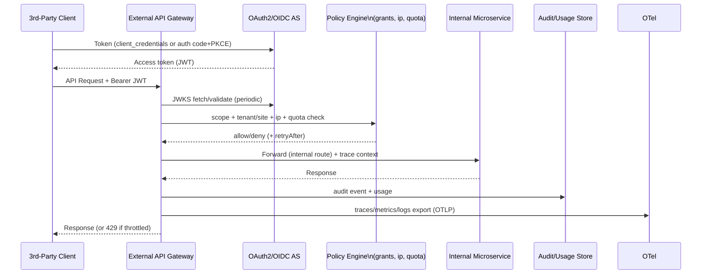
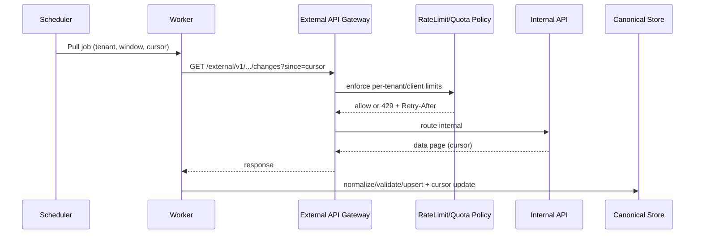
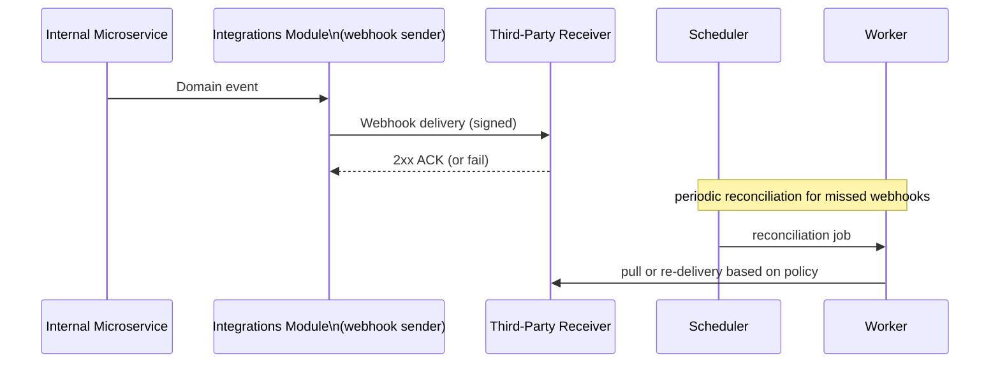

# AYSTEK CORE Go Mikroservislerinde Güvenli, İzlenebilir ve Tenant‑Scoped API Paylaşımı

## Yönetici Özeti

Bu rapor, AYSTEK CORE’un Go mikroservislerinde mevcut **internal route/Swagger(OpenAPI)** yüzeyini **üçüncü taraflara (partner / müşteri entegrasyonları / dış geliştiriciler)** kontrollü biçimde açmak için “**tenant‑scoped API‑sharing**” (API yayınlama ve yetkilendirilmiş erişim) kabiliyetinin nasıl tasarlanıp hayata geçirileceğini, kurumsal (enterprise‑grade) gereksinimler ve Türkiye KVKK uyumu çerçevesinde ortaya koyar. Tasarım; soruda verilen varsayımlara göre Integrations modülünün zaten sahip olduğu **Connector/Action/Hook/Chain/Execution/DLQ**, RabbitMQ worker hattı, mapping/enrichment, SSRF allowlist ve admin API’lerle **uyumlu ve tamamlayıcı** olacak şekilde kurgulanmıştır (varsayım: “no specific constraint”).

Önerilen hedef mimari, dış erişimi tüm mikroservislerden izole eden bir **External API Edge/Gateway** katmanı ve bunun üzerinde çalışan bir **API Publishing & Access Control Control‑Plane** (API katalog, scope/grant, client kaydı, audit, quota/rate‑limit, IP allowlist, onay/consent) yaklaşımıdır. Bu mimari; (i) **Broken Authorization (BOLA/BFLA)**, (ii) **Broken Authentication**, (iii) **Unrestricted Resource Consumption** gibi OWASP API Security Top 10 2023 risk sınıflarını tasarımın merkezine alır. citeturn3search3turn3search23

Kimlik doğrulama ve yetkilendirmede, üçüncü taraf erişimine uygun standartlar temel alınır: **OAuth 2.0 çerçevesi (RFC 6749)**, per‑user senaryolar için **Authorization Code + PKCE (RFC 7636)**, servis‑servis için **client_credentials**, güçlü istemci kimlik doğrulama ve token bağlama için **OAuth mTLS (RFC 8705)** ve isteğe bağlı replay dayanımı için **DPoP (RFC 9449)**. citeturn1search0turn2search1turn1search2turn5search1 JWT tabanlı erişim tokenları ve JWKS ile anahtar dağıtımı için **RFC 7519 (JWT)** ve **RFC 7517 (JWK/JWKS)** kullanılır. citeturn1search1turn5search2 Token yaşam döngüsü yönetimi için **Introspection (RFC 7662)** ve **Revocation (RFC 7009)** uçları önerilir. citeturn2search3turn2search2

Rate‑limit ve throttle, hem platform hem tenant hem de client seviyesinde uygulanır; 429 “Too Many Requests” semantiği **RFC 6585** ile uyumlu, Retry‑After gibi geri basınç sinyalleri HTTP semantiği (RFC 9110) ile tutarlı tasarlanır. citeturn1search0turn8search0turn1search0turn0search3 Token bucket gibi algoritmalar için Envoy’un token bucket tabanlı local rate limit yaklaşımı, pratik referans sağlar. citeturn7search3turn7search0turn7search1 Asenkron işlerde backpressure kontrolü için RabbitMQ **consumer prefetch (basic.qos)** mekanizması kurumsal bir kontrol noktasıdır. citeturn3search1 Yatay ölçekleme ve HA için Kubernetes **HorizontalPodAutoscaler** yaklaşımı önerilir. citeturn3search2

KVKK uyumu; KVKK Kanunu (6698) temel çerçevesi, KVKK Kurumu’nun **Aydınlatma Yükümlülüğü Rehberi**, **Yurt Dışına Aktarım Rehberi**, **Veri Güvenliği Rehberi** ve **silme/yok etme/anonimleştirme yönetmeliği** ile birlikte ele alınır. citeturn0search0turn0search1turn0search2turn6search6turn6search4 Özellikle API paylaşımı, iç sistemlerden dışarı veri aktarımı doğuracağı için “consent/aydınlatma kaydı, audit trail, saklama‑imha politikası ve yurt dışı aktarım etkileri” control‑plane’in doğal parçaları olmalıdır. citeturn0search1turn0search2turn6search0

MVP hedefi 6–9 ay olup; ilk sürümde REST tabanlı dış API yayınlama + OAuth2 client management + tenant/site scoped grants + IP allowlist + quota/rate‑limit + audit & OTel observability + OpenAPI tabanlı dokümantasyon yayımlama (swagger) + operasyon runbook ve test stratejisi hedeflenir. OpenAPI 3.1, HTTP API’ler için dil bağımsız standart arayüz tanımlar ve swagger dokümantasyonunun standart temelidir. citeturn0search3turn0search11 OpenTelemetry/OTLP ile metrik‑trace‑log standartlaştırılması, kurumsal gözlemlenebilirlik için önerilir. citeturn3search12turn3search0

## Kapsam, terminoloji ve hedef mimari

### API‑sharing’in kapsamı

“Tenant‑scoped API‑sharing” burada şu anlama gelir: AYSTEK CORE’un iç mikroservislerindeki seçili operasyonlar (route’lar), bir “External API ürün kataloğu”na (API Product) alınır; üçüncü taraf uygulamalar (API client) bu operasyonlara sadece kendilerine atanmış **tenant/site kapsamı**, **scope**, **limit** ve **allowed operations** çerçevesinde erişebilir. Bu erişim; kimlik doğrulama, yetkilendirme, IP allowlist, rate limit/quota, audit ve gözlemlenebilirlik açısından **tek bir dış giriş katmanında** zorlanır.

Bu yaklaşımın iki temel nedeni vardır:

OpenAPI/Swagger yayınlama, “hangi endpoint’in var olduğunu” standart biçimde açıklığa kavuşturur; OpenAPI 3.1 bunu HTTP API’ler için standart sözleşme olarak tanımlar. citeturn0search3  
API güvenliğinde temel riskler (özellikle BOLA/BFLA ve kaynak tüketimi) route/operation düzeyinde policy gerektirir; OWASP API Security Top 10 2023 bunu açık risk kategorileriyle vurgular. citeturn3search3turn3search23

### Önerilen yüksek seviye mimari

Aşağıdaki mimari, dış erişimi internal mikroservislerden izole eder; aynı zamanda Integrations modülünün mevcut kabiliyetlerini (özellikle webhook/pull gibi entegrasyon desenlerini) tamamlar.

```mermaid
flowchart TB
  subgraph EXT[External Edge]
    GW[External API Gateway / Edge\n(Envoy/Kong/NGINX)\nTLS/mTLS + WAF + RateLimit]
  end

  subgraph ACP[API Publishing & Access Control\n(Control Plane)]
    REG[API Registry\n(OpenAPI spec, operations)]
    CL[API Clients\n(client_id, secrets/certs)]
    GR[Grants & Consents\n(tenant/site, scopes, allowed ops)]
    POL[Policies\n(IP allowlist, quotas, DLP rules)]
    AUD[(Audit Log)]
  end

  subgraph AUTH[Authorization]
    AS[OAuth2/OIDC Authorization Server\n(token, jwks, introspect, revoke)]
  end

  subgraph CORE[AYSTEK CORE Microservices]
    S1[Service A\n(internal routes)]
    S2[Service B]
    INT[Integrations Module\n(webhooks/pulls/actions/chains)]
    OBS[OTel Collector + Observability Backends]
  end

  DEV[Third-Party Developer/App] -->|OpenAPI docs| REG
  DEV -->|OAuth flows| AS
  DEV -->|API calls| GW

  GW -->|JWT verify via JWKS| AS
  GW -->|Policy check| GR
  GW -->|Route to internal| S1
  GW -->|Route to internal| S2

  S1 -->|events| INT
  INT -->|webhooks/pulls| DEV

  GW --> AUD
  AS --> AUD
  GW --> OBS
  S1 --> OBS
  S2 --> OBS
  INT --> OBS
```

Bu tasarımda, dışarıya açılacak her operasyonun sözleşmesi “OpenAPI” ile yayınlanır; kimlik doğrulama ve yetkilendirme OAuth2/OIDC tabanlıdır. OpenAPI’nin amaçları ve kapsamı spesifikasyon girişinde tanımlanır. citeturn0search3 OIDC Core, OAuth 2.0 üzerinde kimlik doğrulama/claim taşıma yeteneklerini tanımlar. citeturn5search3

## Fonksiyonel gereksinimler ve yönetişim

### Kullanım senaryosu matrisi

| Senaryo | Tipik aktör | Önerilen OAuth akışı | Ana kontrol noktaları |
|---|---|---|---|
| ERP/WMS entegrasyonu (servis‑servis) | Partner sistem | client_credentials | scope, IP allowlist, quota, audit, mTLS opsiyonel citeturn1search0turn1search2 |
| “Kullanıcı adına” 3rd‑party uygulama | Dış uygulama + kullanıcı | auth code + PKCE | consent kaydı, scope ekranı, revocation citeturn2search1turn2search2 |
| Dosya tabanlı entegrasyon | Partner SFTP | SFTP + SSH key | tenant dizin izolasyonu, retention, hash‑dedup citeturn4search3 |
| IoT/telemetri | MQTT istemcisi | MQTT + mTLS | topic bazlı yetki, rate limit citeturn4search2turn5search1 |
| Olay bazlı bildirim | AYSTEK → Partner | Webhook | signature doğrulama, retry, DLQ, replay guard citeturn5search0 |

### Operasyon (allowed operations) ve scope modeli

API paylaşımında en kritik tasarım kararı, **scope’ların route/operation ile nasıl eşleneceğidir**. OWASP API riskleri içinde “Broken Object Level Authorization” ve “Broken Function Level Authorization” gibi kategoriler, hem nesne düzeyinde hem fonksiyon düzeyinde yetkilendirmeyi zorunlu kılar. citeturn3search3turn3search23 Bu nedenle:

- **Operation‑centric scope** önerilir: ör. `orders.read`, `orders.write`, `stocks.read`, `shipments.create`.  
- Her OpenAPI operation bir `operation_id` ile tanımlanır; scope check bu seviyede yapılır (OperationId kullanımı OpenAPI pratiklerinde yaygındır; spesifikasyon operation tanımlarında yer alır). citeturn0search3  
- Tenant/site kapsamı token claim’lerine yansıtılır (örn. `tenant_id`, `site_ids[]`) ve mikroservislerde middleware ile “southbound” filtre uygulanır (varsayım: no specific constraint).

### Per‑tenant/site limitler, kota ve IP allowlist

- **Quota**: günlük/aylık call sayısı, veri satırı, payload boyutu; plan bazında (Free/Standard/Enterprise).  
- **Rate limit**: token bucket/leaky bucket; ör. Envoy local rate limit filtresi token bucket uygular ve token yoksa 429 dönerek throttling yapar. citeturn7search3turn1search0  
- **IP allowlist**: policy store’da CIDR listeleri; gateway ingress katmanında ve uygulama katmanında çift kontrol (defense in depth).

429 “Too Many Requests” RFC 6585’te tanımlanır ve istemciye geri basınç sinyali olarak kullanılır. citeturn1search0 Retry‑After gibi header’larla “ne zaman tekrar dene” sinyali HTTP semantiği kapsamında açıklanır. citeturn8search1turn8search0

### Audit trail ve consent/recording

KVKK uyumunda “kim, hangi amaçla, hangi veri kategorilerini işledi/aktardı” gibi kayıtlar kritik hale gelir; ayrıca aydınlatma yükümlülüğü rehberi veri sorumlularının aydınlatma yükümlülüğünü vurgular. citeturn0search1 Bu nedenle:

- **Consent record**: per‑user grant’larda hangi scope’ların hangi tarihte onaylandığı, hangi üçüncü taraf client’e verildiği saklanır. (Detay: no specific constraint.)  
- **Audit trail**: `client_id`, `tenant_id`, `user_id(optional)`, `operation_id`, `ip`, `result`, `latency`, `resource_ids` (hashlenmiş) alanları ilke olarak tutulur.  
- **Retention + imha**: KVKK silme/yok etme/anonimleştirme yönetmeliği, işleme şartları ortadan kalkınca silme/yok etme/anonimleştirme yükümlülüğünü düzenler; periyodik imha kavramını da tanımlar. citeturn6search4turn6search0

## Protokoller, kimlik doğrulama ve yetkilendirme tasarımı

### Desteklenecek protokoller

- REST: OpenAPI 3.1 ile dokümante edilir. citeturn0search3  
- GraphQL: GraphQL spesifikasyonu (ör. October 2021 release) GraphQL operasyon semantiğini tanımlar. citeturn4search1turn4search5  
- SOAP: SOAP 1.2, W3C Recommendation olarak mesajlaşma çerçevesini tanımlar. citeturn4search0turn4search12  
- Webhooks: güvenlikte signature doğrulama + replay guard zorunlu olmalı (pratik referanslar).  
- SFTP: OpenSSH, SFTP protokolünün filexfer draft’la tarif edildiğini ve OpenSSH’nin SFTP client/server implement ettiğini belirtir. citeturn4search3  
- MQTT: MQTT 5.0’ın OASIS standardı olduğu belirtilir. citeturn4search2turn4search6  

### OAuth2/OIDC ve token tasarımı

OAuth2’nin temel amacı, üçüncü taraf uygulamanın bir HTTP servise **sınırlı erişim** alabilmesidir. citeturn1search0 Bu rapor, iki ana erişim tipini standartlaştırır:

- **Servis‑servis (client_credentials)**: tenant’a bağlı bir dış sistem, kendi adına token alır (per‑client scopes).  
- **Kullanıcı adına (authorization code + PKCE)**: OAuth public client’larda authorization code interception riskine karşı PKCE önerilir. citeturn2search1turn1search0 OIDC Core, OAuth 2.0 üstünde kullanıcı kimliği/claim aktarımını standardize eder. citeturn5search3  

JWT, claim’leri kompakt ve güvenli biçimde taşımak için kullanılır; RFC 7519 bunu tanımlar. citeturn1search1 Token imzalama anahtarlarının dağıtımı için JWK/JWKS veri yapıları RFC 7517’de tanımlanır. citeturn5search2

**Token içerik önerisi (JWT claims)**  
- `iss`, `aud`, `exp`, `iat` (standart)  
- `client_id`  
- `tenant_id`, `site_ids`  
- `scp` veya `scope` (scope listesi)  
- `sub` (user‑bound tokenlarda kullanıcı id)  
- `jti` (revocation/dedup için)

Token doğrulama tarafında iki yaklaşım vardır:  
- **Self‑contained JWT** (gateway/mikroservis JWKS ile doğrular)  
- **Introspection** (resource server token meta bilgisini introspect eder); RFC 7662 bu mekanizmayı tanımlar. citeturn2search3  

Token iptali için RFC 7009 revocation endpoint’ini tanımlar. citeturn2search2

### mTLS ve PoP (proof‑of‑possession) seçenekleri

- mTLS: RFC 8705; mutual TLS ile OAuth client authentication ve certificate‑bound token konseptini tanımlar. citeturn1search2  
- DPoP: RFC 9449; token replay saldırılarını tespit etmeye yardımcı olacak PoP mekanizmasını tanımlar. citeturn5search1  

OAuth2 güvenliği için Best Current Practice rehberi RFC 9700’dır; OAuth2 threat model ve pratik güvenlik tavsiyelerini günceller. citeturn5search0 MVP’de mTLS opsiyonel, DPoP Phase‑2 olarak değerlendirilebilir (no specific constraint).

## Veri hattı, operasyon akışları, idempotency/dedup ve retry/backfill

### Dış API → İç mikroservis çağrı akışı

Dış API paylaşımında, istek (external client → gateway) geldikten sonra “policy + auth + routing” ve sonrasında servis çağrısı yapılır. OWASP riskleri nedeniyle (özellikle authorization ve resource consumption) policy’nin edge’de zorlanması kritik kabul edilmelidir. citeturn3search3



OTLP, telemetry verisinin encoding/transport/delivery mekanizmasını OpenTelemetry kapsamında tanımlar. citeturn3search0

### Scheduled pull ve webhook fallback diyagramları

Sorudaki gereksinimle uyumlu olması için, dış API paylaşımına ek olarak “event delivery” desenleri de önerilir: üçüncü taraf ya sizin API’nizi düzenli **poll** eder ya da siz ona **webhook** ile push edersiniz; kayıp olaylar için scheduled reconciliation yapılır. HTTP 429 ve Retry‑After semantiği bu tür backfill süreçlerinde de geçerlidir. citeturn1search0turn8search1

#### Scheduled pull



#### Webhook + reconciliation fallback



### Idempotency ve dedup stratejileri

Idempotency, özellikle retry/backoff koşullarında “çift işlem” riskini azaltır. JWT token + external client çağrılarında idempotency key standardı platformda zorlanmalıdır (no specific constraint). (HTTP standardı olarak Idempotency‑Key kavramı yaygın pratik; Retry‑After semantiği ise 429’la birlikte MDN’de açıklanır.) citeturn8search1turn1search0

**Önerilen anahtarlar**
- **Request‑level idempotency**: `Idempotency-Key` + `{client_id, tenant_id, operation_id}` ile birleşik hash → “idempotency store” (TTL’li).  
- **Event dedup**: webhook olaylarında `delivery_id` veya `event_id` tutulur.  
- **Pagination/cursor dedup**: cursor checkpoint ve “seen external ids” bloom/kv store (no specific constraint).

### Retry/backoff algoritması ve Retry‑After önceliği

429 “Too Many Requests” RFC 6585’te tanımlıdır. citeturn1search0 Retry‑After header’ı, 429 veya 503 gibi yanıtlarla istemciye “ne kadar beklemesi gerektiğini” bildirir. citeturn8search1turn8search0

```text
attempt = 0
while attempt < MAX_RETRIES:
  resp = call()
  if 200-299: return OK

  if resp.status == 429:
     if resp.headers["Retry-After"] exists:
        sleep(parse_retry_after())
     else:
        sleep(exp_backoff_with_jitter(attempt))
     attempt++
     continue

  if resp.status in [408, 500, 502, 503, 504] or network_error:
     sleep(exp_backoff_with_jitter(attempt))
     attempt++
     continue

  return terminal_fail
send_to_DLQ()
```

### Şema evrimi ve OpenAPI sözleşme yönetimi

OpenAPI, HTTP API’nin standart sözleşmesidir ve hem insan hem makine tarafından anlaşılabilir arayüz tanımlar. citeturn0search3 API paylaşımında:

- OpenAPI spec versiyonlanmalı (semver).  
- Breaking change’ler yeni major olarak yayınlanmalı ve eski sürüm için “sunset” politikası (no specific constraint).  
- OAuth scopes OpenAPI security scheme’lerine yansıtılmalı (OpenAPI 3.1 security tanımları). citeturn0search3  

## Gözlemlenebilirlik, güvenlik & KVKK/GDPR uyumu, ölçek ve test

### Observability: OpenTelemetry + OTLP

OpenTelemetry spesifikasyonu ve OTLP; telemetry verilerinin standart şekilde taşınmasını ve backendlere gönderilmesini tanımlar. citeturn3search12turn3search0 API sharing için öneri:

- Her request’te trace context propagate edilir (W3C tracecontext detayları: no specific constraint).  
- Metrikler: `requests_total`, `throttled_total`, `latency_p95`, `auth_fail_total`, `scope_denied_total`, `dlq_total`.  
- Loglarda PII maskeleme (KVKK ve veri güvenliği rehberiyle uyumlu). citeturn6search6turn0search0  

### KVKK/GDPR uyumu: saklama, güvenlik, yurt dışı aktarım

KVKK Kanunu kişisel verilerin işlenmesi ve veri sorumlusu yükümlülüklerini düzenler. citeturn0search0 KVKK Kurumu’nun aydınlatma rehberi, aydınlatma yükümlülüğünü (Kanun md.10) vurgular. citeturn0search1 Veri güvenliği rehberi, teknik ve idari tedbirlere yer verir. citeturn6search6 Yurt dışı aktarım rehberi, Kanun md.9 kapsamındaki aktarımlara ilişkin yol haritası sunar. citeturn0search2

**Retention & imha**: Kişisel verilerin silinmesi/yok edilmesi/anonimleştirilmesi yönetmeliği; işleme şartları kalkınca silme/yok etme/anonimleştirme gereğini ve periyodik imha kavramını düzenler. citeturn6search4turn6search0 Bu nedenle:

- Audit log ve access log’lar için saklama süresi politikası (no specific constraint)  
- Token/consent kayıtları için saklama‑imha planı  
- Raw payload’lar için kısa süreli TTL (özellikle webhooks)  
- Automatic “periyodik imha” job’ları (KVKK yönetmelik kavramıyla uyumlu) citeturn6search4  

### Multi‑tenant izolasyon

OWASP’in authorization riskleri bağlamında, tenant izolasyonu sadece “route guard” değil veri seviyesinde zorlanmalıdır. citeturn3search3 Bu raporda:

- Token claim’lerinde tenant/site açıkça taşınır; gateway ve servis middleware aynı doğrulamayı yapar (double enforcement).  
- “Cross‑tenant” erişim varsayılan olarak deny (no specific constraint).  
- Audit log multi‑tenant sorgularda row‑level security ile filtrelenir (no specific constraint).

### Ölçeklenebilirlik ve HA

- Yatay ölçek: Kubernetes HPA, artan yükte daha fazla Pod deploy ederek kapasiteyi artırmayı amaçlar. citeturn3search2  
- Backpressure: RabbitMQ consumer prefetch, unacked mesaj sayısını kısıtlamak için basic.qos ile uygulanır. citeturn3search1  
- Gateway rate limit: Envoy token bucket yaklaşımıyla 429 üretir. citeturn7search3turn1search0  

### Test stratejisi

- Contract test (CDC): Pact, consumer-driven contract testing yaklaşımıyla contract üretir ve doğrular. citeturn3search3turn3search11  
- Integration test: sandbox vendor, OAuth flows, rate limit 429, Retry‑After. citeturn1search0turn8search1  
- Chaos test: gateway pod kill, auth server latency, network partition (no specific constraint).  
- Security test: OWASP API Top 10 risklerine özel negatif test setleri. citeturn3search3turn3search23  

## Uygulama planı, maliyet/efor ve Codex teslimatları

### MVP zaman çizelgesi (6–9 ay)

```mermaid
gantt
  title Tenant-Scoped External API Sharing - MVP (6–9 Ay)
  dateFormat  YYYY-MM-DD
  axisFormat  %d.%m

  section Analiz ve Tasarım
  Use-case + scope model + OpenAPI publishing tasarımı        :a1, 2026-03-17, 21d
  KVKK envanteri + saklama/imha + yurtdışı aktarım analizi    :a2, parallel a1, 21d

  section Control Plane
  API Registry + Client/Grant/Consent modelleri + Admin API   :b1, 2026-04-07, 35d
  Audit/Usage metering + quota/rate-limit policy store        :b2, after b1, 28d

  section Auth & Edge
  OAuth2/OIDC AS (JWKS, revoke, introspect)                   :c1, 2026-05-20, 45d
  Gateway entegrasyonu (JWT verify, scopes, IP allowlist)     :c2, parallel c1, 45d

  section Observability & Ops
  OTel instrumentation + OTLP export + dashboards             :d1, 2026-07-04, 28d
  Runbook + oncall playbooks + incident drills                :d2, parallel d1, 21d

  section Test ve Pilot
  Contract tests + integration + chaos                        :e1, 2026-08-01, 35d
  Pilot tenant + partner onboarding + hardening               :e2, after e1, 35d
  MVP Go-Live                                                  :milestone, e3, 2026-10-10, 1d
```

### Efor (person‑month) tahmini

Belirtilmeyen organizasyonel kısıtlar “no specific constraint”. Tipik enterprise MVP için:

- Platform/Backend (control plane, policy, audit, usage, gateways): 10–14 PM  
- Auth (OAuth2/OIDC AS, token lifecycle): 4–7 PM  
- DevOps/SRE (K8s, Helm, Terraform, dashboards, runbook): 3–5 PM  
- QA/Security (CDC, pentest koordinasyonu, OWASP testleri): 3–5 PM  
Toplam: ~20–31 PM (ekip büyüklüğüne bağlı olarak 6–9 ay bandında uygulanabilir). OWASP risk seti ve OAuth2 security BCP (RFC 9700) gereklilikleri, güvenlik/test eforunu artırır. citeturn5search0turn3search3

### Codex’e gönderilecek teslimat listesi

Aşağıdaki liste, “code generation + kickoff” için doğrudan kullanılabilir.

#### Kod yapısı ve modül arayüzleri

Odak: **Go mikroservislerinde internal route’ları external API’ye güvenli yayınlama**. (Repo isimleri/path’ler varsayımsal, “no specific constraint”.)

- `internal/modules/api_publishing/model/`
  - `api_product.go` (OpenAPI doc ref, version, status)
  - `api_operation.go` (operation_id, method, path, upstream service target)
  - `api_client.go` (client_id, cert refs, status)
  - `api_grant.go` (tenant_id/site_id, scopes, allowed_operations, ip_allowlist, limits)
  - `api_consent.go` (user_id, scopes, issued_at, revoked_at)
  - `api_usage.go`, `api_audit.go`
- `internal/modules/api_publishing/dto/`
  - create/update/list DTO’ları
- `internal/modules/api_publishing/repository/`
  - mongo repos + unique index stratejileri
- `internal/modules/api_publishing/service/`
  - `registry_service.go` (OpenAPI publish, versioning)
  - `grant_service.go` (grant resolve, scope checks)
  - `limit_service.go` (token bucket/quota, Redis)
  - `audit_service.go` (audit append, retention)
- `internal/modules/api_publishing/handler/`
  - `/admin/api-publishing/*` CRUD
  - `/external/v1/*` request entry (gateway behind) — sadece internal trust header ile (no specific constraint)
- `internal/modules/auth_server/`
  - `/oauth/token`, `/oauth/authorize`, `/oauth/jwks`, `/oauth/introspect`, `/oauth/revoke`
  - BCP: RFC 9700 check list maddeleri (secure defaults) citeturn5search0

#### IaC gereksinimleri

- K8s `Deployment`: `external-api-gateway`, `auth-server`, `api-publishing-control-plane`
- `HPA`: gateway ve auth server (Kubernetes HPA tanımı). citeturn3search2  
- `NetworkPolicy`: dışa açık sadece gateway; iç servisler cluster‑internal
- `Secret`: JWKS signing keys, OAuth client secrets → KMS/Vault referansları (no specific constraint)
- RabbitMQ `prefetch` ayarları (async job’lar varsa) citeturn3search1  
- Helm charts: values (`rate_limit_defaults`, `ip_allowlist_mode`, `jwks_rotation_days`)
- Terraform: Redis/Mongo/RabbitMQ/Observability backend; KMS/Vault

#### CI/CD pipeline ve testler

- Unit tests (Go)
- Static analysis + secret scan
- Contract tests (Pact) citeturn3search7  
- Integration tests: OAuth2 flows (RFC 6749), PKCE (RFC 7636), introspection (RFC 7662), revocation (RFC 7009) citeturn1search0turn2search1turn2search3turn2search2  
- Load tests: rate limiting 429 + Retry‑After (RFC 6585, HTTP semantics RFC 9110) citeturn1search0turn8search0turn8search1  
- Security tests: OWASP API Top 10 senaryoları citeturn3search23  

#### Güvenlik checklist ve KVKK görevleri

- KVKK veri envanteri + aydınlatma metni girdileri (KVKK aydınlatma rehberi) citeturn0search1  
- Veri güvenliği teknik/idari tedbir matrisi (KVKK veri güvenliği rehberi) citeturn6search6  
- Saklama & imha (KVKK yönetmelik; periyodik imha) citeturn6search4turn6search0  
- Yurt dışı aktarım değerlendirmesi (KVKK aktarım rehberi) citeturn0search2  
- OAuth2 security BCP checklist (RFC 9700) citeturn5search0  
- mTLS opsiyonu (RFC 8705), DPoP opsiyonu (RFC 9449) citeturn1search2turn5search1  

#### Sprint‑sprint plan (özet)

- Sprint 1–2: API product/operation modeli + OpenAPI yayınlama  
- Sprint 3–4: client/grant/consent + audit/usage  
- Sprint 5–6: OAuth2 AS + JWKS + token lifecycle  
- Sprint 7–8: gateway policy (scope/ip/limit) + OTel  
- Sprint 9–10: contract+integration+security test harness  
- Sprint 11–12: pilot + hardening + runbook + SLO  

(Detaylar “no specific constraint”; ancak MVP hedefi 6–9 ay Gantt’ına uygun olarak planlanmıştır.)

---

### Ek: Örnek JSON şemaları ve kanonik mapping

#### API Client (örnek)

```json
{
  "client_id": "partner_acme",
  "name": "ACME ERP Connector",
  "status": "active",
  "auth_methods": ["client_credentials", "mtls"],
  "jwks_uri": null,
  "mtls_cert_ref": "vault://pki/certs/acme-erp",
  "created_at": "2026-03-10T10:00:00Z"
}
```

#### Grant + limits (örnek)

```json
{
  "tenant_id": "tenant_123",
  "site_id": "no specific constraint",
  "client_id": "partner_acme",
  "scopes": ["orders.read", "orders.write"],
  "allowed_operations": ["orders_list_v1", "orders_create_v1"],
  "ip_allowlist": ["203.0.113.0/24"],
  "limits": {
    "rps": 10,
    "rpm": 300,
    "daily_quota": 20000,
    "max_payload_kb": 256
  }
}
```

#### Canonical event mapping (webhook/pull için)

```json
{
  "canonical_event": {
    "tenant_id": "tenant_123",
    "event_type": "order.updated",
    "external_id": "order_987",
    "effective_at": "2026-03-10T09:58:12Z",
    "payload": {
      "status": "shipped",
      "tracking_no": "TRK123"
    }
  }
}
```

Bu örnekler, OpenAPI sözleşmesi ile yayımlanan operasyonların scope tabanlı kontrolü ve KVKK gereği audit/retention süreçleriyle birlikte düşünülmelidir. citeturn0search3turn0search1turn6search4