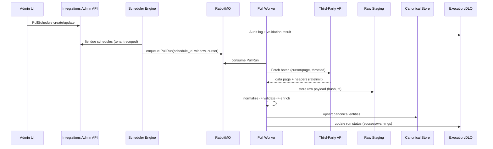
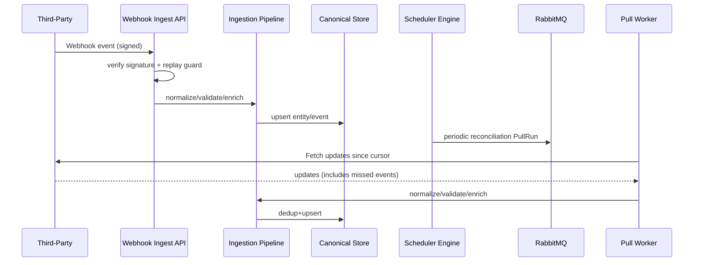

# AYSTEK CORE Integrations Modülüne Enterprise Düzeyde Zamanlanmış Dış Veri Çekme Yeteneği Eklenmesi

## Yönetici Özeti

AYSTEK CORE’daki mevcut **Integrations** modülü, ağırlıklı olarak “**domain event → hook eşleşmesi → (action/chain) → harici çağrı**” şeklinde çalışan, **izlenebilirlik (execution), retry/DLQ, mapping/enrichment, SSRF koruması** gibi kurumsal ihtiyaçları kapsayan bir “outbound entegrasyon platformu” olarak konumlanmıştır. fileciteturn0file0 Bu raportaki hedef, aynı modülün olgunluğunu koruyarak, **zamanlanmış/periyodik üçüncü taraf veri çekme (scheduled/periodic pull)** kabiliyetini enterprise seviyede eklemek; bunu yaparken çok kiracılı izolasyon, ölçeklenebilirlik, gözlemlenebilirlik, KVKK/GDPR uyumu ve operasyonel sürdürülebilirliği bir “platform yeteneği” olarak standartlaştırmaktır.

Önerilen çözüm, Integrations’ın mevcut kavramlarını (Connector/Action/Chain/Execution/DLQ + RabbitMQ worker hattı) **yeniden kullanır**, ancak “event-driven tetikleme”ye ek olarak yeni bir “**schedule-driven tetikleme**” kontrol düzlemi ekler: **Pull Schedule** (zamanlama), **Pull Cursor/Checkpoint** (incremental/backfill), **Pull Run** (çalıştırma kaydı) ve **Ingestion Pipeline** (normalizasyon → kanonik model → doğrulama → zenginleştirme → depolama) bileşenleri ile tamamlanır.

Ayrıca, gerçek dünyada birçok entegrasyonun “webhook (push) + periyodik uzlaşma çekimi (reconciliation pull)” hibrit yaklaşımına ihtiyacı olur. Bu yüzden tasarım, **webhook ingestion** (varsa) ile **periyodik backfill** akışını birlikte ele alır; kayıp webhooks, gecikmiş olaylar veya üçüncü taraf tarafında sonradan güncellenen kayıtlar bu mekanizma ile telafi edilir. GitHub’ın webhook imza doğrulaması yaklaşımı ve Stripe’ın webhook signature doğrulama pratikleri bu alanda iyi referanslardır. citeturn6search3turn6search2

MVP hedefi **6–9 ay** içinde: REST/GraphQL/SOAP üzerinden zamanlanmış çekim + OAuth2 client_credentials/JWT/API-key desteği + cursor/backfill + idempotency/dedup + observability (OTel) + admin UI/API ile yönetim + operasyonel runbook. Bu yaklaşım, mevcut Integrations modülünün “enterprise entegrasyon altyapısı” standardını korur. fileciteturn0file0

## Mevcut Integrations Modülü Baseline ve Tasarım Kısıtları

Mevcut Integrations modülü; **Connector, Action, Hook, Chain, Execution, DLQ** nesneleri üzerinden ilerler. Connector dış sistem bağlantı bilgilerini (base URL / test URL / auth / timeout / outbound allowlist) taşır; Action ise method/path ve mapping ile request üretimini ve response şema/kurallarına göre “başarı/başarısızlık” değerlendirmesini tanımlar. Hook, bir **event_key** dinler ve hedefi action veya chain olabilir. Chain, çok adımlı DAG akışını yönetir. Her çalıştırma Execution’da kayıt altına alınır; retry limiti aşılınca DLQ’ya düşer. fileciteturn0file0

Çalışma modları “sync” ve “async (RabbitMQ)” olarak ayrılır; async modda işler queue’ya bırakılır ve worker tüketir. Dokümanda, RabbitMQ yoksa kontrollü fallback davranışı bulunduğu, ancak production hedefinde queue-worker hattının esas alınması gerektiği belirtilir. fileciteturn0file0 Bu, scheduled pull tasarımında da **varsayılanın async** olması gerektiğine işaret eder: scheduled job tetiklenir, iş kuyruklanır, worker idempotent şekilde işler, Execution/DLQ üzerinden izlenir.

Payload Builder, “kırıcı olmayan (non‑breaking)” bir pipeline olarak tasarlanmıştır: field mapping + static values + enrichment + defaults sırası uygulanır ve eksik alanlar için warning üretilerek akışın gereksiz kesilmesi engellenir. fileciteturn0file0 Scheduled pull için yeni ihtiyacımız “inbound mapping/normalization” olsa da, bu pipeline yaklaşımı (özellikle enrichment/defaults) **gelen veriyi kanonik modele taşırken** de yeniden kullanılabilir.

Response değerlendirme format bağımsızdır: JSON parse/flat map; XML/SOAP flattening ve SOAP fault yakalama; text/raw tutma. fileciteturn0file0 Bu, SOAP tabanlı üçüncü taraflardan periyodik veri çekme (inbound) için önemli bir avantajdır; SOAP 1.2’nin XML tabanlı mesajlaşma çerçevesi W3C standartlarında tanımlıdır. citeturn5search1

Güvenlik modelinde SSRF koruması ve Connector allowlist yaklaşımı yer alır; request/response/error context Execution kayıtlarında tutulur. fileciteturn0file0 Scheduled pull eklerken bunlar korunmalı ve genişletilmelidir: inbound kaynaklardan veri çekilse bile “hedef URL” üçüncü taraf endpoint’i olacağından SSRF/allowlist kuralları aynen geçerlidir.

AYSTEK ekosisteminde AI/Codex üretimi için, modül ve UI geliştirmesinde **zorunlu standartlar** (DDD katmanları, seed dosyaları, menü seed, 28 dil çeviri, test zorunlulukları vb.) “README FOR AI ASSISTANTS” dokümanında kuvvetli şekilde dayatılır. fileciteturn0file1 Bu raporun “Codex’e teslim paketi” bölümü bu standartları doğrudan uygular.

## Fonksiyonel Gereksinimler ve Enterprise Davranışları

### Çekilecek veri tipleri ve zamanlama modelleri

Scheduled pull yeteneği “tek tip” değil, farklı veri sınıflarını yönetebilmelidir:

Veri tipleri için minimum kapsama; **referans veriler** (müşteri, ürün, lokasyon), **operasyonel/işlem verileri** (sipariş, sevkiyat, stok hareketi), **durum/telemetri** (zaman serisi), **dosya tabanlı akışlar** (SFTP ile CSV/JSON/XML drop), ve **olay akışı** (webhook ile gelen, pull ile uzlaştırılan) olarak tasarlanmalıdır. Bu çeşitlilik, protokol ve depolama stratejisini de belirler: örn. telemetri için zaman serisi yaklaşımı, sipariş için OLTP yaklaşımı.

Zamanlama, cron-benzeri ifade + tenant timezone + concurrency policy desteklemelidir. Kubernetes CronJob konseptinde “startingDeadlineSeconds” gibi alanlar, schedule kaçırıldığında job’ın başlatılma penceresi gibi enterprise beklentileri tanımlar. citeturn0search3 AYSTEK CORE’da schedule sayısı tenant sayısı ile çarpılacağı için (binlerce schedule), her schedule için ayrı K8s CronJob oluşturmak yerine “**tek scheduler service** + dahili cron store” yaklaşımı önerilir; ancak K8s CronJob dokümanındaki kavramlar iç politikaları tanımlamak için iyi bir referans çerçeve sunar. citeturn0search3

### Backfill, retry, idempotency ve deduplication

Kurumsal veri entegrasyonunda iki temel çekim modu vardır:

Incremental çekim için minimum üç strateji desteklenmelidir:  
- **Zaman damgası penceresi** (updated_since / from-to): basit, ama clock skew ve gecikmiş güncellemelerde dikkat ister.  
- **Cursor/offset** (sayfalama): büyük datasetlerde performans sağlar.  
- **Delta token / değişim akışı** (bazı API’lerde): schema/semantik vendor’a özel olabilir.

Retry (özellikle network/429/5xx durumlarında) “güvenli tekrar” gerektirir. HTTP 429 “Too Many Requests” RFC 6585’te tanımlıdır; yanıtın Retry-After içerebileceği belirtilir. citeturn4search6turn4search2 GitHub rate limit dokümanı, limit aşımlarında 403/429 dönülebileceğini ve “x-ratelimit-reset” zamanına kadar retry edilmemesi gerektiğini açıkça söyler. citeturn4search0 Bu, connector bazında rate-limit uyumunun platform standardı olması gerektiğini gösterir.

Idempotency/dedup için iki katman önerilir:  
- **İş (run) düzeyi idempotency**: aynı schedule_id + planned_window için aynı PullRun’ın iki kez yarış koşulunda başlatılmaması.  
- **Kayıt (record) düzeyi dedup**: aynı external_id + source + tenant kombinasyonunun iki kez ingest edilmemesi.

Örnek pratik: Stripe, güvenli retry için idempotency key kullanımını açıkça önerir. citeturn4search1 HTTP dünyasında “Idempotency-Key” header’ının amacı ve tekrar gönderimde aynı key’in kullanılması gerektiği MDN’de özetlenmiştir. citeturn4search9 Scheduled pull’da idempotency key daha çok “internal ingestion idempotency” olarak ele alınmalı, ancak bazı upstream’ler de idempotency destekliyorsa outbound request’lerde de kullanılabilir.

### Şema evrimi ve doğrulama

Third‑party veri şemaları zamanla değişir; platformun “kırılmadan evrim” kabiliyeti gerekir. Bunun için:

- **Raw payload saklama** (kısa/orta süre TTL)  
- **Kanonik modele dönüştürme** (versiyonlu)  
- **Şema doğrulama** (JSON Schema)  
- **Evrim kuralları** (non-breaking field add, breaking rename/deletion)

JSON Schema 2020-12 sürümü, JSON verisini tanımlama/doğrulama için güncel bir spesifikasyon sürümü olarak yayınlanmıştır. citeturn5search2 Bu, “connector mapping sözleşmesi” ve “kanonik model versiyonu” yönetiminde kullanılabilir.

### Desteklenecek protokoller ve kimlik doğrulama

Gereksinim seti REST/GraphQL/SOAP, Webhooks, SFTP, MQTT’yi kapsıyor. Bunları enterprise düzeyde desteklemek için farklı “driver”lar gerekir:

- **REST**: pagination, ETag/If-Modified-Since, 429/Retry-After, OAuth2/JWT, JSON/XML payload. 429 davranışı RFC 6585 ile; rate-limit header pratikleri vendor dokümanları ile yönetilir. citeturn4search6turn4search0  
- **GraphQL**: GraphQL Foundation spesifikasyonu, ekosistem için bir çerçeve sunar; pratikte schema introspection, cursor tabanlı pagination, query cost limitleri dikkate alınır. citeturn5search0  
- **SOAP**: W3C SOAP 1.2 mesajlaşma çerçevesi; request/response XML parse + fault handling gerekir. citeturn5search1  
- **Webhooks**: Inbound push; imza doğrulama ve replay koruması şart. GitHub, X‑Hub‑Signature‑256 header’ı ile secret üzerinden hash imzası gönderdiğini ve doğrulama gerektiğini belirtir. citeturn6search3 Stripe da signature doğrulamada raw body ve endpoint secret kontrollerini vurgular. citeturn6search2  
- **SFTP**: OpenSSH, SFTP protokolünün “filexfer draft” ile tanımlandığını ve OpenSSH’nin SFTP client/server uyguladığını söyler. citeturn4search3 Bu pratikte dosya drop → parse → ingest pipeline anlamına gelir (dosya hash/idempotency kritik).  
- **MQTT**: MQTT 5.0’ın OASIS standardı olduğu belirtilir; publish/subscribe telemetri ve IoT kaynakları için idealdir. citeturn1search2turn1search14 Scheduled pull ile aynı “connector çerçevesi” içinde değerlendirilebilir (MQTT daha çok stream/push olsa da, periyodik snapshot çekimleri de kurgulanabilir).

Kimlik doğrulama yöntemleri:

- **OAuth2 client_credentials**: RFC 6749 OAuth 2.0 çerçevesini tanımlar; client credentials grant, makine‑makine (M2M) erişimi için yaygındır. citeturn0search0turn0search8  
- **JWT**: RFC 7519, JWT’nin taraflar arasında claim transferi için kompakt ve güvenli bir format olduğunu tanımlar. citeturn0search1  
- **mTLS**: RFC 8705, OAuth istemci kimlik doğrulaması ve sertifika‑bağlı access token yaklaşımını mutual TLS ile tarif eder. citeturn0search2turn0search18  
- **API Key**: Basit ama riskli; rotation ve scope kısıtlarının platformda zorlanması gerekir.

## Önerilen Mimari, Bağlayıcı Tasarımı ve Veri Alma Hattı

### Yüksek seviye mimari

Mevcut Integrations modülünün “queue-worker + execution/DLQ + mapping/enrichment + response evaluation” yetenekleri korunarak aşağıdaki ek bileşenler önerilir:  
- **Pull Schedule Control Plane**: schedule tanımı, tenant/site scope, cron/interval, concurrency, backfill politikası  
- **Scheduler Engine**: due schedule’ları bulur ve PullRun mesajları üretir  
- **Pull Worker Runtime**: driver/adaptor üzerinden third‑party’den veri çeker, normalize eder, ingest eder  
- **Ingestion Pipeline**: ham → kanonik → doğrulama → zenginleştirme → depolama / domain event  
- **Observability & Ops**: metrik/trace/log, runbook, SLO’lar, DLQ analitiği

```mermaid
flowchart TB
  subgraph CP[Control Plane (Admin)]
    UI[Admin UI\nPull Schedules / Connectors / Actions]
    API[Admin API\n(/admin/integrations/...)]
  end

  subgraph INT[Integrations Core]
    Conn[Connector Registry\n(auth, allowlist, timeouts)]
    Act[Action Registry\n(endpoint, mapping, response rules)]
    Sch[Pull Schedule Store\n(cron, tz, concurrency)]
    Cur[Cursor/Checkpoint Store]
    Exec[Execution Store]
    DLQ[DLQ Store]
  end

  subgraph RT[Runtime]
    Tick[Scheduler Engine\n(due finder)]
    MQ[(RabbitMQ\npull_jobs queue)]
    W[Pull Workers\nN replicas]
    Drivers[Driver/Adapter Layer\nREST/GraphQL/SOAP/SFTP/MQTT]
  end

  subgraph PIPE[Ingestion Pipeline]
    Raw[(Raw Staging\nTTL)]
    Canon[(Canonical Store\nversioned)]
    Val[Validation\n(JSON Schema + rules)]
    Enr[Enrichment\nlookup/defaults]
    Pub[Domain Event Publish\n(optional)]
  end

  UI --> API
  API --> Conn
  API --> Act
  API --> Sch

  Sch --> Tick
  Tick --> MQ
  MQ --> W
  W --> Drivers
  Drivers --> Raw
  Raw --> Val --> Enr --> Canon
  W --> Exec
  W --> DLQ
  Canon --> Pub
```

Bu mimari, mevcut Integrations’ın async işleme çizgisini ve DLQ/Execution observability modelini doğal biçimde genişletir. fileciteturn0file0

### Zamanlanmış çekim akışları için sequence diyagramları

#### Zamanlanmış çekim (polling) akışı



RabbitMQ’nin consumer acknowledgement modeli ve “unacked message” sayısının prefetch ile sınırlandırılabilmesi, worker backpressure stratejisi için temel dayanak sağlar. citeturn1search0turn1search16

#### Webhook + uzlaşma pull (fallback) hibrit akışı



Webhook doğrulaması için GitHub (X‑Hub‑Signature‑256) ve Stripe imza doğrulama pratikleri referans alınabilir; enterprise seviyede “signed delivery + replay guard” standardı oluşturulmalıdır. citeturn6search3turn6search2

### Connector/Driver (adapter) tasarım desenleri ve lifecycle

Mevcut Integrations nesneleri outbound odaklı olsa da, Connector ve Action kavramları scheduled pull için yeniden kullanılabilir. fileciteturn0file0 Önerilen desen:

- **Connector**: bağlantı bilgisi + auth + allowlist + timeout + rate-limit policy (global, per-tenant, per-connector)  
- **Action**: “pull” türünde okunur operasyon (REST GET/POST search, GraphQL query, SOAP method, SFTP list+get, MQTT subscribe snapshot). Action’ın response schema/mapping yetenekleri, inbound data extraction ve doğrulama için genişletilebilir. fileciteturn0file0  
- **Driver/Adapter**: protokol‑özgü runtime (RESTDriver, GraphQLDriver, SOAPDriver, SFTPDriver, MQTTDriver).  
- **Schedule**: connector/action seçer, incremental stratejiyi ve cron/interval’i tanımlar.

Lifecycle önerisi: **Draft → Validated/Tested → Active → Paused → Deprecated**. Bu lifecycle, mevcut Integrations “Action Test / Chain Test-Run” yaklaşımıyla uyumlu şekilde “Pull Test” yeteneği ile tamamlanmalıdır. fileciteturn0file0

### Veri alma hattı, kanonik model ve depolama stratejisi

Veri hattı iki aşamalı olmalıdır:

- **Raw Staging (append-only, kısa süre)**: ham response, header’lar, request context, checksum; TTL ile otomatik temizlik  
- **Canonical Store (uzun süre)**: normalize edilmiş ve doğrulanmış data; domain tüketimine hazır

Bu ayrım, schema evriminde geri dönük düzeltme/backfill için güvenli bir “kanıt katmanı” sağlar; ayrıca KVKK kapsamında saklama süresi ve veri minimizasyonu politikalarını uygulamayı kolaylaştırır. KVKK rehberleri, aydınlatma sürecinde işlenen veri türlerinin doğru tespiti ve sürecin yönetilmesi gerektiğini vurgular. citeturn3search1

Kanonik model önerisi (yüksek seviye):

- `canonical_entity` = `{ tenant_id, source_system, entity_type, external_id, version, payload, payload_hash, observed_at, effective_at, deleted_at? }`
- `cursor_checkpoint` = `{ tenant_id, schedule_id, strategy, cursor_state, last_success_at }`
- `pull_run` = `{ tenant_id, schedule_id, window, status, metrics, warnings, started_at, finished_at }`

#### Örnek JSON Schema: Canonical Entity

Aşağıdaki şema, JSON Schema 2020-12 yaklaşımıyla uyumludur. citeturn5search2

```json
{
  "$schema": "https://json-schema.org/draft/2020-12/schema",
  "$id": "https://aysteknolojileri.com/schemas/integrations/canonical-entity-v1.json",
  "title": "CanonicalEntityV1",
  "type": "object",
  "required": [
    "tenant_id",
    "source_system",
    "entity_type",
    "external_id",
    "version",
    "payload",
    "observed_at"
  ],
  "properties": {
    "tenant_id": { "type": "string", "minLength": 1 },
    "site_id": { "type": "string" },
    "source_system": { "type": "string", "minLength": 1 },
    "entity_type": { "type": "string", "minLength": 1 },
    "external_id": { "type": "string", "minLength": 1 },
    "version": { "type": "integer", "minimum": 1 },
    "payload": { "type": "object" },
    "payload_hash": { "type": "string" },
    "observed_at": { "type": "string", "format": "date-time" },
    "effective_at": { "type": "string", "format": "date-time" },
    "deleted_at": { "type": "string", "format": "date-time" }
  }
}
```

#### Örnek mapping: Third-party Order → CanonicalEntity

```json
{
  "source_system": "vendor_x",
  "entity_type": "order",
  "external_id_path": "$.order.id",
  "effective_at_path": "$.order.updated_at",
  "field_mapping": {
    "order_id": "$.order.id",
    "status": "$.order.status",
    "customer.external_id": "$.order.customer.id",
    "total.amount": "$.order.total.amount",
    "total.currency": "$.order.total.currency",
    "items": "$.order.items"
  },
  "defaults": {
    "status": "unknown"
  },
  "enrichment": [
    {
      "lookup": "customers",
      "join_key_from_payload": "customer.external_id",
      "attach_to": "customer"
    }
  ]
}
```

Bu yapı, mevcut Integrations’ın mapping/enrichment/defaults mantığını inbound tarafa taşır. fileciteturn0file0

### Retry/backoff, circuit breaker, rate limit ve throttling

Retry stratejisi üç kuralı birlikte zorlamalıdır:

- **Retry güvenli olmalı (idempotent)**  
- **Retry limitleri ve backoff uygulanmalı**  
- **Rate limit header’ları (Retry-After / X-RateLimit-Reset) öncelikli olmalı**

Google Cloud IAM dokümanı, “truncated exponential backoff + jitter” önerir ve jitter’ın retry fırtınalarını azaltacağını belirtir. citeturn6search1 AWS rehberleri de “retry with backoff” desenini ve jitter mantığını pattern olarak sunar. citeturn6search0turn6search4

Önerilen algoritma (pseudo):

```text
if response.status in [408, 429, 500, 502, 503, 504] or network_error:
  if response.headers.Retry-After exists:
     sleep(Retry-After)
  else:
     # truncated exponential backoff with jitter
     base = min(cap, random(0, 2^attempt * baseDelay))
     sleep(base)
  attempt += 1
else:
  fail fast (4xx non-429 except configured cases)
```

429 davranışı RFC 6585’te tanımlıdır ve Retry‑After header’ı içerebileceği ifade edilir. citeturn4search6turn4search2 GitHub rate limit dokümanı da “x‑ratelimit-reset” zamanına kadar retry edilmemesi gerektiğini vurgular. citeturn4search0

Backpressure için RabbitMQ tarafında **consumer prefetch** önemli bir kontrol yüzeyidir: prefetch, bir consumer’ın aynı anda “unacked” olarak tutacağı mesaj sayısını sınırlar (basic.qos). citeturn1search16 Bu mekanizma ile worker replica sayısı artsa bile “aynı connector’a aşırı paralel istek” engellenebilir.

### Idempotency key stratejileri

İki seviyeli anahtar önerisi:

- **Run idempotency key**  
  `run_key = sha256(tenant_id + schedule_id + planned_window_start + planned_window_end + action_version)`  
  Mongo tarafında `unique(run_key)` ile yarış koşullarında duplicate run önlenir.

- **Record idempotency key**  
  `record_key = sha256(tenant_id + source_system + entity_type + external_id + effective_at_or_payload_hash)`  
  Canonical store’da `unique(tenant_id, source_system, entity_type, external_id, version?)` + “payload_hash değişirse update” modeli uygulanır.

Stripe’ın idempotency yaklaşımı “retry sırasında aynı idempotency key ile tekrar gönder ve duplicate işlem yapma” fikrini doğrular. citeturn4search1

### Connector interface contract tablosu

Aşağıdaki tablo, Codex tarafından üretilecek “driver”ların izlemesi gereken minimum sözleşmeyi örnekler:

| Connector tipi | Uç/Operasyon | Auth | Rate limit sinyalleri | Veri formatı | Incremental strateji |
|---|---|---|---|---|---|
| REST Pull | `GET /resource?updated_since=...` veya cursor | OAuth2 client_credentials / API key / JWT | 429 + Retry‑After (RFC 6585), vendor header’ları | JSON/XML | time-window / cursor |
| GraphQL Pull | `POST /graphql` (query + variables) | OAuth2/JWT | query-cost limitleri + 429 | JSON | cursor (edges/pageInfo) |
| SOAP Pull | SOAPAction + XML body | Basic auth / mTLS | 429/5xx + fault handling | XML/SOAP | time-window / cursor (vendor) |
| SFTP Pull | `LIST + GET` dosya | SSH key / password | bağlantı/IO hataları | CSV/JSON/XML | “file watermark” (dosya adı+tarih) |
| MQTT | subscribe topics | mTLS / user-pass | broker limitleri | binary/json | “snapshot + stream” hibrit |

Bu tablo, rate limit davranışının 429 üzerinden standardize edilebileceğini ve Retry‑After gibi header’ların dikkate alınması gerektiğini RFC seviyesinde dayandırır. citeturn4search6turn1search2

## Güvenlik, Uyumluluk, Multi‑Tenant İzolasyon, SLA/SLO ve Operasyon

### KVKK/GDPR uyumluluğu ve güvenlik kontrolleri

Scheduled pull ile CORE içine üçüncü taraflardan veri taşındığında, kişisel veri barındıran kayıtlar için KVKK/GDPR uyumu zorunlu hale gelir. KVKK’nın “Aydınlatma Yükümlülüğünün Yerine Getirilmesi Rehberi”, aydınlatma metni hazırlama sürecinde veri sorumlusunun önce hangi tür verileri işlediğini tespit etmesi gerektiğini vurgular. citeturn3search1 KVKK’nın yurt dışına veri aktarma rehberi de 6698 sayılı Kanun’un 9. maddesi kapsamındaki aktarımlara ilişkin veri sorumlularına yol göstermek amacıyla hazırlandığını belirtir. citeturn1search3

GDPR tarafında “Security of processing” (Madde 32) risk temelli güvenlik tedbirlerinin uygulanmasını bekler. citeturn2search2 Bu yaklaşım, scheduled pull için pratik kontrol listesine dönüşmelidir:

Veri güvenliği kontrolleri:
- **Şifreleme (in transit)**: TLS; mTLS gerektiğinde RFC 8705 modeline uygun sertifika yönetimi. citeturn0search18  
- **Şifreleme (at rest)**: disk encryption (node/volume), opsiyonel alan bazlı şifreleme (secrets, token, PIİ).  
- **Anahtar yönetimi**: KMS/Vault; per-tenant secret izolasyonu; rotation.  
- **Audit trail**: schedule/connector/action değişiklikleri, run tetiklemeleri, veri erişimleri, DLQ requeue işlemleri.

Mevcut Integrations modülünde zaten “request/response ve error context execution kayıtlarında tutulur” yaklaşımı vardır; bu, audit trail’in çekirdeğidir ve scheduled pull koşullarında da genişletilmelidir. fileciteturn0file0

### Multi-tenant izolasyon ve ölçeklenebilirlik

Integrations kapsamında tenant/site izolasyonunun zorunlu olduğu ve cross-tenant forwarding’in özel onay gerektirdiği standartlar, AYSTEK AI rehberinde açıkça vurgulanır. fileciteturn0file1 Scheduled pull bileşenleri, her run mesajında **tenant_id + site_id** bağlamını taşımayı zorunlu kılmalıdır.

Ölçeklenebilirlik için:
- **Horizontal scaling**: Pull worker’lar stateless olmalı ve çoğaltılabilmeli.  
- **Sharding**: queue partitioning (örn. tenant hash ile routing key) ve/veya Mongo koleksiyonlarında tenant bazlı indeks stratejileri.  
- **HPA**: Kubernetes HPA, gözlenen metriklere göre replica sayısını ayarlayan kontrolör olarak tanımlanır; worker ölçekleme için doğal araçtır. citeturn5search3  
- **Backpressure**: RabbitMQ prefetch + connector bazlı concurrency limit + token bucket. citeturn1search16

### SLA/SLO tanımları

Enterprise müşteriler için scheduled pull’un “çalışması” yetmez; ölçülebilir SLO’lar gerekir. Öneri:

- **Scheduler SLO**: “due schedule’ların %99.9’u 2 dakika içinde kuyruklandı”  
- **Ingestion latency SLO**: “pull ile alınan kaydın %95’i 5 dakika içinde canonical store’a işlendi”  
- **Completeness SLO**: “incremental cursor ilerlemesi geriye gitmiyor; gap alarmı < %0.1”  
- **Error budget**: 30 günlük periyot; DLQ requeue oranı, retry oranı.

Mevcut Integrations’ta execution ve DLQ analitiği endpoint’leri bulunduğu için, aynı yaklaşım PullRun’lar için de uygulanabilir ve tek bir “Integration Ops Console” altında toplanabilir. fileciteturn0file0

### Operasyonel runbook önerisi

Integrations dokümanında RabbitMQ hattının canlı doğrulaması için smoke runbook/pipeline job’ları bulunduğu ifade edilir. fileciteturn0file0 Scheduled pull için benzeri ops paketleri gereklidir:

- **Oncall dashboard**: due/queued/running/success/fail, per connector error rate, 429 oranı, ortalama çekilen kayıt sayısı  
- **Incident playbook**:
  - “Vendor rate limit spike” (429): throttle artır, schedule interval uzat, cursor güvenliğini kontrol et  
  - “Schema breaking change”: validation fail spike; mapping version bump; raw payload üzerinden replay/backfill  
  - “RabbitMQ backlog”: prefetch düşür, worker sayısını artır, büyük tenant’ları shard et  
- **DLQ playbook**: DLQ analytics → root cause → requeue stratejisi

Observability standardı için OpenTelemetry, vendor‑neutral bir framework olarak traces/metrics/logs üretimini ve export’u tanımlar; OTLP spesifikasyonu da telemetry encoding/transport mekanizmasını tarif eder. citeturn1search1turn1search13

## Test Stratejisi, Üçüncü Taraf Yönetimi ve Maliyet/Efor Tahmini

### Test stratejisi

Enterprise entegrasyonda test, sadece unit test değildir; “sözleşme kırılmalarını” ve “operasyonel dayanıklılığı” yakalamalıdır.

- **Contract tests (CDC)**: Pact, consumer-driven contract testing aracı olarak anlatılır; contract’ın consumer testleri sırasında üretildiği belirtilir. citeturn2search3 Scheduled pull’da “driver” consumer’dır; vendor API response shape’leri için contract suite tutulabilir.  
- **Integration tests**: sandbox vendor ortamlarına karşı; pagination, cursor, rate limit, auth refresh testleri.  
- **Chaos/Resilience tests**: worker kill, network partition, duplicate message, delayed delivery senaryoları; idempotency/dedup doğrulaması.  
- **Replay tests**: raw staging’den canonical store’a yeniden işleme; schema version bump sonrası backfill.

AYSTEK standartlarında modül geliştirmesinde test zorunluluğu ve DDD katmanları (model/dto/repository/service/handler/routes) ile seed/translations/menu gibi kalemler, AI rehberinde “MUST” olarak belirtilir. fileciteturn0file1

### Vendor/third-party yönetimi

Scheduled pull ile vendor riskleri artar: API değişir, rate limit değişir, auth token policy değişir. Bu yüzden:

- **Versiyonlama stratejisi**: Connector/Action config’leri versiyonlu olmalı (action_version).  
- **Contract monitoring**: Pact verification pipeline; schema drift detection. citeturn2search3  
- **Rate limit uyumu**: 429/Retry-After + vendor header’ları; GitHub’ın x‑ratelimit-reset yaklaşımı türden kural seti uygulanmalı. citeturn4search0turn4search6  
- **Webhook güvenliği**: signature verification zorunlu; GitHub / Stripe pratikleri temel alınmalı. citeturn6search3turn6search2  

### Maliyet/Efor (person‑month) ve infra öngörüsü

MVP (6–9 ay) için tipik efor:

- Backend (scheduler + worker + drivers + ingestion + admin API): **10–14 PM**
- Frontend (admin UI ekranları + observability ekranları): **4–6 PM**
- DevOps/SRE (K8s, monitoring, dashboards, runbooks, CI/CD): **3–5 PM**
- QA (integration/contract/chaos test harness): **3–5 PM**
- Security/Compliance (KVKK/GDPR checklist, pentest koordinasyonu): **1–2 PM**

Toplam: **21–32 person‑month** (ekip büyüklüğüne göre 6–9 ayda tamamlanabilir). Bu aralık, kaç protokol/driver’ın MVP’ye dahil edileceğine bağlı olarak değişir (MVP’de REST + SOAP + SFTP; MQTT/GraphQL’ü Phase‑2 yapmak tipik bir maliyet düşürücüdür). MQTT 5.0’ın OASIS standardı olduğu ve IoT/M2M için uygunluğu, Phase‑2’nin teknik gerekçesidir. citeturn1search14

Infra maliyetleri (yüksek seviye):
- RabbitMQ cluster (durable queue, monitoring)  
- MongoDB storage (raw staging TTL + canonical uzun süre)  
- Log/metric/trace backend (OTel collector + Prometheus/Loki/Tempo vb.)  
- Opsiyonel: ayrı “ingestion” node pool (network egress maliyeti vendor’a göre artabilir)

## Codex’e Gönderilecek Teslim Paketleri ve Sprint‑Sprint Uygulama Planı

Bu bölüm, doğrudan Codex ile “kod üretimi + proje kick‑off” için kullanılacak somut çıktı listesidir. AYSTEK’in zorunlu standartları (DDD katmanları, test, seed, menü, 28 dil çeviri) mutlaka uygulanmalıdır. fileciteturn0file1

### Codex teslimi: kod yapısı ve modül arayüzleri

Mevcut Integrations modül yolu dokümanda “/internal/modules/integrations” olarak geçer. fileciteturn0file0 Bu modül içinde yeni alt paketler önerilir:

**Backend (Go) önerilen paket/file yapısı**
- `internal/modules/integrations/model/pull_schedule.go`
  - `type PullSchedule struct { ... }`
  - `type IncrementalStrategy string` (`time_window|cursor|delta|file_watermark`)
- `internal/modules/integrations/model/pull_run.go`
- `internal/modules/integrations/model/pull_cursor.go`
- `internal/modules/integrations/model/incoming_raw.go`
- `internal/modules/integrations/dto/pull_schedule.go`
  - `CreatePullScheduleRequest/Response`, `Update...`, `List...`
- `internal/modules/integrations/repository/pull_schedule_interface.go`
- `internal/modules/integrations/repository/pull_schedule_mongo.go`
- `internal/modules/integrations/service/pull_scheduler_service.go`
  - `FindDueSchedules(ctx, now)`  
  - `EnqueuePullRun(ctx, scheduleID, window)`
- `internal/modules/integrations/service/pull_run_service.go`
  - `StartRun(ctx, runKey)` (idempotent)  
  - `CompleteRun(ctx, status, metrics)`  
- `internal/modules/integrations/driver/driver.go`
  - `type PullDriver interface { ValidateConfig(...); FetchPage(...); Parse(...); NextCursor(...); }`
  - `RESTDriver`, `SOAPDriver`, `SFTPDriver`, `GraphQLDriver`, `MQTTDriver`
- `internal/modules/integrations/worker/pull_worker.go`
  - RabbitMQ consumer; prefetch ayarlı; ack/nack; DLQ route
- `internal/modules/integrations/ingestion/pipeline.go`
  - `Normalize()`, `Validate(schema)`, `Enrich()`, `UpsertCanonical()`
- `internal/modules/integrations/handler/admin_pull_schedules.go`
  - `/admin/integrations/pull-schedules` CRUD + test-run
- `internal/modules/integrations/routes.go`
  - yeni admin route kayıtları

**Internal API sözleşmeleri (örnek)**
- `POST /admin/integrations/pull-schedules`
- `PUT /admin/integrations/pull-schedules/:id`
- `GET /admin/integrations/pull-schedules`
- `POST /admin/integrations/pull-schedules/:id/test-run`
- `GET /admin/integrations/pull-runs`
- `POST /admin/integrations/pull-runs/:id/retry`
- `GET /admin/integrations/pull-dlq`
- `POST /admin/integrations/pull-dlq/:id/requeue`

Bu, mevcut Integrations admin API yüzeyinin (connectors/actions/hooks/chains/executions/dlq) kalıbına uyumlu genişlemedir. fileciteturn0file0

### Codex teslimi: IaC gereksinimleri

**Kubernetes**
- `Deployment`: `integrations-pull-worker` (HPA enabled)
- `Deployment`: `integrations-scheduler` (leader election veya distributed lock)
- `ConfigMap/Secret`: connector secrets (Vault/KMS entegrasyon tercihe bağlı)
- `NetworkPolicy`: vendor allowlist/egress kısıtları
- `CronJob` (opsiyonel): scheduler tick; CronJob kavramları (deadline vb.) Kubernetes dokümanındaki alanlarla uyumlu kurgulanabilir. citeturn0search3
- `HPA`: worker için CPU veya custom metric (queue depth) tabanlı; HPA konsepti Kubernetes’te tanımlıdır. citeturn5search3

**Helm**
- chart values: worker replicas, prefetch, per-connector concurrency, OTEL exporter endpoint, retention TTL

**Terraform**
- Managed Mongo/RabbitMQ/observability backend (bulut/on‑prem/hybrid seçeneğine göre)
- KMS/Vault kaynakları (key rotation)
- Object storage (raw payload arşivi gerekiyorsa)

### Codex teslimi: CI/CD adımları ve testler

Pipeline önerisi:
- `go test ./...` (unit)
- `go test` + mock driver suite (protocol simulators)
- CDC: Pact consumer test → contract publish → provider verification (varsa)
- Integration tests: docker compose (RabbitMQ + Mongo) + fake third‑party server
- Security: secret scanning + SAST + dependency audit
- Post-deploy smoke: Integrations eventbridge smoke yaklaşımına benzer “pull smoke” job (schedule tetikle → run oluştu mu → canonical yazıldı mı). fileciteturn0file0

### Codex teslimi: güvenlik checklist ve KVKK görevleri

KVKK/GDPR görevleri:
- Veri envanteri: hangi entity_type’lar kişisel veri içeriyor? (KVKK aydınlatma rehberi “veri türünü tespit et” yaklaşımını vurgular.) citeturn3search1  
- Saklama politikası: raw staging TTL, canonical retention, silme/anonimleştirme  
- Yurt dışı aktarım analizi: cloud region ve alt yüklenici zinciri; KVKK yurt dışı aktarım rehberi kapsamında değerlendirme. citeturn1search3  
- Güvenlik tedbirleri: GDPR Art 32 risk temelli kontroller. citeturn2search2  
- Webhook signature doğrulama standardı (GitHub/Stripe pratikleri). citeturn6search3turn6search2  

Platform güvenliği:
- SSRF/allowlist zorunluluğu (mevcut Integrations güvenlik modeli). fileciteturn0file0  
- mTLS destekleyen entegrasyonlarda sertifika yaşam döngüsü (RFC 8705). citeturn0search18  
- Audit log: schedule değişiklikleri + run tetikleme + DLQ requeue

### Sprint‑sprint plan ve MVP Gantt

Aşağıdaki plan 2 haftalık sprintler varsayar ve MVP’yi 6–9 ay bandına yerleştirir.

```mermaid
gantt
  title Scheduled Pull MVP (6–9 ay) - Sprint Planı
  dateFormat  YYYY-MM-DD
  axisFormat  %d.%m

  section Keşif ve Temel Tasarım
  Gereksinim netleştirme + veri sınıfları + SLO/SLA     :a1, 2026-03-10, 28d
  Kanonik model + JSON Schema + mapping v1              :a2, after a1, 21d

  section Platform Çekirdeği
  PullSchedule/PullRun/PullCursor modelleri + repo      :b1, 2026-04-28, 28d
  Scheduler Engine (due finder + enqueue)               :b2, after b1, 28d
  Pull Worker iskeleti + RabbitMQ prefetch + DLQ        :b3, after b2, 28d

  section Driverlar ve Ingestion
  REST Driver (OAuth2/JWT/API-key)                      :c1, 2026-06-23, 35d
  SOAP Driver (XML parse + fault)                       :c2, parallel c1, 35d
  Ingestion Pipeline (raw->canonical, validation, enrich):c3, parallel c1, 42d

  section Admin UI ve Operasyon
  Admin API + UI ekranları (schedule/runs/dlq)          :d1, 2026-08-05, 42d
  Observability (OTel traces/metrics/logs)              :d2, parallel d1, 28d

  section Stabilizasyon ve Pilot
  Contract/integration/chaos test harness               :e1, 2026-09-16, 28d
  Pilot müşteri + runbook + SLO dashboard               :e2, after e1, 28d
  MVP Go-Live                                            :milestone, e3, 2026-11-11, 1d
```

Observability’de OpenTelemetry/OTLP standardı baz alınmalıdır. citeturn1search1turn1search13 Retry/backoff standardı truncated exponential backoff + jitter yaklaşımıyla uygulanmalıdır. citeturn6search1turn6search0

### Roller ve person‑month dağılımı (MVP)

- Product/BA: 1–2 PM  
- Backend (scheduler/worker/driver/ingestion): 10–14 PM  
- Frontend (admin UI): 4–6 PM  
- DevOps/SRE: 3–5 PM  
- QA: 3–5 PM  
- Security/Compliance: 1–2 PM  

Bu dağılım, AYSTEK’in “tam modül çıktısı” beklentisini (test, seed, menü, translation) karşılayacak şekilde planlanmıştır. fileciteturn0file1