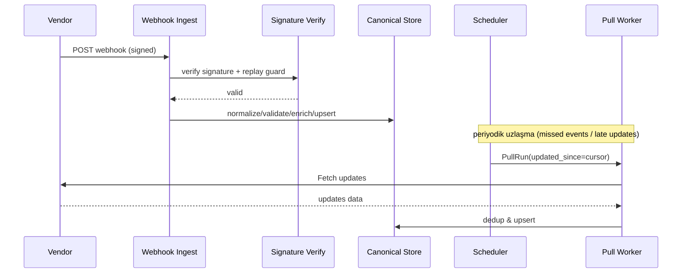

# AYSTEK CORE Integrations Modülüne Güvenli, İzlenebilir ve Sınırlı Üçüncü Taraf Servis Paylaşımı Eklenmesi

## Yönetici Özeti

AYSTEK CORE; çok kiracılı (tenant) ve çok site’lı (site) kurumsal platformdur; Go (Gin) microservice mimarisi ile MongoDB/Redis/RabbitMQ kullanır ve güvenlikte JWT/cookie auth, RBAC, tenant-site izolasyonu ve CSRF gibi katmanları standart kabul eder. fileciteturn1file0turn1file2 Mevcut **Integrations** modülü ise enterprise seviyede **Connector / Action / Hook / Chain / Execution / DLQ** modelini, RabbitMQ tabanlı async worker hattını, mapping/enrichment/defaults “payload pipeline”ını, format bağımsız response değerlendirmeyi (JSON/XML/SOAP/Text), SSRF + outbound allowlist güvenlik politikasını ve admin API yüzeyini sunar. fileciteturn1file3turn1file0 Ayrıca platform rehberi ve Integrations rehberi; “Scheduled Pull (Pull Schedule / Pull Run)” gibi periyodik dış veri çekme kabiliyetinin de Integrations kapsamında ele alındığını açıkça konumlandırır. fileciteturn1file0turn1file3

Bu raporun hedefi; mevcut Integrations yeteneklerini bozmadan, **“Üçüncü Taraf Servis Paylaşımı (Third‑Party Service Sharing)”** adı altında **güvenli, gözlemlenebilir ve sınırlı** yeni bir kabiliyeti tasarlamaktır. Bu kabiliyetin özünde şu fikir vardır: Bazı üçüncü taraf entegrasyonları (ör. SMS sağlayıcı, kargo/lojistik, ödeme, e‑fatura, IoT broker, içerik ajansı, ERP gateway vb.) **platform tarafından yönetilen bir servis/connector olarak merkezi tanımlanır** ve tenant’lara **“grant/scope/limit”** mekanizmasıyla **sadece izin verilen operasyonlar (Action’lar)** ve **tanımlı kotalar** dahilinde kullandırılır. Böylece:

- Tenant’lar **hassas secret**’ları görmeden (paylaşılan kimlik bilgileri varsa) servis kullanabilir (secret isolation).
- Operasyonlar **whitelist’li** olur: method/path/host allowlist + payload/field guard.
- Kullanım **kota ve rate‑limit** ile sınırlanır; vendor rate‑limit’lerine uyumlu throttle uygulanır (HTTP 429 / Retry‑After). citeturn1search3turn1search7turn5search3
- Tüm çağrılar Execution/DLQ üzerinde uçtan uca izlenir; ayrıca audit trail ile “kim, hangi grant ile, hangi aksiyonu” yaptı şeffaftır. fileciteturn1file3turn1file0

Uyumluluk tarafında; Türkiye’de KVKK (6698) çerçevesi, özellikle aydınlatma yükümlülüğü ve (varsa) yurt dışına aktarım rejimi nedeniyle, entegrasyonların “veri sınıflandırması + saklama + şifreleme + erişim denetimi + alt yüklenici yönetimi” olarak ele alınmasını gerektirir. citeturn0search0turn0search2turn0search3 GDPR bakımından da “işlemenin güvenliği” (Art.32) şifreleme ve risk temelli tedbirleri vurgular. citeturn3search0 Protokol ve kimlik doğrulamada rapor; OAuth2 (RFC 6749), JWT (RFC 7519), mTLS ile OAuth istemci doğrulama ve sertifikaya bağlı token’lar (RFC 8705) ve HTTP 429 (RFC 6585) gibi otoritatif standartları referans alır. citeturn1search0turn1search1turn1search2turn1search3

MVP hedefi **6–9 ay**: “Shared Service Registry + Grant/Scope + per‑tenant limits + rate‑limit/throttle + OTel observability + güvenlik kontrolleri + admin UI/API + runbook + test stratejisi”. (Belirtilmeyen detaylar: **no specific constraint**.)

## Kavram, Kullanım Senaryoları ve Fonksiyonel Gereksinimler

Bu bölümde “servis paylaşımı”nın AYSTEK CORE bağlamında ne anlama geldiği netleştirilir ve gereksinimler çıkarılır.

**Tanım (öneri)**: “Üçüncü taraf servis paylaşımı”; Integrations içinde tanımlı bir **Connector/Action setinin** “paylaşılan servis” olarak etiketlenip; tenant’lara **kısıtlı yetkiler (scope)** ve **kısıtlı kullanım (quota/rate limit)** ile tahsis edilmesidir. Bu, AYSTEK CORE’un “server-side authority model” yaklaşımıyla uyumludur; policy’ler UI’de değil, backend’de zorlanır. fileciteturn1file2turn1file0

**Tipik kullanım senaryoları**
- “Platform sağlarken tenant kullanır”: AYSTEK; örn. bir SMS sağlayıcıyla kurumsal anlaşma yapar ve bir “shared SMS service” oluşturur. Tenant’lar sadece `SEND_SMS` gibi izinli Action’ları çalıştırabilir; `LIST_BALANCE` gibi aksiyonlar kapalı tutulur.
- “Vendor‑compliance gereği merkezi yönetim”: Bazı vendor’lar IP allowlist, mTLS sertifikası, statik kaynak IP veya fixed client_id gerektirir. Merkezi connector yönetimi bu operasyonel yükü düşürür. (Belirtilmeyen vendor şartları: **no specific constraint**.)
- “Webhook + reconciliation”: Vendor webhook gönderiyorsa anlık olaylar inbound alınır; veri kaçırma/yeniden gönderim sorunlarına karşı Scheduled Pull ile uzlaşma (reconciliation/backfill) yapılır. Integrations platformu webhook test, execution/DLQ ve scheduled pull/pull run ekranlarını zaten işletim modeli olarak tanımlar. fileciteturn1file3turn1file0
- “SFTP/MQTT gibi protokollerde ortak altyapı”: Bir SFTP dropbox veya MQTT broker standartlaştırılır, tenant’a sadece kendi dizinine/topic’ine erişim grant edilir.

**Fonksiyonel gereksinimler (enterprise)**
- **Allowed operations (izinli aksiyonlar)**: Shared servis üzerinde hangi Action’ların çalıştırılacağı ve hangi HTTP method/path kombinasyonlarının izinli olduğu zorunlu olmalı. Action sistemi zaten method/path + request mapping + response schema ile operasyonu tarif eder. fileciteturn1file3  
- **Grant/Scope modeli**: Tenant’a servis verilirken “scope” seti tanımlanmalı (örn. `sms.send`, `shipping.create_label`, `iot.publish`). OAuth2’nin “limited access” yaklaşımı konsept olarak örnek alınabilir; OAuth 2.0 çerçevesi üçüncü tarafın sınırlı erişim elde etmesini anlatır. citeturn1search0  
- **IP allowlist + SSRF kontrolleri**: Mevcut Integrations güvenlik modelinde SSRF koruması ve connector allowlist bulunur; servis paylaşımında bu kontrol “varsayılan deny” olmalı, private IP erişimi (varsa) yalnızca açık gerekçe ve ayrı policy ile açılmalı. fileciteturn1file3turn1file0  
- **Per‑tenant ve global limitler**: Paylaşılan serviste kötüye kullanım ve maliyet kontrolü için token bucket/leaky bucket tabanlı rate limit; ayrıca günlük/aylık quota (request sayısı, payload boyutu, veri satırı sayısı) gerekir. HTTP 429 Too Many Requests standardı ve Retry‑After davranışı tasarımın merkezi parçası olmalı. citeturn1search3turn1search7turn1search11  
- **Audit & izlenebilirlik**: Her call için “tenant_id + site_id + grant_id + action_id + correlation id” kaydı; Execution/DLQ üzerinde görünür olmalı (mevcut modül Execution ve DLQ ile izlenebilirliği zaten platform hedefi olarak koyar). fileciteturn1file3turn1file0  
- **Idempotency + dedup**: Özellikle retry’larda double‑send/double‑charge gibi risklerde idempotency key stratejisi zorunlu olmalı. HTTP Idempotency‑Key header konsepti (MDN) ve Stripe’ın idempotent request yaklaşımı, pratikte güvenli retry için referans davranışı açıklar. citeturn5search1turn5search2  
- **Schema evolution**: Response schema/mapping’ler kırılmadan evrimleşmeli. JSON Schema spesifikasyonu, canonical model doğrulaması için temel alınabilir. citeturn2search3turn2search7  
- **Backfill/retry**: Scheduled pull ile incremental cursor/ checkpoint + backfill pencereleri + exponential backoff + jitter (Retry‑After öncelikli) standardize edilmeli. RFC 6585 ve GitHub rate limit dokümanı, retry zamanlamasını “reset” header’ları ile ilişkilendirir. citeturn1search3turn5search3  
- **Protokol kapsama**: REST/GraphQL/SOAP, Webhooks, SFTP, MQTT (belirtilmeyen proto detayları: **no specific constraint**). GraphQL ve SOAP için otorite spesifikasyonlar mevcuttur; MQTT 5.0 OASIS standardıdır. citeturn4search1turn4search6turn4search0

## Güvenlik, Yetkilendirme ve KVKK/GDPR Uyum Tasarımı

### Türkiye KVKK bağlamı

KVKK (6698) kişisel verilerin işlenmesinde temel hak ve özgürlüklerin korunması ve veri işleyenlerin yükümlülüklerini düzenler. citeturn0search0 Integrations üzerinden üçüncü tarafa veri aktarımı (outbound) veya üçüncü taraftan veri çekimi (inbound) kişisel veri içerebileceğinden, iki düzeyde uyum gerektirir:

- **Aydınlatma yükümlülüğü**: KVKK’nın aydınlatma yükümlülüğüne ilişkin rehber; veri sorumlusunun 10. madde kapsamında ilgili kişileri aydınlatma yükümlülüğü olduğunu açıkça vurgular. citeturn0search3turn0search6  
- **Yurt dışına aktarım**: KVKK Kurumu “Kişisel Verilerin Yurt Dışına Aktarılması Rehberi”nin, Kanun’un 9. maddesi kapsamında veri sorumlularına yol göstermek amacıyla hazırlandığını belirtir. citeturn0search2turn0search11

**Servis paylaşımı için pratik uyum sonuçları**
- “Shared service” kayıtlarına **veri sınıflandırması** alanı eklenmeli (PII var mı? özel nitelikli veri ihtimali var mı?).
- “Paylaşılan connector” üzerinden outbound gönderilen payload’ın hangi amaçla gönderildiği ve hangi hukuki sebep ile işlendiği tenant’ın uyum dokümanlarına bağlanmalı (belirtilmeyen tenant uyum politikaları: **no specific constraint**).
- Eğer shared servis yurtdışı vendor’a bağlanıyorsa: “data transfer impact” kayıtları; hangi veri alanlarının vendor’a gittiği; mümkünse alan bazlı maskeleme/pseudonymization (uygulama kararı: **no specific constraint**). KVKK Kurumu’nun yurtdışı aktarım sayfası, rejimin aşamalı olduğunu ve yeterlilik/uygun güvenceler gibi mekanizmaları içerdiğini belirtir. citeturn0search11

### GDPR güvenliği (özellikle enterprise müşteriler)

GDPR Art. 32, “işlemenin güvenliği” için risk temelli tedbirlerin (örn. şifreleme) önemini vurgular. citeturn3search0 Bu, özellikle çok kiracılı platformda “encryption at rest/in transit + key rotation + least privilege + audit” gibi bileşenlerin servis paylaşımında zorunlu olmasına neden olur.

### Kimlik doğrulama yöntemleri ve protokol bazlı güvenlik

Bu projede kimlik doğrulama dört ana yöntemle standardize edilmeli:

- **OAuth2 client_credentials**: OAuth2 çerçevesi RFC 6749’da tanımlıdır ve üçüncü taraf uygulamanın sınırlı erişim almasını sağlar. citeturn1search0 Paylaşılan servislerde en sık gereken M2M model budur.
- **JWT**: RFC 7519, JWT’nin claim taşımak için kompakt ve URL-safe bir yapı olduğunu açıklar. citeturn1search1 AYSTEK CORE içi yetkilendirme (tenant/site/role) yanında, vendor token’larında da kullanılabilir.
- **mTLS**: RFC 8705, mutual TLS ile OAuth client authentication ve certificate-bound token yaklaşımını tanımlar. citeturn1search2turn1search10 Paylaşılan servislerde güçlü kimlik doğrulama + kaynak IP kısıtları istenen senaryolarda önerilir.
- **API keys**: Basit ama riskli; rotation ve audit zorunlu tutulmalı (tasarım kararı: **no specific constraint**).

### Webhook güvenliği (inbound)

Webhook’lar “push” kanalıdır ve servis paylaşımı ile birlikte kaçınılmazdır. GitHub, webhook teslimatlarının imzasının doğrulanmasını ve secret’ın güvenli tutulmasını önerir. citeturn5search0turn5search4 Stripe da signature doğrulamada doğru secret, raw request body ve header’daki imza parametrelerinin kontrol edilmesi gerektiğini vurgular. citeturn4search3

**Platform standardı**
- Webhook endpoint’leri için: HMAC signature verify + replay guard (timestamp window) + per‑source IP allowlist (opsiyonel) + strict content-type.
- “Webhook event id” (ör. GitHub `X-GitHub-Delivery`) gibi benzersiz ID’ler dedup için saklanmalı. citeturn5search4

## Mimari Öneri: “Shared Services Overlay” ve Connector/Driver Modeli

### Mevcut Integrations temelini kullanan tasarım ilkeleri

Integrations modülü zaten:
- Domain event → hook eşleşmesi → action/chain yürütme (sync/async),
- Payload mapping + enrichment + defaults,
- Response schema ile dinamik başarı/failure kararı,
- Execution kayıtları ve DLQ ile takip,
- SSRF koruması ve outbound allowlist,
- Admin API yüzeyi
olarak tanımlanmıştır. fileciteturn1file3

Servis paylaşımı eklerken amaç; bu akışa “yeni bir policy katmanı” eklemek ve “shared service + grant” kavramlarını çözümleme aşamasında uygulamaktır.

### Önerilen veri modeli (Integrations içinde yeni domain nesneleri)

Belirtilmeyen detaylar: **no specific constraint**. Aşağıdaki model önerisi, mevcut Connector/Action kurgusuna minimum müdahale eder:

- **SharedService**
  - `id`, `name`, `category`, `status` (draft/active/deprecated)
  - `protocol_type` (REST/GraphQL/SOAP/SFTP/MQTT/Webhook)
  - `default_outbound_allowlist`, `requires_mtls`, `region/data_residency_notes`
  - `compliance_classification` (pii/none/unknown)
- **SharedServiceVersion**
  - allow breaking change yönetimi için versiyonlama
- **SharedServiceGrant**
  - `tenant_id`, `site_id(optional)`, `shared_service_id`, `allowed_action_ids[]`, `scopes[]`, `limits`
  - `limits`: `rps`, `rpm`, `daily_quota`, `max_payload_kb`, `max_records_per_run`, `concurrency`
- **SharedSecret**
  - vendor secret’ları platform tarafından yönetiliyorsa “vault ref” (KMS/Vault ref), tenant’lar göremez.
- **UsageMeter / UsageAggregate**
  - per tenant/service kullanım sayacı (Redis + Mongo rollup)

Bu model, platform overview’de vurgulanan “governed, connector-based ingestion ve merkezi kontrol” prensibine uygundur. fileciteturn1file2turn1file0

### Sistem mimarisi (mermaid)

```mermaid
flowchart LR
  subgraph Admin[Admin Control Plane]
    UI[Next.js Admin UI]
    API[Integrations Admin API\n/admin/integrations/*]
  end

  subgraph Registry[Registry & Policy]
    SS[(SharedService Registry)]
    GR[(SharedService Grants\n(tenant/site scopes & limits))]
    SEC[(Secrets\nKMS/Vault refs)]
    AL[(Outbound Allowlist Policy)]
  end

  subgraph Runtime[Integrations Runtime]
    EB[EventBridge\n(domain events -> hooks)]
    MQ[(RabbitMQ)]
    WK[Workers\n(action/chain/pull)]
    EXE[Executor\nHTTP/SOAP/etc.]
    RL[Rate Limit & Quota\n(Redis token bucket)]
    CB[Circuit Breaker]
    AUD[(Audit & Execution Store)]
    DLQ[(DLQ Store)]
  end

  subgraph Data[Ingest/Canonical]
    RAW[(Raw staging TTL)]
    CAN[(Canonical store\n(versioned))]
    VAL[Validation\n(JSON Schema)]
    ENR[Enrichment]
  end

  UI --> API
  API --> SS
  API --> GR
  API --> AL
  API --> SEC

  EB --> MQ
  MQ --> WK
  WK --> RL --> CB --> EXE
  EXE --> AUD
  EXE --> DLQ

  WK --> RAW --> VAL --> ENR --> CAN
```

Bu mimari, mevcut Integrations’ın async worker, execution/dlq ve payload/response pipeline kabiliyetlerini “paylaşım policy” ile genişletir. fileciteturn1file3turn1file0

### Protokol desteği ve driver/adapter modeli

**Driver/adapter modeli**: Her protokol için bir driver; ortak policy katmanı.

- **REST**: HTTP client + pagination/cursor + 429/Retry-After uyumu (RFC 6585). citeturn1search3turn1search7  
- **GraphQL**: GraphQL spesifikasyonu (October 2021) ile uyumlu query/variables; cost limit ve pagination vendor’a göre. citeturn4search1  
- **SOAP**: SOAP 1.2 Messaging Framework (W3C) tanımına uygun XML/SoapFault parse. citeturn4search6  
- **Webhooks**: Signature verify (GitHub, Stripe) + dedup + canonical mapping. citeturn5search0turn4search3  
- **SFTP**: OpenSSH, SFTP protokolünün filexfer draft ile tarif edildiğini ve SFTP client/server implement ettiğini söyler; dosya drop → parse → ingest hattı. citeturn3search3  
- **MQTT**: MQTT 5.0 OASIS standardı; pub/sub. citeturn4search0turn4search4  

### Data ingestion + outbound pipeline (canonical model)

Integrations rehberi, payload builder’ın mapping/enrichment/defaults biçiminde “non‑breaking” çalıştığını belirtir; response yakalama da JSON/XML/SOAP/Text normalize eder ve response schema ile başarı kriteri belirler. fileciteturn1file3 Scheduled pull için platform rehberi “cursor/checkpoint incremental çekme, canonical mapping/upsert, publish_events ile downstream event yayını” gibi kavramları açıkça listeler. fileciteturn1file0

Bu nedenle önerilen kanonik model yaklaşımı:

- **Raw staging (TTL)**: ham payload + header + request context (debug/forensics için kısa süre sakla)
- **Canonical store (versioned)**: normalize edilmiş kayıtlar; schema evolution için versiyonlu
- **Validation**: JSON Schema ile “shape” doğrulama (JSON Schema 2020-12 referansı). citeturn2search7turn2search3  
- **Enrichment**: secondary lookup / defaults

#### Örnek JSON Schema: Canonical Entity

```json
{
  "$schema": "https://json-schema.org/draft/2020-12/schema",
  "$id": "https://aystek.local/schemas/integrations/canonical-entity-v1.json",
  "title": "CanonicalEntityV1",
  "type": "object",
  "required": ["tenant_id", "source_system", "entity_type", "external_id", "version", "payload", "observed_at"],
  "properties": {
    "tenant_id": { "type": "string", "minLength": 1 },
    "site_id": { "type": "string" },
    "source_system": { "type": "string", "minLength": 1 },
    "entity_type": { "type": "string", "minLength": 1 },
    "external_id": { "type": "string", "minLength": 1 },
    "version": { "type": "integer", "minimum": 1 },
    "payload": { "type": "object" },
    "payload_hash": { "type": "string" },
    "observed_at": { "type": "string", "format": "date-time" },
    "effective_at": { "type": "string", "format": "date-time" }
  }
}
```

### Konnektör arayüz sözleşmesi tablosu (Connector Interface Contract)

Aşağıdaki tablo “driver implementasyonu” için Codex’e verilecek minimum sözleşmedir (belirtilmeyen vendor detayları: **no specific constraint**).

| Connector tipi | Örnek operasyon | Auth | Rate limit sinyali | Format | Idempotency/Dedup |
|---|---|---|---|---|---|
| REST | `GET /items?updated_since=...` / `POST /search` | OAuth2 client_credentials (RFC 6749), JWT (RFC 7519), API key | 429 + Retry‑After (RFC 6585); vendor header’ları | JSON/XML | Upstream: Idempotency-Key (ops); Internal: record_key |
| GraphQL | `POST /graphql` query+vars | OAuth2/JWT | 429, query-cost limit | JSON | cursor + record_key |
| SOAP | SOAPAction + XML body | mTLS (RFC 8705), basic | 429/5xx + SoapFault | XML/SOAP (W3C SOAP 1.2) | request hash + response fault dedup |
| Webhook | `POST /webhooks/vendor` | HMAC signature (GitHub/Stripe), optional mTLS | burst control | JSON | delivery_id dedup |
| SFTP | `LIST + GET + MOVE` | SSH key | IO/network | CSV/JSON/XML | file hash + watermark |
| MQTT | subscribe topics | mTLS/user-pass | broker limits | JSON/binary | message_id + retained snapshot |

citeturn1search0turn1search1turn1search2turn1search3turn4search6turn5search0turn4search3turn3search3turn4search0

### Zamanlanmış çekim ve webhook fallback sequence diyagramları

#### Scheduled Pull (incremental + throttle + canonical upsert)

```mermaid
sequenceDiagram
  participant UI as Admin UI
  participant API as Integrations Admin API
  participant SCH as Scheduler
  participant MQ as RabbitMQ
  participant W as Pull Worker
  participant POL as Policy (Grant+Limits)
  participant V as Vendor API
  participant RAW as Raw Staging
  participant CAN as Canonical Store
  participant EX as Execution/DLQ

  UI->>API: Create/Update PullSchedule (shared_service_grant)
  API->>EX: Audit entry

  SCH->>MQ: Enqueue PullRun(schedule_id, window, cursor)
  MQ->>W: Deliver PullRun
  W->>POL: Check grant scope + rate limit + quota
  POL-->>W: OK (or reject)
  W->>V: Fetch page (with throttling)
  V-->>W: 200 + data OR 429 + Retry-After
  W->>W: backoff+retry (Retry-After priority)
  W->>RAW: store raw (TTL)
  W->>CAN: validate + enrich + upsert
  W->>EX: update run status; DLQ on terminal fail
```

429 ve Retry‑After semantiği RFC 6585 ile tanımlanır; vendor limitlerinde ayrıca “retry after reset time” yaklaşımı GitHub dokümanında örneklenir. citeturn1search3turn5search3

#### Webhook + Reconciliation Pull fallback



Webhook signature doğrulama gerekliliğini GitHub açıkça vurgular; Stripe da signature hatalarının çözümü için raw body ve secret kontrollerini öne çıkarır. citeturn5search0turn4search3turn5search4

## Dayanıklılık, Ölçek, Rate‑Limit, SLA/SLO ve Observability

### Rate limiting ve throttling stratejileri

**Hedef**: Paylaşılan serviste hem **vendor tarafı limitleri** hem **platform maliyet/risk limitleri** aynı anda yönetilsin.

- **Per-tenant**: Tenant’ın grant’ında tanımlı RPS/RPM/daily quota.
- **Per‑connector/service**: Vendor’ın paylaşılan connector’ı için global limit (örn. `max 100 rps`).
- **Global**: Platform genel egress koruması (abuse control).

HTTP 429 “Too Many Requests” standardı RFC 6585’te tanımlıdır; yanıtın Retry‑After içerebileceği belirtilir. citeturn1search7turn1search3 GitHub, rate limit aşıldığında 403/429 alınacağını ve `x-ratelimit-reset` zamanına kadar retry edilmemesi gerektiğini söyler. citeturn5search3

**Token bucket vs leaky bucket (öneri)**
- Token bucket: burst’e izin vererek daha iyi UX sağlar (webhook burst, kısa süreli yoğunluk).
- Leaky bucket: daha stabil çıkış hızı üretir (vendor limitleri çok sıkıysa).

(Algoritma seçimi: **no specific constraint**. Redis tabanlı token bucket tipik ve pratiktir; AYSTEK CORE stack’inde Redis bulunduğu belirtilir. fileciteturn1file0)

### Retry/backoff algoritması (exponential backoff + jitter)

Yahoo/Google/AWS gibi pratiklerde “exponential backoff + jitter” genel kabul görür; burada temel standartlar için 429/Retry‑After ve vendor reset header’ı önceliklendirilmelidir. (Jitter standardı: **no specific constraint**; ancak 429/Retry‑After ve reset header davranışları standart/dokümante.)

**Pseudocode (platform standardı)**

```text
attempt = 0
while attempt < MAX_RETRIES:
  resp = call_vendor()
  if resp.status in [200..299]:
     return success

  if resp.status == 429:
     if Retry-After header exists:
        sleep(Retry-After)
     else if x-ratelimit-reset exists:
        sleep(until reset time)
     else:
        sleep(exp_backoff_with_jitter(attempt))
     attempt++
     continue

  if resp.status in [408, 500, 502, 503, 504] or network_error:
     sleep(exp_backoff_with_jitter(attempt))
     attempt++
     continue

  # non-retryable 4xx
  return fail_terminal
fail_to_DLQ
```

429 ve Retry‑After kısmı RFC 6585’te; GitHub reset header kısmı GitHub rate limit dokümanında açıkça belirtilir. citeturn1search7turn5search3

### Idempotency key stratejileri

**Internal idempotency (öneri)**
- `execution_key = sha256(tenant_id + grant_id + action_id + event_id_or_pull_window + action_version)`
- Mongo üzerinde unique index ile yarış koşullarında duplicate çalıştırma engellenir (index tasarımı: **no specific constraint**).

**Upstream idempotency (varsa)**
- HTTP Idempotency‑Key header; istemci aynı isteği tekrar gönderirken aynı anahtarı kullanır (MDN). citeturn5search1  
- Stripe, object create/update isteklerinde idempotency key ile güvenli retry yapılabileceğini anlatır. citeturn5search2

### Scalability, HA ve backpressure

Integrations rehberi, async hook’ların RabbitMQ ile kuyruklandığını ve worker tükettiğini belirtir; production hedefinde queue-worker hattı esas alınır. fileciteturn1file3 Backpressure için RabbitMQ tarafında **consumer prefetch** kritik kontrol noktasıdır; RabbitMQ dokümanı, AMQP basic.qos ile “unacknowledged message” sayısının sınırlandırılabildiğini açıklar. citeturn2search1

Kubernetes tarafında ölçeklemeyi otomatik yapmak için HPA kullanılabilir; Kubernetes dokümanı HPA’nın yük arttığında daha fazla Pod deploy ederek kapasiteyi artırdığını açıklar. citeturn2search2

### Observability: OpenTelemetry ve OTLP

AYSTEK CORE platform rehberi “metrics/health/ops” ve execution trace görünürlüğünü platform standardı olarak konumlandırır. fileciteturn1file0 Servis paylaşımında bu; “shared_service_id / grant_id” boyutlarının metriklere eklenmesiyle güçlendirilmelidir.

OpenTelemetry, vendor‑neutral gözlemlenebilirlik framework’ü olarak traces/metrics/logs üretimi ve export’u anlatır. citeturn2search8 OTLP spesifikasyonu ise telemetry verilerinin encoding/transport/delivery mekanizmasını tanımlar. citeturn2search0

**Önerilen metrikler (minimum)**
- `integrations_shared_requests_total{shared_service_id, tenant_id, action_id, status}`
- `integrations_shared_throttled_total{reason=quota|rps|vendor429}`
- `integrations_shared_latency_ms_p95{shared_service_id, action_id}`
- `integrations_shared_dlq_total{shared_service_id, action_id}`
- `integrations_shared_circuitbreaker_state{shared_service_id}`

### SLA/SLO tanımları (öneri)

Belirtilmeyen hedefler: **no specific constraint**. Yine de enterprise için öneri:

- **SLO‑Availability**: Shared service execution pipeline (API→queue→worker→vendor call) aylık %99.9 başarıyla “işlenebilir” durumda. (Vendor outage ayrı sınıflandırılır.)
- **SLO‑Latency**: p95 worker processing latency < X saniye (tenant’e göre değişebilir).
- **SLO‑Security**: signature verify fail oranları, allowlist deny oranları, secret access errors alarm olarak izlenir.

## Test Stratejisi, Operasyon Runbook’u ve Vendor Yönetimi

### Test yaklaşımı (enterprise)

AYSTEK standartlarında modül geliştirmesinde test zorunluluğu, DDD katmanları ve operasyonel prosedürler “MUST” olarak belirtilir. fileciteturn1file1 Servis paylaşımı için test planı:

- **Contract tests (CDC)**: Pact, consumer-driven contract testing aracı olarak contract’ın consumer testleri sırasında üretildiğini belirtir. citeturn3search1 Shared service driver’ları “consumer”dır; vendor sandbox response shape’leri için CDC uygulanabilir.
- **Integration tests**: RabbitMQ + Mongo + Redis + fake vendor server ile; 429/Retry‑After, OAuth2 token refresh, mTLS handshake (mock) senaryoları.
- **Chaos tests**: worker kill, duplicate message delivery, vendor timeout, rate-limit spike; idempotency/dedup doğrulaması.
- **Security tests**: SSRF allowlist bypass denemeleri, webhook signature spoof, secret sızıntısı regresyonu.

### Operasyon runbook (oncall ve playbook’lar)

Integrations rehberi, smoke runbook ve QA matrix dosyalarının ve scriptlerin bulunduğunu belirtir (eventbridge/chain/scheduled pull smoke). fileciteturn1file3turn1file0 Servis paylaşımı için runbook genişletmesi:

- **Dashboard**: throttled oranı, vendor429 oranı, DLQ büyümesi, circuit breaker open duration
- **Incident playbook**
  - “Vendor 429 spike”: grant limit düşür, schedule interval artır, concurrency azalt, reset header’a uyum kontrol et (GitHub reset yaklaşımı örnek). citeturn5search3  
  - “Signature verify fail”: secret rotasyonu/yanlış endpoint secret; raw body parsing kontrolü (Stripe doğrulama dokümanı). citeturn4search3  
  - “SSRF deny explosion”: allowlist yanlış; private ip match policy kontrolü (Integrations SSRF modeli). fileciteturn1file3  
  - “Queue backlog”: prefetch düşür, HPA ile worker sayısı artır (RabbitMQ prefetch + K8s HPA). citeturn2search1turn2search2

### Vendor yönetimi (API değişimleri, versiyonlama)

- **Connector/Action versioning**: vendor breaking değişiklikte yeni action_version; eski tenant grant’ları kontrollü migrate edilir.
- **Schema drift detection**: response schema mismatch artışı alarm; raw staging’den replay/backfill.
- **Rate limit policy güncellemesi**: vendor limit değişikliğinde config update; 429/Retry‑After ve reset header uyumu korunur. citeturn1search7turn5search3  
- **Webhook katalog yönetimi**: event id ve signature header değişimleri (GitHub `X-Hub-Signature-256` tavsiyesi) izlenir. citeturn5search4

## Codex İçin Teslimat Paketi, IaC/CI-CD ve MVP 6–9 Ay Planı

Bu bölüm, doğrudan Codex’e gönderilecek “üretim-ready” teslim listesidir. AYSTEK AI rehberi; DDD katmanları, test, seed, menü ve 28 dil çeviri gibi standartları zorunlu kılar. fileciteturn1file1 Ayrıca Integrations modülü yolu ve alt paketleri (eventbridge/executor/worker) ile yönetim API yüzeyi rehberde özetlenmiştir. fileciteturn1file3

### Codex teslimi: Kod yapısı ve modül arayüzleri

**Modül yolu**: `/internal/modules/integrations` (Integrations rehberinde verilmiştir). fileciteturn1file3

**Yeni dosya/paket önerisi (Go, DDD uyumlu)**  
(Belirtilmeyen iç isimlendirme kısıtları: **no specific constraint**; ancak “model/dto/repository/service/handler/routes” kalıbı zorunludur. fileciteturn1file1)

- `internal/modules/integrations/model/shared_service.go`
  - `type SharedService struct { ... }`
  - `type SharedServiceProtocol string` (`rest|graphql|soap|sftp|mqtt|webhook`)
- `internal/modules/integrations/model/shared_service_grant.go`
  - `type SharedServiceGrant struct { tenant_id, site_id, scopes, limits, allowed_action_ids ... }`
- `internal/modules/integrations/model/usage_meter.go`
- `internal/modules/integrations/dto/shared_service.go`
  - Create/Update/List DTO’ları (admin)
- `internal/modules/integrations/repository/shared_service_interface.go`
- `internal/modules/integrations/repository/shared_service_mongo.go`
- `internal/modules/integrations/service/shared_service_service.go`
  - `CreateSharedService(...)`
  - `GrantServiceToTenant(...)`
  - `ResolveSharedExecutionContext(tenant_id, action_id) (resolvedConnector, policy, secretsRef)`
- `internal/modules/integrations/service/limits_service.go`
  - `Allow(ctx, grant_id, dimension) (ok, retryAfter)`
  - Redis token bucket implementasyonu (stack’te Redis var). fileciteturn1file0
- `internal/modules/integrations/service/circuit_breaker_service.go`
  - per shared_service: open/half-open/closed
- `internal/modules/integrations/executor/shared_executor_wrapper.go`
  - Mevcut executor’u “policy + rate limit + audit tags” ile saran katman (Integrations executor mimarisi rehberde anlatılır). fileciteturn1file3turn1file1
- `internal/modules/integrations/handler/admin_shared_services.go`
  - `/admin/integrations/shared-services` CRUD
  - `/admin/integrations/shared-services/:id/grants` CRUD
- `internal/modules/integrations/routes.go`
  - Yeni endpoint mount
- **Seed & i18n**
  - `internal/seeds/translation_seed.go` (28 dil) + `menu_seed.go` + permissions seed; AYSTEK standardı gereği zorunlu. fileciteturn1file1

### Codex teslimi: IaC (K8s/Helm/Terraform)

**Kubernetes**
- `Deployment`: `integrations-shared-worker` (async executions + pull jobs)
- `Deployment`: `integrations-scheduler` (scheduled pull için)
- `HPA`: worker için autoscale (K8s HPA konsepti). citeturn2search2  
- `NetworkPolicy`: outbound allowlist’den türetilmiş egress kısıtlar
- `ConfigMap/Secret`: OTEL exporter endpoint, rate limit default config; secrets Vault/KMS ref

**Helm**
- values: `prefetch_count`, `max_concurrency_per_shared_service`, `token_bucket_defaults`, `cb_thresholds`

**Terraform**
- Redis/RabbitMQ/Mongo managed kaynakları (bulut/on‑prem/hybrid seçeneği: **no specific constraint**)
- KMS/Vault resources + secret rotation policy

### Codex teslimi: CI/CD pipeline adımları ve testler

- Unit tests: `go test ./...` + service mocks
- Pact CDC: consumer test → pact publish → (varsa) provider verify (Pact docs). citeturn3search1  
- Integration tests: docker compose (mongo+redis+rabbitmq) + fake vendor server + 429/Retry‑After senaryosu (RFC 6585). citeturn1search7  
- Security: SSRF regression tests; webhook signature test vectors (GitHub/Stripe). citeturn5search0turn4search3  
- Post‑deploy smoke: Integrations runbook yaklaşımıyla paralel “shared service smoke” (Integrations rehberinde smoke yaklaşımı var). fileciteturn1file3

### Codex teslimi: Güvenlik checklist ve KVKK görevleri

**KVKK görevleri**
- Veri envanteri: shared service’lerin işlediği veri alanları; aydınlatma metnine girdi oluşturma (KVKK aydınlatma rehberi). citeturn0search3turn0search6  
- Yurt dışı aktarım değerlendirmesi: vendor lokasyonu, aktarım mekanizması (KVKK yurt dışı aktarım rehberi). citeturn0search2turn0search11  
- Saklama/retention: raw TTL + canonical retention; silme/anonimleştirme (belirtilmeyen süreler: **no specific constraint**).

**Güvenlik checklist**
- TLS everywhere; mTLS gereken servislerde RFC 8705 uyumu. citeturn1search2  
- OAuth2 client_credentials akışı RFC 6749 uyumlu; token cache/refresh. citeturn1search0  
- Webhook signature verify (GitHub/Stripe) + replay guard. citeturn5search0turn4search3  
- SSRF + outbound allowlist (Integrations güvenlik modeli). fileciteturn1file3  
- Audit trail: grant değişikliği, action yürütme, DLQ requeue (Integrations execution/dlq izlenebilirliği). fileciteturn1file3turn1file0

### Sprint‑sprint MVP planı ve efor (6–9 ay)

**Efor tahmini (person‑month, no specific constraint)**
- Backend: 10–14 PM (registry/grant, limit, executor wrapper, drivers entegrasyonu)
- Frontend (admin screens): 4–6 PM
- DevOps/SRE: 3–5 PM
- QA/Testing: 3–5 PM
- Security/Compliance: 1–2 PM  
Toplam: ~21–32 PM (ekip büyüklüğüne göre 6–9 ay).

#### MVP Gantt (6–9 ay)

```mermaid
gantt
  title Shared Third-Party Service Sharing (MVP 6–9 Ay)
  dateFormat  YYYY-MM-DD
  axisFormat  %d.%m

  section Keşif ve Tasarım
  Use-case & risk analizi + KVKK envanteri              :a1, 2026-03-10, 21d
  Veri modeli + scope/limit sözleşmesi + API tasarımı    :a2, after a1, 21d

  section Backend Çekirdeği
  SharedService/Grant modelleri + repo + indexes         :b1, 2026-04-21, 28d
  Policy resolution + secret ref + audit tagging         :b2, after b1, 28d
  Rate limit (token bucket) + quota + 429 uyumu          :b3, after b2, 28d
  Circuit breaker + DLQ entegrasyonu                     :b4, parallel b3, 28d

  section UI ve Operasyon
  Admin UI: shared services & grants ekranları           :c1, 2026-07-14, 35d
  Observability: OTel metrics/traces/logs + dashboards   :c2, parallel c1, 28d

  section Test ve Pilot
  Pact/contract + integration + chaos test harness       :d1, 2026-08-25, 35d
  Pilot tenant rollout + runbook + SLO alarmları         :d2, after d1, 28d
  MVP Go-Live                                            :milestone, d3, 2026-10-27, 1d
```

Cron scheduling/“concurrency policy” gibi kavramlar Kubernetes CronJob dokümanında yer alan `startingDeadlineSeconds` gibi alanlarla iyi bir referans çerçevesi sunar; ancak AYSTEK CORE’da schedule yönetimi zaten Integrations Scheduled Pull olarak konumlandığı için bu kısım “platform scheduler service” üzerinden uygulanmalıdır. citeturn3search2turn1file0turn1file3