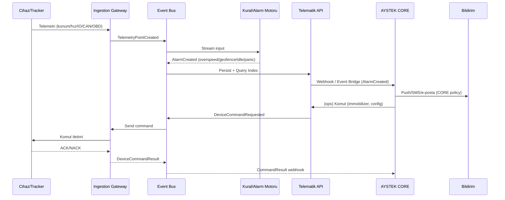

# AYSTEK CORE’a İleri Seviye Araç/Filo/Nesne Takip Sistemi Eklenmesi Üzerine Derin Araştırma ve Uygulama Planı

## Yönetici Özeti

Bu rapor, AYSTEK CORE’a Türkiye pazarındaki güçlü oyuncularla (Triomobil, Mobiliz, Arvento, n2Mobil) **karşılaştırılabilir** bir GPS/filo/araç/nesne takip (telematik) modülü eklemek için ürün kapsamı, mimari öneri, entegrasyon tasarımı, maliyet/ROI ve go‑to‑market planı sunar. İncelenen resmi kaynaklar, bu oyuncuların çekirdek değer önerisinin “anlık izleme + geçmiş/rota + alarm/ihlal + sürüş davranışı + CAN/OBD/yakıt + sensör/IoT + mobil uygulama” bileşenlerinin farklı kombinasyonları üzerine kurulduğunu gösterir. Örneğin Triomobil kampanya sayfasında hız/kontak/konum takibi ve geniş alarm seti (hız, kontak, rölanti, bölge vb.) açıkça vurgulanır. citeturn23view0 Mobiliz, CANBus paketlerinde yakıt/arıza kodları gibi yüksek değerli araç verilerini ve “800’den fazla marka-model uyumluluğunu” öne çıkarır. citeturn10view1 Arvento “standart paket” anlatımında 7/24 gerçek zamanlı + geçmiş takip, rota/bölge tanımlama, 81 ilde montaj-servis, 7/24 çağrı merkezi unsurunu net biçimde listeler. citeturn29view0 n2Mobil ise araç takip çözüm sayfasında **geofencing, CANBUS verileri, SMS/e‑posta bildirimleri, sürücü davranışı** gibi alanları bir arada ifade eder. citeturn14view0

Rekabet analizi açısından kritik bir bulgu: **API açıklığı** oyuncular arasında farklılaşır. n2Mobil, kamuya açık web servis dokümantasyonunda JWT ile kimlik doğrulama, REST yaklaşımı ve “Araç Listesi / Geçmiş İzleme / Güvenli Sürüş / Park Alarmı” gibi uçları örnek istek/yanıtlarla yayımlar. citeturn17view2turn16view1turn17view0 Arvento tarafında “Report.asmx” üzerinde, CANBus/OBD yakıt raporu, alarm ve konum durumunu JSON döndüren operasyonlar listelenmiştir. citeturn18view0turn18view1 Buna karşılık Triomobil ve Mobiliz’in **birincil/ resmi** API dokümanları herkese açık biçimde bulunmayabilir; Triomobil tarafında en azından bir başarı hikâyesinde “API entegrasyonları” ifadesi geçer. citeturn3view1 Bu durum AYSTEK CORE için “API‑first + SDK + webhook” yaklaşımını, pazarda ölçülebilir bir farklılaştırıcı yapar.

Önerilen strateji, AYSTEK CORE içerisinde “Telematik Platform Katmanı” inşa ederek (çok kiracılı, olay güdümlü, protokol adaptörlü) **donanım bağımsız** bir çekirdek oluşturmak; üstüne sürüş güvenliği, CAN/OBD, video telematik ve IoT sensörleri gibi katma değerli modülleri paketlemektir. Donanım tarafında Türkiye’de yaygın ekosistemlerden (Teltonika/Queclink vb.) cihazları desteklemek için protokol çözücü/adaptörler planlanmalı; örneğin Teltonika veri iletiminde Codec8 ailesini ayrıntılandırır. citeturn31search0

Regülasyon ve uyumlulukta Türkiye’de özellikle **KVKK (6698)**, sektörel/kurumsal müşterilerde sözleşmesel güvenlik beklentileri, ayrıca taşımacılıkta **U‑ETDS** gibi zorunlu bildirim sistemleri ve akaryakıt tarafında **UTTS** gibi düzenlemeler dikkate alınmalıdır. U‑ETDS’nin hangi faaliyetleri kapsadığı UAB sisteminde açıkça listelenir. citeturn25search0 UTTS ise Hazine ve Maliye Bakanlığı (GİB) tebliğinde amaç/kurulum/işletim ve sistem unsurlarına (TTB, TTO, UTTS Veri Merkezi vb.) ilişkin tanımlar içerir. citeturn30view0 KVKK’da “aydınlatma yükümlülüğü” veri sorumlusunun ilgili kişiyi kim/niçin/hangi hukuki sebeple işlediği ve kime aktardığı gibi başlıklarda bilgilendirmesini gerektirir. citeturn35search8

Finansal açıdan rapor; **Muhafazakâr / Baz / Agresif** olmak üzere 3 yıllık ROI senaryoları sunar. Baz senaryoda kârlılığa yaklaşma 3. yıl sonu‑4. yıl başı bandındadır (ürün geliştirme yatırımı ve satış ölçeklenmesi hızına bağlı). Bu, pazara girişte “hızlı pilot + referans müşteri + kanal ortakları” kurgusunu kritik hale getirir.

## Rekabet ve ürün karşılaştırması

Aşağıdaki karşılaştırma, **resmi ürün sayfaları, resmi uygulama mağazası açıklamaları ve kamuya açık teknik dokümanlar** üzerinden derlenmiştir. Fiyat/SLA gibi kalemler çoğunlukla teklif bazlı olduğundan, yalnızca açıkça yayınlanan yerlerde sayısallaştırılmıştır.

### Ana yetenek matrisi

| Boyut | Triomobil | Mobiliz | Arvento | n2Mobil |
|---|---|---|---|---|
| Anlık konum/hız/kontak | Var (hız, kontak, konum) citeturn23view0 | Var (konum, hız, yakıt tüketimi vurgusu) citeturn9view0 | Var (7/24 gerçek zamanlı takip) citeturn29view0 | Var (gerçek zamanlı konum, hız/sert fren vb.) citeturn14view0 |
| Geofencing / bölge yönetimi | Var (bölge dahil alarm seti) citeturn23view0 | “Kural/alarmlar” var; “geofence” adıyla net ifade her sayfada geçmeyebilir citeturn8view2 | Var (rota ve bölge tanımı) citeturn29view0 | Var (geofencing ifadesi ve uyarılar) citeturn14view0 |
| Geçmiş izleme / rota / replay | Mobil uygulama açıklamasında animasyonlu geçmiş lokasyon inceleme var citeturn24search4 | Resmi sayfalarda “rota replay” net ifadeyle her yerde geçmeyebilir (detaylı raporlama var) citeturn7view0 | Web platform anlatımında “animasyonlu geçmiş rota izleme” var citeturn2view6 | Geçmişe dönük rota/durma noktaları vb. takip vurgusu citeturn14view0 |
| Alarm/ihlal yönetimi | Geniş alarm seti (hız/kontak/rölanti/bölge/mesai dışı) citeturn23view0 | Alarmlar/kurallar ve raporlama vurgusu citeturn8view2turn7view0 | Hız limiti/rota/bölge tanımlarıyla operasyonel güvenlik vurgusu citeturn29view0 | Web tabanlı uyarılar + SMS/e‑posta bildirim citeturn14view0 |
| Sürücü davranışı | “Dijital Sürüş Koçu” (G‑sensör, sesli uyarı, sürücü tanıma) citeturn6view0 | Sürücümetre (aşırı hız/sert fren/viraj, rölanti vb.) citeturn8view0 | Arvento Connect “Güvenli Sürüş Skoru” parametreleri citeturn12view2 | Sürücü davranışı ve sert fren gibi parametreler citeturn14view0 |
| Yakıt + CAN/OBD | Premium CAN Bus ile yakıt/motor sıcaklığı/odometre vb. citeturn6view0 | CANBus paket: yakıt, depo seviyesi, motor devri, arıza kodları; 800+ araç uyumu citeturn10view1 | Web servis: CANBus/OBD yakıt bilgisi rapor operasyonları citeturn18view0 | CANBUS bilgileri + yakıt seviyesi birlikte vurgulanır citeturn14view0 |
| Sensör/IoT ekosistemi | WiFi/BLE kullanan sürüş koçu; telematik cihaz ekosistemi citeturn6view0 | IoT: çoklu cihaz/protokol, BLE sensör, Wi‑Fi/GSM gateway, alarm‑kural seti citeturn8view2 | İlave birimler: acil durum butonu, araç durdurma, kapı sensörü citeturn29view0 | Çoklu alarm + sürücü tanıma + motor blokaj + sıcaklık/nem + panik butonu citeturn14view0 |
| Mobil uygulamalar | Google Play/App Store’da araç durumu, alarm, ihlal, rapor, animasyonlu geçmiş konum citeturn24search17 | Mobiliz NG uygulaması + mobil uygulama sayfası (anlık takip, analiz, özet filo) citeturn24search1turn24search3 | Web/mobil uygulama vurgusu (mağaza linkleri mevcut) citeturn29view0 | Web + mobil raporlama vurgusu citeturn13view1 |
| API / entegrasyon | Başarı hikâyesinde API entegrasyonu ifadesi citeturn3view1 | Resmi, kamuya açık API dokümanı net bulunamayabilir (teklif/entegrasyonla ilerleme olası) | SOAP/JSON web servis operasyonları kamuya açık listelenmiş citeturn18view1 | JWT + REST API dokümanı kamuya açık ve örnekli citeturn17view2turn16view0turn16view1 |
| UTTS | UTTS entegrasyonu + montaj iş ortaklığı (RS Oto Servis) citeturn19view0 | UTTS yetkili montaj hizmeti verdiğini global sayfasında belirtir citeturn33search18 | Resmi sayfalarda UTTS entegrasyonu ayrı bir ürün olarak bu çalışmada zorunlu doğrulanmadı | UTTS portal bağlantısı bulunur (detay bu raporda sınırlı) citeturn14view0 |

### Rakip bazlı özet tablolar

Aşağıdaki tablolar, “ana satırların” rakip özelinde hızlı doğrulaması için hazırlanmıştır.

| Triomobil boyut | Resmi/ birincil bulgu | Kaynak |
|---|---|---|
| Alarm/ihlal seti | Hız/kontak/rölanti/bölge/mesai dışı kullanım alarmları vurgulanır | citeturn23view0 |
| CAN bus & yakıt analitiği | Anlık yakıt tüketimi, menzil, motor suyu sıcaklığı, odometre, emniyet kemeri vb. veri alanları listelenir | citeturn6view0 |
| Sürücü davranışı | G‑sensör ile sürüş davranışı, sesli uyarılar, sürücü kimlik tespiti, risk analizi | citeturn6view0 |
| Mobil uygulama | Alarm/ihlal ve animasyonlu geçmiş lokasyon inceleme | citeturn24search17 |
| UTTS | UTTS entegrasyonu ve montaj hizmeti (iş birliği vurgusu) | citeturn19view0 |
| Fiyat şeffaflığı | Fiyatların teklif bazlı olduğu belirtilir | citeturn6view0 |

| Mobiliz boyut | Resmi/ birincil bulgu | Kaynak |
|---|---|---|
| Araç takip çekirdeği | Konum/hız/yakıt tüketimi izleme vurgulanır | citeturn9view0 |
| CANBus derin telematik | Yakıt seviyesi, motor devri, arıza kodları; 800+ marka-model; CAN Click | citeturn10view1 |
| Sürücü davranışı | Aşırı hız, sert hızlanma/fren/viraj; rölanti; sürücü mobil uygulaması; CANBus entegrasyonu | citeturn8view0 |
| IoT altyapısı | Çoklu cihaz/protokol; BLE sensör; Wi‑Fi/GSM; bulut tabanlı; alarm‑kural tanımlama | citeturn8view2 |
| Takograf süreçleri | AETR uyumu + uzaktan takograf yönetimi + TOBB sistemine aktarım | citeturn8view1 |
| UTTS | Türkiye genelinde yetkili montaj hizmeti belirttiği ifade | citeturn33search18 |

| Arvento boyut | Resmi/ birincil bulgu | Kaynak |
|---|---|---|
| Standart paket kapsamı | 7/24 anlık + geçmiş; hız limiti/rota/bölge tanımları | citeturn29view0 |
| Operasyonel kapasite | 81 ilde montaj/servis, 7/24 çağrı merkezi, sunucu+abonelik hizmeti | citeturn29view0 |
| İlave birimler | Acil durum butonu, araç durdurma, kapı sensörü | citeturn29view0 |
| Video telematik | Araç takip ile entegre video telematik; ADAS/DMS gibi başlıklar | citeturn12view1 |
| API/raporlama servisleri | Konum, alarm, CANBus/OBD raporları dahil web servis operasyonları | citeturn18view0turn18view1 |
| KVKK vurgusu | KVKK’ya uygun paylaşım ve aydınlatma yaklaşımı ifade edilir | citeturn35search0 |

| n2Mobil boyut | Resmi/ birincil bulgu | Kaynak |
|---|---|---|
| Araç takip çekirdeği | Gerçek zamanlı konum, hız/sert fren; geofencing; CANBUS+sensör verileri | citeturn14view0 |
| Bildirimler | Uyarıların SMS/e‑posta ile bildirilebildiği açıkça yazılıdır | citeturn14view0 |
| API açıklığı | JWT ile kimlik doğrulama, REST; araç listesi/konum vb. endpoint örnekleri | citeturn17view2turn16view1turn16view0 |
| Veri modeli ipuçları | “fleet_id”, geojson dönüş, cihaz IMEI, plaka vb. alanlar örneklenir | citeturn16view1 |
| 7/24 destek | “Türkiye’nin her noktasında 7/24 destek” ifadesi | citeturn28search3 |
| KVKK rol ayrımı | “asset tracking” süreçlerinde veri işleyen rolü vurgulanır (müşteriye özel süreç) | citeturn35search3 |

### Rekabetten çıkarılan “zorunlu özellikler” ve fırsat alanları

Rakiplerin resmi sayfa/dokümanlarında sık tekrar eden ortak çekirdek; **anlık izleme, geçmiş izleme, alarm/ihlal, sürüş davranışı, CAN/OBD, sensör entegrasyonları ve mobil uygulama**dır. citeturn23view0turn10view1turn29view0turn14view0  
Buna karşı AYSTEK CORE için pazarda öne çıkma fırsatı, (i) **kamuya açık ve iyi dokümante edilmiş entegrasyon katmanı** (REST/GraphQL + webhook + SDK), (ii) **çok kiracılı (multi‑tenant) kurumsal yönetişim** (RBAC/denetim izleri/veri yaşam döngüsü), (iii) **donanım‑agnostik protokol adaptörleri** (Teltonika Codec8, Queclink @Track vb.) ve (iv) (sektöre göre) **U‑ETDS/UTTS/takograf gibi regülasyon modülleri** üzerinden oluşturulabilir. citeturn17view2turn31search0turn25search0turn30view0

## Ürün kapsamı ve fonksiyonel gereksinimler

Bu bölüm, AYSTEK CORE’a eklenecek modülün “MVP → Genel Kullanım (GA) → Katma değerli modüller” kademesinde nasıl kurgulanacağını tanımlar. “Belirsiz/konulmamış kısıtlar yoktur” varsayımıyla, kurumsal ölçekte çok kiracılı tasarım hedeflenmiştir.

**Çekirdek takip (MVP) kapsamı**: (1) Araç/varlık envanteri, cihaz kaydı, sürücü eşleştirme (RFID/QR/iButton), (2) anlık konum/hız/kontak, (3) geçmiş izleme ve rota raporları, (4) geofence/bölge (içeri‑dışarı), (5) alarm motoru (hız, kontak, rölanti, bölge, mesai dışı kullanım), (6) mobil uygulama ve web konsol, (7) temel entegrasyon API’leri (araç listesi, anlık konum, geçmiş rota, alarm akışı). Bu çekirdeğin, pazardaki temel paketlerle birebir örtüştüğü Arvento standart paket tanımı ve rakiplerin “anlık + geçmiş + alarm/bölge” vurgularından doğrulanır. citeturn29view0turn23view0turn14view0

**Gelişmiş telematik (Pro) kapsamı**: (1) sürüş davranışı skorlaması (aşırı hız, sert fren/hızlanma/viraj, rölanti), (2) sürücüye anlık geri bildirim (sesli uyarı gibi), (3) gelişmiş raporlama ve sürücü risk analizi, (4) CANBus/OBD üzerinden yakıt, odometre, arıza kodları, motor sıcaklığı vb. Bu tür verilerin rekabette “premium” katmanda konumlandığı Triomobil’in Premium CAN Bus açıklaması ve Mobiliz CANBus paketindeki “yakıt/arıza kodu/35+ sensör‑gösterge verisi” anlatımıyla açıkça görülür. citeturn6view0turn10view1turn8view0

**IoT/sensör modülleri**: (1) soğuk zincir (sıcaklık/nem), (2) kapı/damper/yakıt kapağı, (3) panik/acil durum, (4) BLE beacon ekosistemi ve gateway topolojisi (Wi‑Fi/GSM). Mobiliz IoT yaklaşımı, BLE sensör ve gateway mimarisini; Arvento ise kapı sensörü/panik butonu gibi ilave birimleri net olarak listeler. citeturn8view2turn29view0

**Video telematik**: ADAS/DMS, ihlal anı video klibi, NVR/çoklu kamera gibi yetenekler; Arvento ve Mobiliz tarafında ayrı çözüm başlığı olarak yer alır. citeturn12view1turn10view2

**API/SDK ve entegrasyon gereksinimi**: AYSTEK CORE’un güçlüleşmesi için API katmanı yalnızca rapor çekmek değil, **olay akışı (stream) + webhook** biçiminde tasarlanmalıdır. n2Mobil dokümanı JWT temelli REST ve örnekli endpoint yaklaşımını netleştirir; bu pratik, AYSTEK CORE için “dokümantasyon kalitesi” ölçütü olarak benchmark alınabilir. citeturn17view2turn16view1turn16view0

## Donanım ekosistemi ve maliyet tahmini

### Donanım uyumluluğu hedefi

Pazarda ürünlerin rekabet ettiği alan, sadece yazılım değil “cihaz + sensör + kurulum + SIM” bütünüdür. Arvento’nun standart paketinde “sunucu ve abonelik hizmeti” yanında 81 il montaj/servis vurgusu; Triomobil’in cihaz ekosisteminde 4G, CANBus, G‑sensör gibi cihaz özelliklerinin belirtilmesi bu bütünsel yaklaşıma örnektir. citeturn29view0turn26view0

AYSTEK CORE için önerilen uyumluluk hedefleri:

- **Araç cihazları**: OBD tak‑çalıştır (hızlı devreye alma), kablolu GNSS tracker (gizli montaj, immobilizer), CANBus/OBD derin veri okuma (yakıt/odometre/arıza kodları).  
- **GNSS**: GPS + çoklu GNSS (GLONASS/Galileo/BeiDou) destekli cihazlar (örn. örnek bir ürün sayfasında çoklu GNSS listesi görülebilir). citeturn39view0  
- **Hücresel**: 4G/LTE (en az Cat‑1) + olası 2G fallback (bazı OBD cihazlarda 4G/3G/2G destek ifadesi bulunur). citeturn36search12  
- **LPWAN**: Nesne takip/uzun pil ömrü senaryolarında NB‑IoT opsiyonu. Turkcell NB‑IoT “geniş kapsama/düşük maliyet” değer önerisini kurumsal sayfasında öne çıkarır; Vodafone da IoT çözümlerini uçtan uca konumlandırır. citeturn32search0turn32search1  

### Örnek donanım listesi ve tahmini birim maliyetler

Aşağıdaki maliyetler, teklif/kur, hacim ve montaj anlaşmalarına göre değişebilir. Amaç, 2026 itibarıyla “kabaca bütçe çerçevesi” oluşturmaktır.

| Kalem | Önerilen sınıf / örnek | Birim maliyet yaklaşımı | Kaynak dayanağı |
|---|---|---:|---|
| 4G GNSS tracker (OBD form faktörü) | Teltonika FMC920 (OBD konektör; GNSS/GSM; CAN bus; Li‑Po batarya) | ~55.64 USD (1 adet) + lojistik/kur citeturn39view0 | Ürün özellikleri ve fiyat citeturn39view0 |
| CAN veri okuma tracker | Teltonika FMB140 sınıfı (CAN verisi okuma) | Örnek TR perakende: ~7.254 TL (KDV dahil) citeturn42view0 | TR perakende fiyat örneği citeturn42view0 |
| OBD derin veri okuma | Teltonika FMB003 sınıfı (OBD portundan OEM PID okuma, gerçek odometre/yakıt seviyesi) | Örnek global perakende: ~47.50 EUR citeturn36search10 | OBD yetenek tanımı + fiyat örneği citeturn36search10 |
| BLE sensör/beacon paketi | BLE sensör beacon (5’li paket) | ~1.228 TL (KDV dahil) citeturn38view0 | Ürün fiyatı citeturn38view0 |
| SIM/iletişim (M2M) | 4G M2M SIM (araç başı aylık) | Tipik: veri kullanımına göre değişken (aylık) | (Operatör teklifine bağlı; NB‑IoT de seçenek) citeturn32search0 |
| Protokol entegrasyonu | Teltonika Codec8 ailesi / Queclink @Track | Yazılım geliştirme maliyeti (adapter başı) | Codec8 protokol ailesi açıklaması citeturn31search0 |

### Protokol ve cihaz yönetimi stratejisi

Donanım bağımsızlığı için iki seçenek bulunur:

**Seçenek A: Doğrudan protokol adaptörleri (önerilen)**  
Teltonika gibi üreticiler, cihazların sunucuya veri gönderirken kullandığı codec/protokolleri dokümante eder; örn. Teltonika “Codec8”i FM cihazlarının ana protokolü olarak açıklar. citeturn31search0 Bu yaklaşım, AYSTEK CORE’un kendi “Device Ingestion Gateway” katmanını inşa etmesini sağlar.

**Seçenek B: Ara katman/harici cihaz bulutu**  
Bazı üreticiler cihaz yönetimi (FOTA, uzaktan konfigürasyon) için ayrı platform sunar; örn. Teltonika “FOTA WEB”i cihazları uzaktan güncelleme/konfigürasyon için konumlandırır. citeturn31search3 AYSTEK CORE burada kendi ingestion’ını sürdürürken, belirli cihaz gruplarında üretici yönetim araçlarından yararlanabilir.

## Önerilen yazılım mimarisi ve güvenlik/uyumluluk

### Önerilen hedef mimari

Aşağıdaki mimari, “yüksek hacimli telemetri + coğrafi sorgular + kural motoru + entegrasyon API’leri” ihtiyaçlarını, çok kiracılı AYSTEK CORE dünyasına uyarlamak için önerilir.

```mermaid
flowchart LR
  subgraph Edge[Edge / Saha]
    D1[GNSS Tracker\n(OBD / Kablolu / CAN)]
    D2[BLE / Kablolu Sensörler\n(Sıcaklık, Kapı, Yakıt, Damper)]
    D3[Video Telematik\n(Dashcam/NVR)]
    GW[Gateway\n(Wi‑Fi/GSM)]
  end

  subgraph Ingest[Telematik Ingestion Katmanı]
    PA[Protokol Adaptörleri\n(TCP/UDP/SMS/HTTP)]
    AUTH[Device Auth\n(PSK/mTLS + IMEI/Serial)]
    NORM[Normalizasyon\n(Canonical Telemetry Model)]
  end

  subgraph Stream[Olay & Akış]
    BUS[(Event Bus\nKafka/Pulsar)]
    RULES[Kurallar & Alarm Motoru\n(CEP/Stream rules)]
    NOTIF[Bildirim Servisi\n(Push/SMS/e‑posta/Webhook)]
  end

  subgraph Data[Veri Katmanı]
    TS[(Time‑series DB)]
    GEO[(Geo‑DB / PostGIS)]
    OLAP[(Analitik/BI\n(warehouse/lake))]
  end

  subgraph App[Uygulama Katmanı]
    API[API Gateway\n(REST/GraphQL)]
    WEB[Web Filo Konsol]
    MOB[Mobil Uygulamalar\n(Yönetici/Sürücü)]
  end

  subgraph Core[AYSTEK CORE]
    IAM[IAM/SSO\n(OIDC/OAuth2)]
    BILL[Billing/Abonelik]
    MDM[Master Data\n(Vehicle/Asset/Fleet)]
  end

  D1 --> PA
  D2 --> GW --> PA
  D3 --> PA
  PA --> AUTH --> NORM --> BUS
  BUS --> RULES --> NOTIF
  BUS --> TS
  BUS --> GEO
  BUS --> OLAP
  TS --> API
  GEO --> API
  API --> WEB
  API --> MOB
  IAM --> API
  API <--> MDM
  API <--> BILL
```

### Veri modeli ilkeleri (öneri)

n2Mobil’in kamuya açık API örneklerinde “fleet_id”, geojson feature collection, cihaz IMEI, plaka, hız, kilometre gibi alanların birlikte işlendiği görülür. citeturn16view1 Bu pratikten hareketle AYSTEK CORE için önerilen kanonik model:

- **Tenant (Kiracı)** → **Organization / Account**  
- **Fleet (Filo)** → tenant altında araç grupları  
- **Vehicle / Asset** → plaka/şasi/varlık tipi  
- **Device** → IMEI/serial, protokol, firmware, SIM  
- **TelemetryPoint** → (timestamp, lat/lng, speed, ignition, heading, odometer, io, can, obd, sensor payload)  
- **Event/Alarm** → kural sonucu üretilen olaylar (overspeed, geofence_in/out, idle, tow, panic…)  
- **Trip** → rota segmentleri, duraklar, idling süreleri (Arvento’nun “geçmiş veriler” vurgusuyla uyumlu) citeturn29view0  

### Güvenlik ve KVKK/GDPR uyumluluğu

**KVKK (6698) temel çerçevesi**: KVKK metni resmi mevzuat PDF’i olarak yayımlanır; uygulama kapsamı ve tanımlar burada yer alır. citeturn21search0 Telematik sistemlerde “konum verisi + sürücü/çalışan ilişkisi” çoğu senaryoda kişisel veri niteliği doğurabilir; bu nedenle **aydınlatma** ve hukuki sebep yönetimi kritik olur. KVKK Kurumu’nun “Aydınlatma Yükümlülüğü” sayfası, ilgili kişiye kim tarafından/hangi amaçlarla/hukuki sebeplerle işleneceği ve kimlere aktarılacağı gibi başlıklarda bilgilendirme gereğini vurgular. citeturn35search8

**Yurt dışına veri aktarımı (KVKK madde 9 pratiği)**: KVKK Kurumu “Kişisel Verilerin Yurt Dışına Aktarılması Rehberi”ni yayımlayarak veri sorumlularına uygulama yol haritası sunar. citeturn21search1 Bu, AYSTEK CORE’un bulut bölgesi seçimi (TR’de barındırma / hibrit) ve alt yüklenici sözleşmeleri (veri işleyen) açısından belirleyici olabilir.

**GDPR güvenlik beklentileri (özellikle uluslararası müşterilerde)**: GDPR madde 32, işleme güvenliği kapsamında uygun teknik/organizasyonel tedbirler arasında şifreleme gibi yöntemleri sayar. citeturn21search2

AYSTEK CORE için önerilen uyum/siber güvenlik kontrol seti:
- Veri iletiminde TLS, cihaz‑sunucu arasında kimlik doğrulama (PSK veya mTLS), token‑bazlı kullanıcı erişimi.
- Kiracı izolasyonu: tenant_id zorunluluğu, satır‑seviyesi güvenlik, kritik müşteriler için “dedicated DB / dedicated key” opsiyonu.
- Denetim izleri: API çağrıları, admin aksiyonları, kural değişiklikleri, cihaz komutları (immobilizer) ayrı audit log.
- Veri yaşam döngüsü: ham telemetri saklama (örn. 12‑24 ay), özet/anonimleştirilmiş veri (daha uzun), müşteri talebiyle saklama politikası.
- Mobil uygulama mahremiyeti: KVKK’nın mobil mahremiyet yayınları doğrultusunda izin minimizasyonu ve şeffaflık yaklaşımı (kurumsal politika seti). citeturn35search5

### Türkiye’ye özgü telekom ve cihaz regülasyonları

- **IMEI / cihaz kayıt**: BTK tüketici bilgilendirme sayfasında IMEI’nin kayıt altına alınmasına ilişkin süreç anlatılır (Merkezi Cihaz Kayıt Sistemi üzerinden MCKS’ye kayıt iletimi). citeturn20search3 Bu bilgi, ithal edilecek/tedarik edilecek SIM’li cihazlarda (tracker/dashcam/NVR) tedarik zinciri ve saha dağıtımı için kritik kontrol noktasıdır.
- **Telsiz ekipman/CE**: Ticaret Bakanlığı’nın sektörel rehberinde telsiz ekipmanlarının piyasaya arzında CE işareti zorunluluğu vurgulanır. citeturn21search11 BTK da Radio Equipment Directive (RED) bağlamında yeni yönetmelik hükümlerini özetler. citeturn21search3
- **NB‑IoT/LPWAN**: Turkcell NB‑IoT tarifesi, geniş kapsama/düşük maliyet ve “gerçek zamanlı takip/alarm üretimi” gibi değer alanlarını kurumsal sayfasında belirtir. citeturn32search0 Anadolu Ajansı haberinde Vodafone’un NB‑IoT’yi 81 ilde hizmete aldığı ifade edilir (operatör stratejisi açısından bağlam sunar). citeturn32search5

### Türkiye regülasyon ekosistemi: UTTS ve U‑ETDS

- **UTTS (Ulusal Taşıt Tanıma Sistemi)**: GİB tebliği, UTTS’nin amacını akaryakıt satışlarında plaka bilgisinin yeni nesil pompa ÖKC’lere otomatik gönderimi ve sistemin Darphane tarafından kurulup işletilmesi çerçevesinde tanımlar; TTB/TTO/UTTS Veri Merkezi gibi unsurları açıklar. citeturn30view0 Triomobil, UTTS entegrasyonunu ve montaj hizmetini iş ortaklığıyla sunduğunu ayrıca duyurur. citeturn19view0
- **U‑ETDS**: UAB U‑ETDS portalında U‑ETDS’nin kapsadığı yetki belgesi grupları (yolcu/eşya/lojistik/terminal vb.) listelenir. citeturn25search0 Bu, AYSTEK CORE telematik modülünü özellikle taşımacılık‑lojistik müşterilere satarken “regülasyon uyum eklentisi” olarak konumlandırma fırsatı yaratır.

## AYSTEK CORE ile entegrasyon tasarımı

AYSTEK CORE’un mevcut iç mimarisi bu çalışma kapsamında kurum içi dokümanlarla doğrulanamadığı için (iç kaynak bulunamadı), aşağıdaki tasarım “kurumsal SaaS çekirdekleri” için standart kabul gören entegrasyon desenleri üzerinden önerilmiştir. Uygulama öncesi AYSTEK CORE’un IAM, veri sözlüğü ve olay altyapısı ile netleştirilmelidir.

### Entegrasyon prensipleri

- **Tek kimlik (SSO)**: AYSTEK CORE’un kullanıcı/rol yapısı “Fleet Console” ve “Driver App” katmanının tek kaynağı olmalı (OIDC/OAuth2).  
- **Kanonik veri sözlüğü**: CORE’da araç/varlık nesnesi varsa “TelematicsVehicle” genişletmesi; yoksa telematik modülü CORE master‑data’ya yazmalı.  
- **Olay güdümlü akış**: TelemetryPoint → Event/Alarm üretimi → CORE’da “iş akışı” tetikleme (ör. bakım talebi, güvenlik olayı, ceza/ihlal kaydı).  
- **Çift yönlü komut**: CORE’dan “immobilizer/konfigürasyon” komutu → cihaz komut kuyruğu → ACK/NACK geri dönüş.

### Önerilen olay akışı



### Kimlik doğrulama ve yetkilendirme

n2Mobil’in dokümanında, login sonrası JWT’nin “Authorization: JWT {AUTH_TOKEN}” biçiminde header’da gönderilmesi gerektiği açıkça belirtilir. citeturn16view0 AYSTEK CORE entegrasyonunda öneri:

- Kullanıcı erişimi: OIDC access token → Telematik API Gateway → tenant‑scoped RBAC.  
- Cihaz erişimi: IMEI/serial tabanlı kayıt + PSK/mTLS + komut kanalında nonce/anti‑replay.  
- Entegratör erişimi: API anahtarı + OAuth client credentials + webhook imzalama (HMAC).

### CORE veri şeması eşlemesi (öneri)

- CORE.Vehicle(id, plate, vin, org_id, tags…)  
- Telematics.Device(id, imei, protocol, sim_iccid, vehicle_id, org_id, status…)  
- Telematics.TelemetryPoint(vehicle_id, ts, lat, lng, speed, ignition, odometer, can_obd_json, io_json…)  
- Telematics.Event(event_id, type, severity, ts, vehicle_id, geofence_id, payload, ack_state…)  
- CORE.WorkOrder / CORE.Incident: Event tipine göre otomatik açılabilir (opsiyonel).

## İş modeli, fiyatlandırma, SLA ve operasyon

### Paketleme ve lisanslama önerisi

Rakiplerin konumlandırması, “temel takip + premium telematik + opsiyonlar (kamera, takograf, UTTS vb.)” şeklinde katmanlıdır. citeturn29view0turn8view1turn19view0 AYSTEK CORE için önerilen ticari paketler:

- **CORE Track (Basic)**: anlık takip + geçmiş + geofence + temel alarmlar + standart raporlar.  
- **CORE Telematics (Pro)**: sürüş davranışı + gelişmiş raporlama + sürücü tanıma + immobilizer komut altyapısı.  
- **CORE CAN/OBD (Plus)**: CAN/OBD veri haritalama, yakıt/odometre/arıza kodları, marka‑model uyumluluk kütüphanesi. Mobiliz CANBus paketinin “800+ araç uyumu” vurgusu burada benchmark olabilir. citeturn10view1  
- **CORE IoT (Cold Chain / Asset)**: BLE/wired sensörler, gateway yönetimi, alarm kuralları. Mobiliz IoT sayfasındaki “çoklu cihaz ve protokol desteği, BLE sensörler, Wi‑Fi/GSM” yaklaşımı burada referans alınabilir. citeturn8view2  
- **CORE Video**: video telematik (ADAS/DMS), olay klibi, NVR/dashcam entegrasyonları (Arvento/Mobiliz çizgisi). citeturn12view1turn10view2  
- **Regülasyon Eklentileri**: U‑ETDS, UTTS, takograf (Tachowise benzeri yaklaşım). citeturn25search0turn30view0turn8view1

### Fiyatlandırma modeli

Rakiplerde fiyatın çoğunlukla teklif bazlı olduğu görülür; Triomobil açıkça “kesin fiyat için ihtiyaca göre teklif oluşturulur” yaklaşımını yazar. citeturn6view0 Bu nedenle AYSTEK CORE’un iki katmanlı modelle ilerlemesi önerilir:

- **Donanım**: satış (tek sefer) veya kiralama (aylık) + montaj ücreti.  
- **SaaS abonelik**: araç başı/ay + modül bazlı ek ücretler (CAN, video, sensör).  
- **Kurumsal entegrasyon**: webhook/API paketleri; yüksek çağrı hacmi için “enterprise tier”.

### SLA ve servis operasyonu

Arvento’nun standart paketinde “7/24 çağrı merkezi”, “sunucu ve abonelik hizmeti” ve “81 ilde montaj/servis” açıkça belirtilir; bu pazar standardı olarak kabul edilebilir. citeturn29view0 AYSTEK CORE için önerilen SLA çerçevesi:

- **Uptime**: Standart 99.9%, Enterprise 99.95% (çok bölgeli dağıtım + otomatik failover).  
- **Veri gecikmesi**: (örn.) 10 saniye p95 (LTE senaryosu), NB‑IoT için farklı SLA.  
- **Destek**: 7/24 (kritik alarmlar), iş saatlerinde standart destek. n2Mobil “7/24 destek” ifadesini kurumsal anlatımda kullanır. citeturn28search3  
- **Kurulum ağı**: bayilik/servis ağı modeli (Arvento’nun 81 il yaklaşımı) veya yetkili servis iş ortaklıkları. citeturn29view0  

## Uygulama yol haritası, riskler, ROI ve go‑to‑market

### Uygulama yol haritası

Aşağıdaki plan, hızlı pilot + kademeli modül açılımı üzerine kuruludur.

```mermaid
gantt
  title AYSTEK CORE Telematik Modülü Yol Haritası
  dateFormat  YYYY-MM-DD
  axisFormat  %d.%m

  section Keşif ve Tasarım
  Ürün keşfi, hedef sektörler, veri modeli         :a1, 2026-03-10, 21d
  Donanım/protokol seçimi ve PoC                   :a2, after a1, 21d

  section MVP (Çekirdek Takip)
  Ingestion Gateway + temel protokol adaptörü      :b1, 2026-04-21, 45d
  Geo/Time-series depolama + temel API             :b2, after b1, 35d
  Web console (anlık+geçmiş+geofence+alarmlar)     :b3, parallel b2, 45d
  Pilot (10-50 araç)                               :b4, after b3, 30d

  section GA ve Kurumsallaşma
  RBAC/Audit/tenant izolasyonu sertleştirme        :c1, 2026-08-15, 30d
  Mobil uygulama (yönetici + sürücü MVP)           :c2, 2026-08-15, 45d
  Kurallar motoru v2 + webhook/SDK                 :c3, after c1, 45d
  GA lansmanı                                       :milestone, c4, 2026-10-15, 1d

  section Katma Değer Modülleri
  CAN/OBD veri haritalama + yakıt/arıza kodları    :d1, 2026-10-20, 60d
  IoT sensör/gateway paketi                         :d2, parallel d1, 60d
  Video telematik entegrasyonu                      :d3, 2026-12-01, 90d
```

### Kaynak ve yetkinlik gereksinimi

Telematik, yazılım ekibine ek olarak saha operasyonu gerektirir (montaj, cihaz lojistiği, SIM yönetimi). Önerilen çekirdek kadro (MVP→GA):

| Rol | Adet (MVP) | Adet (GA+) | Not |
|---|---:|---:|---|
| Ürün Yöneticisi | 1 | 1 | Paketleme + sektör gereksinimleri |
| Çözüm Mimarı | 1 | 1 | Çok kiracılı mimari + güvenlik |
| Backend (Ingestion/Stream/API) | 3–4 | 5–6 | Protokol adaptörleri + performans |
| Veri Mühendisi | 1 | 2 | OLAP, rapor, skorlar |
| Frontend (Web) | 1–2 | 2–3 | Harita/rapor/konfig ekranları |
| Mobil (iOS/Android veya cross‑platform) | 1–2 | 2–3 | Yönetici/sürücü uygulamaları |
| DevOps/SRE | 1 | 2 | 24/7 operasyon, gözlemleme |
| QA / Test Otomasyonu | 1 | 2 | Protokol testleri dahil |
| Güvenlik/Uyum | 0.5 | 1 | KVKK süreçleri, pentest |
| Saha Operasyon/Servis Ağı | Pilot için dış kaynak | Ölçek için karma | Arvento’nun 81 il kurgusu benchmark citeturn29view0 |

### Riskler ve azaltma stratejileri

**KVKK ve çalışan izleme riski**: Konum/performans verileri çalışanla ilişkilendirildiğinde aydınlatma ve veri minimizasyonu kritik olur. KVKK “Aydınlatma Yükümlülüğü” rehberi, ilgili kişiye kim/amaç/hukuki sebep/aktarım gibi başlıklarda bilgi verilmesini şart koşar. citeturn35search8  
Azaltma: CORE içinde “çalışan bilgilendirme şablonları”, rol bazlı maskeleme, mesai dışı anonimizasyon, saklama politikaları.

**Regülasyon değişimi riski (UTTS/U‑ETDS)**: UTTS tebliği sistem unsurlarını ve işletim çerçevesini tanımlar; düzenleme güncellemeleri ve kılavuzlar Darphane/GİB kanallarıyla değişebilir. citeturn30view0 U‑ETDS kapsamı da yetki belgesi gruplarıyla geniş bir alanı kapsar. citeturn25search0  
Azaltma: Regülasyon modüllerini çekirdekten ayrıştırmak; “connector” mimarisi; sürümlemeli entegrasyon.

**Cihaz tedariki ve IMEI/kayıt süreçleri**: BTK cihaz kayıt süreçleri tedarik‑dağıtım planını etkiler; IMEI kayıt altına alma mekanizması anlatılır. citeturn20search3  
Azaltma: Yetkili distribütörlerle çalışma, cihaz envanter/seri numarası yönetimi, ithalat uygunluk kontrol listesi.

**Veri hacmi ve ölçek**: Dakikalık telemetri bile araç sayısıyla hızla büyür; harita sorguları (geo) maliyet yaratır. Azaltma: Olay güdümlü mimari, time‑series optimizasyonu, arşiv ve down‑sampling.

**Rekabet baskısı**: Rakiplerin geniş servis ağı ve kurumsal referansları vardır (Mobiliz referans sayfaları ve büyük kurum logoları gibi). citeturn7view0  
Azaltma: AYSTEK CORE’un mevcut müşteri tabanına çapraz satış, güçlü API/entegrasyon farklılaştırması, dikey paketler.

### 3 yıllık maliyet ve ROI senaryoları

Aşağıdaki senaryolar “platform yatırımı + yıllık operasyon” perspektifinde örnek bir finansal çerçeve sunar. Değerler; araç başı aylık ortalama gelir (ARPU), iletişim+bulut+destek değişken maliyeti, sabit operasyon giderleri ve ilk geliştirme maliyetine göre hesaplanmıştır. (Not: Bu bölüm şirket içi bütçe/satış hedefleriyle yeniden kalibre edilmelidir.)

| Senaryo | Y0 geliştirme (TL) | Y3 sonu hedef aktif araç | Ortalama ARPU (TL/araç/ay) | Değişken maliyet (TL/araç/ay) | Y3 kümülatif nakit (TL) | Yorum |
|---|---:|---:|---:|---:|---:|---|
| Muhafazakâr | 10.0M | 1,500 | 230 | 40 | -12.37M | Yatırım geri dönüşü 3 yıl içinde zayıf; daha güçlü kanal gerekir |
| Baz | 12.0M | 5,000 | 250 | 40 | -6.12M | 3. yılda hâlâ negatif; ölçek veya ARPU artırımı gerekli |
| Agresif | 15.0M | 15,000 | 280 | 55 | +22.65M | Ölçek başarıyla gelirse 3. yılda güçlü pozitif |

Bu sonuçlar, AYSTEK CORE’un rekabetçi kalması için yalnızca “temel takip” değil; CAN/OBD, IoT ve video gibi katma değerli modüllerle ARPU’yu büyütmesi gerektiğine işaret eder. Mobiliz’in CANBus paketlerinin derin veri (yakıt, arıza kodu vb.) ile değer yaratması buna örnektir. citeturn10view1

### Go‑to‑market: Türkiye filo müşterilerine satış ve pazarlama planı

**Hedef segmentler (Türkiye)**  
- **Lojistik/dağıtım/kargo**: rota verimliliği, mesai dışı kullanım, sürüş güvenliği. Arvento standart pakette rota/bölge tanımını temel değer olarak verir. citeturn29view0  
- **Soğuk zincir**: sıcaklık/nem sensörü + alarm otomasyonu (Mobiliz IoT yaklaşımı ve sensör vurgusu). citeturn8view2  
- **Kiralama / paylaşımlı filo**: hızlı devreye alma (OBD tak‑çalıştır), sürücü kimliklendirme; Mobiliz’in MOBIRIDE uyumu CANBus paket anlatımında geçer. citeturn10view1  
- **Kamu/servis taşımacılığı**: U‑ETDS uyumu (kapsam geniş). citeturn25search0  
- **Akaryakıt/vergisel uyum odaklı**: UTTS ekosistemi; mevzuat çerçevesi tebliğde tanımlı. citeturn30view0

**Konumlandırma mesajları (öneri)**  
- “AYSTEK CORE içinde entegre telematik: operasyon+güvenlik+uyum tek platform.”  
- “API‑first telematik: ERP/WMS/TMS entegrasyonunu günler içinde canlıya alın.” (n2Mobil’in kamuya açık REST/JWT dokümanı gibi net entegrasyon deneyimi benchmark). citeturn17view2turn16view1  
- “Kurallar motoru: bölge/mesai/hız ihlallerini anında aksiyona çevirin.” (Triomobil/Arvento alarm setleri benchmark). citeturn23view0turn29view0  

**Satış kanalları**  
- Doğrudan kurumsal satış (100+ araç filolar).  
- Bayi/servis ağı (montaj/servis) — Arvento’nun 81 il yaklaşımı pazar beklentisini artırır. citeturn29view0  
- Sektörel iş ortakları: leasing, akaryakıt kartları/otomasyon, sigorta telematiği (OBD/driver score).  
- Büyüme kaldıraçları: “Pilot 30 gün”, “ilk 50 cihazda kurulum teşviki”, UTTS/U‑ETDS uyum danışmanlığı.

**Pazarlama varlıkları**  
- Dikey demo senaryoları: “Soğuk zincirde sıcaklık alarmı → teslimat kalite raporu”, “Lojistikte geofence + mesai dışı km → maliyet düşüşü”, “Sürücü skor kartı → eğitim programı”.  
- Mobil uygulama ekran görüntüleri ve “animasyonlu geçmiş rota” tarzı görsel anlatım (Triomobil mobil uygulama açıklamasında benzer ifade yer alır). citeturn24search17  
- Teknik entegrasyon dokümantasyonu ve Postman koleksiyonları: n2Mobil dokümanının Postman vurgusu benchmark alınabilir. citeturn16view0  

**Başarı metrikleri (ilk 12 ay öneri)**  
- Pilot→ücretli dönüşüm oranı  
- Araç başı aylık gelir (ARPU) ve modül penetrasyonu (CAN/IoT/Video)  
- Alarm doğruluk oranı (false positive)  
- Veri gecikmesi p95  
- Montaj lead time ve servis memnuniyet skoru (Arvento’nun “7/24 çağrı merkezi” standardı). citeturn29view0

## 2026-03-25 Gerçekleşme ve Gap Notu

Bu dokümandaki çekirdek telematics platform kapsamı tamamlanmıştır; ancak dokümanın tüm genişletilmiş pazar ve ekosistem kapsamı henüz bütünüyle teslim edilmemiştir.

Gerçekleşme durumu ve yeni dalga planı için bkz.:

- [TELEMATICS_SCOPE_COMPLETENESS_AND_NEXT_WAVE_PLAN_2026-03-25.md](/workspace/aystek-core-dev-docs/plans/TELEMATICS_SCOPE_COMPLETENESS_AND_NEXT_WAVE_PLAN_2026-03-25.md)

## 2026-04-03 Doğrulanmış Mevcut Durum ve Düzeltme Notu

Bu bölüm, yukarıdaki araştırma ve öneri dokümanını mevcut `aystek-core` ve `aystek-core-next` kod tabanı ile karşılaştırarak doğrulanmış gerçek durumu özetler.

### Önceki varsayımlardan düzeltilenler

- Dokümandaki “AYSTEK CORE’un mevcut iç mimarisi bu çalışma kapsamında kurum içi dokümanlarla doğrulanamadığı için” ifadesi artık güncel değildir.
- 2026-04-03 itibarıyla telematics backend route seti, handler katmanı, dashboard/read-model yüzeyleri, stock reporting governance zinciri ve Next admin operasyon yüzeyleri doğrudan kod üzerinden doğrulanmıştır.

### Kodda doğrulanan mevcut kapsam

1. **Wave A governance zinciri**
   - Lifecycle, onboarding, assignment, provisioning, activation, freeze ve Phase-10 governance hatları backend + stock reporting + merkezi audit + telematics dashboard üzerinde doğrulandı.
   - Phase-10 tarafında doküman tamamlama iddiası ile gerçek export alert emission arasında boşluk vardı; bu boşluk 2026-04-03 turunda kapatıldı.

2. **Wave B mobile ve field operations**
   - Mobile bootstrap, driver trips, field tickets, audit/failure trend ve pilot readiness/perf baseline endpointleri backend’de doğrulandı.
   - Admin erişim yüzeyi Next tarafında doğrulandı:
     - `/admin/telematics/mobile-field`

3. **Wave C IoT / sensor / cold-chain / video**
   - Backend route ve handler seti doğrulandı:
     - sensors
     - sensor policies
     - cold-chain excursions/compliance
     - video events
     - video retention
   - Admin erişim yüzeyi Next tarafında tamamlandı:
     - `/admin/telematics/iot-stack`

4. **Wave D regulation packs**
   - Backend route ve handler seti doğrulandı:
     - U-ETDS submissions/exceptions
     - UTTS transactions/mismatches/compliance
     - tachograph driver hours/violations/report
   - Admin erişim yüzeyi Next tarafında tamamlandı:
     - `/admin/telematics/regulation-packs`

5. **Wave E developer and commercial layer**
   - Backend route ve handler seti doğrulandı:
     - API catalog
     - Postman collection
     - SDK info
     - partner records/escalations
     - entitlements/usage/funnel/commercial KPI
   - Admin erişim yüzeyi Next tarafında tamamlandı:
     - `/admin/telematics/developer-commercial`

### Hâlâ roadmap niteliğinde kalanlar

- Araştırma dokümanında geçen tüm pazar hedefleri “teslim edildi” anlamına gelmez.
- Özellikle aşağıdaki başlıklar halen ürün/operasyon roadmap’i olarak değerlendirilmelidir:
  - gerçek saha montaj-servis ağı
  - kamuya açık partner-grade external telematics API portalı
  - gerçek mobil mağaza uygulaması dağıtımı
  - NB-IoT saha rollout ve operatör ticari paket entegrasyonları
  - donanım tedarik/montaj SLA organizasyonu

### 2026-04-03 sonucunda kapatılan görünür eksikler

- Wave B-E backend’de var olan ama Next admin’de görünmeyen yüzeyler tamamlandı.
- Yeni yüzeyler yalnız sayfa düzeyinde değil, menü/çeviri/ops-rail seviyesinde de bağlandı.

### Referans checkpoint dokümanları

- [TELEMATICS_WAVE_A_REVIEW_AND_PHASE10_INTEGRATION_CHECKPOINT_2026-04-03.md](/workspace/aystek-core-dev-docs/plans/TELEMATICS_WAVE_A_REVIEW_AND_PHASE10_INTEGRATION_CHECKPOINT_2026-04-03.md)
- [TELEMATICS_WAVE_B_TO_E_FRONTEND_ACCESS_CHECKPOINT_2026-04-03.md](/workspace/aystek-core-dev-docs/plans/TELEMATICS_WAVE_B_TO_E_FRONTEND_ACCESS_CHECKPOINT_2026-04-03.md)

## 2026-03-29 Phase-10 Uygulama Checkpointi (Kural Uyumlu İlerleme)

Bu checkpoint, plan disiplinine uygun olarak yalnızca onaylı **Phase-10 stok export/reporting zinciri** kapsamını raporlar.

**Kapsamda doğrulanan teslimler**

- Backend async export akışı `internal/modules/stock/handler/admin.go` üzerinde doğrulandı:
  - `QueueExportStockCSV` ve `DownloadExportJob` akışları,
  - reporting service bağlıysa yeni reporting hattı, bağlı değilse legacy job hattı,
  - tenant/site context zorunluluğu (`requireTenantID`, `requireSiteID`),
  - CSV export hücre güvenliği (`sanitizeCSVCell`) aktif.
- Frontend tarafında Phase-10 ile ilişkili stok/reporting sayfaları ve API tip dosyaları mevcut ve lint temiz:
  - `lib/types/stock-ecosystem.ts`
  - `lib/api/stock-ecosystem.ts`
  - `app/(dashboard)/admin/telematics/dashboard/page.tsx`
  - `app/(dashboard)/admin/stock/reports/exports/jobs/page.tsx`

**Çalıştırılan doğrulamalar**

- `go test ./internal/modules/stock/...` -> **başarılı**
- `npm run -s lint -- --file ...` (Phase-10 ile ilişkili 4 dosya) -> **başarılı**
- `npm run -s test` -> **başarılı (12/12)**

**Remediation (2026-03-29)**

- Tenant doğrulama davranışı test beklentisiyle hizalandı: `lib/tenant/getTenantContext.ts`
  - `tenantId` artık yalnızca ObjectID formatında geçerli kabul ediliyor.
  - Geçersiz ama dolu tenant değerlerinde `errors.tenantInvalid = true` atanıyor.
- Sonuç: önceki iki kırılım kapanmıştır.
  - `tests/tenant-context.test.ts` (`getTenantContext rejects invalid tenant id`) -> geçti
  - `tests/tenant-headers.test.ts` (`buildTenantHeaders skips invalid tenant id`) -> geçti

## 2026-03-29 Kalan Is Plani Paketleme Durumu

Kalan kapsamlar icin is plani seti tamamlanmis ve yurutulebilir dokumanlar uretilmistir.

Tamamlanan plan dokumanlari:

1. Wave A / Phase-10 completion report:
  - [TELEMATICS_WAVE_A_PHASE_10_COMPLETION_REPORT_2026-03-29.md](/workspace/aystek-core-dev-docs/plans/TELEMATICS_WAVE_A_PHASE_10_COMPLETION_REPORT_2026-03-29.md)
2. Wave B execution plan:
  - [TELEMATICS_WAVE_B_MOBILE_AND_FIELD_OPERATIONS_EXECUTION_PLAN_2026-03-29.md](/workspace/aystek-core-dev-docs/plans/TELEMATICS_WAVE_B_MOBILE_AND_FIELD_OPERATIONS_EXECUTION_PLAN_2026-03-29.md)
3. Wave C execution plan:
  - [TELEMATICS_WAVE_C_IOT_VIDEO_AND_SENSOR_STACK_EXECUTION_PLAN_2026-03-29.md](/workspace/aystek-core-dev-docs/plans/TELEMATICS_WAVE_C_IOT_VIDEO_AND_SENSOR_STACK_EXECUTION_PLAN_2026-03-29.md)
4. Wave D execution plan:
  - [TELEMATICS_WAVE_D_REGULATION_PACKS_EXECUTION_PLAN_2026-03-29.md](/workspace/aystek-core-dev-docs/plans/TELEMATICS_WAVE_D_REGULATION_PACKS_EXECUTION_PLAN_2026-03-29.md)
5. Wave E execution plan:
  - [TELEMATICS_WAVE_E_DEVELOPER_AND_COMMERCIAL_LAYER_EXECUTION_PLAN_2026-03-29.md](/workspace/aystek-core-dev-docs/plans/TELEMATICS_WAVE_E_DEVELOPER_AND_COMMERCIAL_LAYER_EXECUTION_PLAN_2026-03-29.md)

Master takip dosyasi guncellemesi:

- [TELEMATICS_SCOPE_COMPLETENESS_AND_NEXT_WAVE_PLAN_2026-03-25.md](/workspace/aystek-core-dev-docs/plans/TELEMATICS_SCOPE_COMPLETENESS_AND_NEXT_WAVE_PLAN_2026-03-25.md)

Oncelik sirasi degismemistir:

1. Wave B
2. Wave C
3. Wave D
4. Wave E

Wave B kickoff (basladi):

1. [TELEMATICS_WAVE_B_SPRINT_BACKLOG_2026-03-29.md](/workspace/aystek-core-dev-docs/plans/TELEMATICS_WAVE_B_SPRINT_BACKLOG_2026-03-29.md)
2. [TELEMATICS_WAVE_B_SPRINT_1_FOUNDATION_AND_CONTRACTS_EXECUTION_PLAN_2026-03-29.md](/workspace/aystek-core-dev-docs/plans/TELEMATICS_WAVE_B_SPRINT_1_FOUNDATION_AND_CONTRACTS_EXECUTION_PLAN_2026-03-29.md)

## 2026-03-29 Wave B Sprint-1 Uygulama Checkpointi (Plan Uyumlu)

Wave B Sprint-1 kapsaminda acik kalan B1-S1-04 kabul kriterlerinden "daily transition failure trend is exportable" maddesi kod seviyesinde tamamlandi.

Tamamlanan teslimler:

1. Endpoint eklendi:
  - `GET /admin/telematics/mobile/field-tickets/audit/failure-trend`
  - Query parametreleri: `days` (1..31), `ticket_id`, `format=json|csv`
2. Repository katmani tarih aralikli audit sorgusunu destekleyecek sekilde genisletildi:
  - `ListAuditByRange(...)` kontrati + mongo/memory implementasyonlari
3. Json ve csv export davranislari testlerle dogrulandi.

Calistirilan dogrulamalar:

1. `go test ./internal/modules/telematics/handler ./internal/modules/telematics/field_tickets/... ./cmd/api` -> basarili

## 2026-03-29 Wave B Sprint-2 Uygulama Checkpointi (Plan Uyumlu)

Wave B Sprint-2 kapsamindaki B1-S2-01 maddesi olan "driver trip list/detail contracts" kod seviyesinde tamamlandi.

Tamamlanan teslimler:

1. Endpoint eklendi:
  - `GET /admin/telematics/mobile/driver/trips`
  - `GET /admin/telematics/mobile/driver/trips/:id`
2. Her iki endpoint icin driver role guard eklendi (`telematics.mobile.trips.role_forbidden`).
3. Tenant/site context, telemetry service cagrisindan once request context'e enjekte edildi.
4. List endpointi icin filtre kontratlari eklendi:
  - `page`, `limit`, `status`, `vehicle_id`, `device_id`
  - invalid query durumlari icin deterministik 400 message kodlari
5. Handler test kapsamı eklendi:
  - list success
  - invalid vehicle id
  - manager role forbidden
  - detail success
  - invalid detail id
  - detail not found

Calistirilan dogrulamalar:

1. `go test ./internal/modules/telematics/handler` -> basarili
2. `go test ./internal/modules/telematics/handler ./internal/modules/telematics/... ./cmd/api` -> basarili

## 2026-03-29 Wave B Sprint-2 Uygulama Checkpointi (Plan Uyumlu) - B1-S2-02

Wave B Sprint-2 kapsamindaki B1-S2-02 maddesi olan "push queue retry and dead-letter controls" kod seviyesinde tamamlandi.

Tamamlanan teslimler:

1. Push notification lifecycle durumlari genisletildi:
  - `queued`
  - `dlq`
2. Retry/DLQ metadata alanlari eklendi:
  - `retry_count`
  - `max_retries`
  - `next_retry_at`
  - `moved_to_dlq_at`
3. Send failure akisi retry-aware hale getirildi:
  - provider hatasinda exponential backoff ile queue'ya geri alma
  - max retry asiminda DLQ durumuna tasima
4. Admin kontrol endpointleri eklendi:
  - `GET /admin/push-notifications/dlq`
  - `POST /admin/push-notifications/dlq/:id/retry`
  - `POST /admin/push-notifications/retries/process`
5. Repository katmani status filtreleme ve retry-due sorgusunu destekleyecek sekilde genisletildi.
6. Push service test kapsaminda retry/DLQ akis testleri eklendi.

Calistirilan dogrulamalar:

1. `go test ./internal/modules/notifications/push/...` -> basarili

## 2026-03-29 Wave B Sprint-2 Uygulama Checkpointi (Plan Uyumlu) - B1-S2-04

Wave B Sprint-2 kapsamindaki B1-S2-04 maddesi olan "acknowledge/recheck response loop for mobile actions" kod seviyesinde tamamlandi.

Tamamlanan teslimler:

1. Mobile notification action response endpointleri eklendi:
  - `POST /notifications/:id/acknowledge`
  - `POST /notifications/:id/recheck`
2. Read notification modeli response loop alanlari ile genisletildi:
  - `acknowledged_at`
  - `rechecked_at`
  - `last_action`
  - `action_note`
3. Notification service action loop eventleri eklendi:
  - `notification.acknowledged`
  - `notification.rechecked`
4. Notification service test kapsaminda action loop testleri eklendi.

Calistirilan dogrulamalar:

1. `go test ./internal/modules/notifications/...` -> basarili

## 2026-03-29 Wave B Sprint-2 Hardening Checkpointi (Plan Uyumlu)

B1-S2-01/B1-S2-02/B1-S2-03 teslimlerinden sonra push admin endpointleri icin handler regression test kapsami genisletildi.

Tamamlanan teslimler:

1. Handler testleri eklendi:
  - DLQ list endpointi (`GET /admin/push-notifications/dlq`)
  - DLQ retry endpointi (`POST /admin/push-notifications/dlq/:id/retry`) invalid id + success
  - Retry queue process endpointi (`POST /admin/push-notifications/retries/process`)
  - Audit endpointi (`GET /admin/push-notifications/:id/audit`)
2. Response envelope icindeki counter ve audit alanlari assertion ile dogrulandi.

Calistirilan dogrulamalar:

1. `go test ./internal/modules/notifications/push/...` -> basarili

## 2026-03-29 Wave B Sprint-2 Uygulama Checkpointi (Plan Uyumlu) - B1-S2-03

Wave B Sprint-2 kapsamindaki B1-S2-03 maddesi olan "notification action audit stream" kod seviyesinde tamamlandi.

Tamamlanan teslimler:

1. Push notification modeline action audit stream eklendi:
  - `audit_trail`
  - event alanlari: `action`, `timestamp`, `actor_id`, `details`
2. Lifecycle boyunca audit event kaydi eklendi:
  - `created`
  - `scheduled_retry`
  - `moved_dlq`
  - `retry_requested`
  - `sent`
3. Audit stream okuma endpointi eklendi:
  - `GET /admin/push-notifications/:id/audit`
4. Repository update akisi audit trail persistence destekleyecek sekilde genisletildi.
5. Push service test kapsaminda audit trail action assertleri eklendi.

Calistirilan dogrulamalar:

1. `go test ./internal/modules/notifications/push/...` -> basarili
