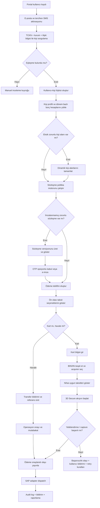
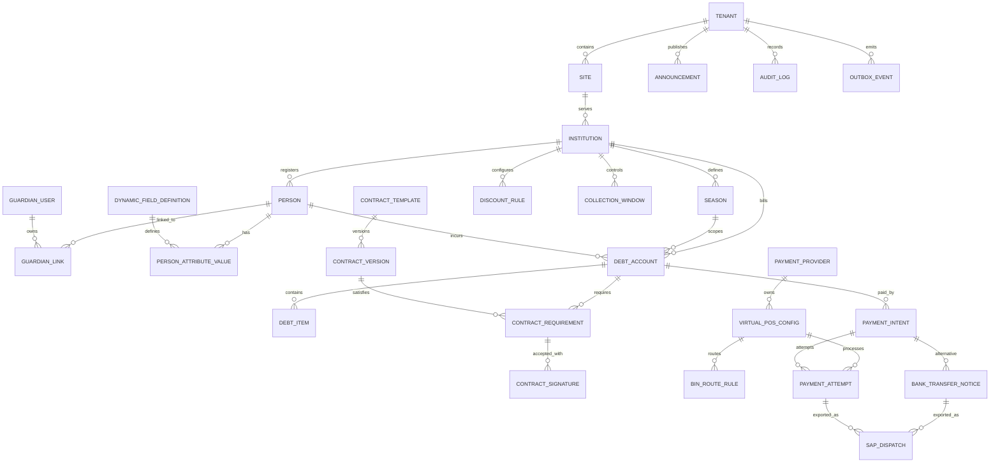

# AYSTEK Core ile veli.gurseltur.com.tr Tabanlı Okul ve Personel Tahsilat Platformunun Birleştirme Kararı İçin Enterprise Tasarım Raporu

## Executive Summary

Bu çalışma için en doğru teknik karar, yeni Okul/Personel Ödeme alma işini ayrı bir uygulama olarak geliştirmek değil, **AYSTEK Core içinde tenant ve site temelli yeni bounded context’ler** olarak konumlandırmaktır. Bunun temel nedeni, AYSTEK Core’un zaten çok kiracılı ve çok siteli çalışma, DDD katmanlı modül yapısı, RabbitMQ/SSE tabanlı entegrasyon omurgası, zorunlu seed/menu disiplini ve **28 dil** i18n standardı ile bu işi taşıyabilecek kurumsal çerçeveyi sunmasıdır. İç mimari standartlar bunu açıkça desteklemekte; ayrıca AYSTEK’in mevcut ulaşım/taşınan kişiler bağlamındaki iç taslağı da kurum–kişi–grup–indirim–raporlama ekseninde benzer bir alan modeli tarif etmektedir. Bu nedenle öneri, `gursel-turizm` tenant’ı altında `veli.gurseltur.com.tr` sitesini **public self-service kanal** olarak koruyup, iş mantığını AYSTEK Core’a taşımaktır. fileciteturn0file1 fileciteturn0file0

Doğrulanabilen public akış, bugün login ekranında öğrenci T.C. kimlik numarası ve okul seçimi ile SMS tabanlı giriş başlatıldığını; login olmadan erişilen ön kayıt formunda ise okul, kimlik, sınıf, doğum tarihi, **kan grubu**, veli/ebeveyn iletişim bilgileri ve servis başlangıç/ kullanım bilgileri toplandığını gösteriyor. Aynı public yüzeyde şartname, gizlilik ve İngilizce seçenekleri de mevcut. Bu, yeni tasarımın yalnızca “ödeme alma” değil, aynı zamanda **kimlik bağlama, kişi verisi tamamlama, sözleşme onayı ve servis talep yönetimi** içeren birleşik bir self-service alanı olması gerektiğini açık biçimde gösterir. citeturn0view0turn0view1

Ödeme tarafında en güçlü öneri, **iki aşamalı teklif + tek aşamalı kesin ödeme** modelidir: Kart girilmeden önce kurum/okul ve aktif POS anlaşmalarına göre **ön olası taksit seçenekleri** gösterilir; kart bilgisi verildiğinde BIN/IIN tespiti ve acquirer kural motoru çalışır; ardından **nihai uygun taksit seçenekleri** sunulur ve 3D Secure ile ödeme tamamlanır. Garanti BBVA’nın switch dokümantasyonu, banka ID verilirse doğrudan ilgili bankaya; verilmezse kartın bankasına; kartın bankası sistemde yoksa da default bankaya yönlendirme mantığını açıkça tarif eder. Bu, sizin beklediğiniz “kartın numarasına göre banka tespiti ve fallback POS seçimi” ihtiyacıyla doğrudan örtüşür. BIN/IIN yönlendirmesinin sektör standardı olduğu, Mastercard ve Visa’nın ilgili dokümanlarında da desteklenmektedir. citeturn10view3turn16search0turn16search10

Sözleşme ve dinamik alan tarafında ise kritik tasarım ilkesi şudur: **borç bazlı sözleşmeler** ile **kişi bazlı veri tamamlama** ayrılmalıdır. Kan grubu gibi veriler kişi profilinde tutulmalı ve kurum politikası uyarınca eksikse bir kez istenmelidir; buna karşılık sözleşme gereksinimleri, her yeni borç girişinde veya borç versiyonu değiştiğinde tekrar değerlendirilmelidir. KVKK karar ve rehberleri, kan grubu bilgisini sağlık verisi olarak değerlendirmekte ve özel nitelikli kişisel veriler için daha sıkı koruma ile uygun hukuki sebep gerektirmektedir. Bu yüzden kan grubu ve benzeri alanlar için açık politika, dar erişim, maskeleme ve ayrı saklama kuralları şarttır. citeturn13search2turn11view11turn11view12turn13search4

Güvenlik ve uyumluluk bakımından en önemli sonuç, kart verisini mümkün olduğunca AYSTEK yüzeyinden uzaklaştırmaktır. PCI SSC’ye göre PCI DSS, kart verisini saklayan, işleyen, ileten veya güvenliğini etkileyen tüm bileşenleri kapsar; ayrıca e-ticarette hosted payment page kullanılsa bile merchant sorumluluğu tamamen kalkmaz. Ancak bütün ödeme sayfası elemanları PCI uyumlu üçüncü taraftan geliyorsa SAQ A kapsamı mümkün olabilir; merchant sayfası ödeme sayfasının güvenliğini etkiliyorsa SAQ A-EP veya daha geniş kapsam gündeme gelir. Dolayısıyla öneri, **merchant-origin JavaScript ile kart alanı üretmeyen**, mümkünse provider-owned hosted page veya provider-controlled payment component kullanmaktır. citeturn11view2turn11view3turn11view4turn6search3turn6search9

Belirsiz kalan kritik konular şunlardır: hangi bankalar veya sanal POS sağlayıcılarıyla çalışılacağı, SAP tarafında ECC mi S/4HANA mı kullanıldığı, OData/IDoc/BAPI/RFC hangi entegrasyon yolunun esas alınacağı, mevcut Yii2 veritabanı ve şema detayları, bugünkü sözleşme versiyonlama düzeni, SMS/e-posta sağlayıcısı ve mevcut müşteri web servislerinin teknik kontratı. Nihai tasarım bu nedenle **adapter-first**, **idempotent**, **outbox destekli** ve **anti-corruption layer** kullanan bir kurumsal geçiş planı ile hayata geçirilmelidir. citeturn14search0turn14search3turn15search3turn15search10turn11view5turn11view6turn11view7

## Araştırma Temeli ve Mevcut Durum

Bu rapor, dört veri tabanına dayanır: AYSTEK iç mimari standart dokümanı, AYSTEK’in taşınan kişiler/kurumlar eksenindeki ilişkili iç taslağı, `veli.gurseltur.com.tr` üzerindeki public ekranların canlı incelemesi ve resmi dış kaynaklar olarak PCI SSC, KVKK, SAP Help, RabbitMQ, BKM ve bankaların resmi sanal POS/3D Secure dökümanları. Teknik olarak en önemli sınırlama, authenticated Yii2 ekranları ile mevcut veritabanı ve sözleşme şemasına doğrudan erişim olmamasıdır; bu nedenle authenticated iç akışların bir bölümü ihtiyaç metninden türetilmiş, public gözlemle doğrulanabilen kısmı ise ayrıca işaretlenmiştir. fileciteturn0file1 fileciteturn0file0 citeturn0view0turn0view1

### Doğrulanmış bulgular

| Alan | Doğrulanmış durum | Tasarım etkisi | Kaynak |
|---|---|---|---|
| Public giriş | Öğrenci T.C. kimlik numarası ve okul seçimi sonrası kayıtlı telefona SMS onay kodu gönderildiği belirtiliyor. | Yeni self-service, kişi bağlama akışını native kullanıcı hesabı + ikinci faktör mantığı ile yeniden kurmalı. | citeturn0view0 |
| Public menü | Şartname, gizlilik, iletişim ve İngilizce seçeneği public yüzeyde mevcut. | Login öncesi sözleşme/duyuru/CMS yüzeyi AYSTEK Core site katmanında korunmalı. | citeturn0view0 |
| Login’siz ön kayıt | “Servis Ön Kayıt Formu” login olmadan erişilebiliyor. | Public form altyapısı korunmalı; ama AYSTEK Core vaka/talep nesnelerine bağlanmalı. | citeturn0view0turn0view1 |
| Ön kayıt veri alanları | Öğrenci kimlik bilgileri, okul, sınıf, doğum tarihi, kan grubu, anne/baba/diğer kişi iletişim bilgileri, servis başlangıç tarihi ve kullanım yönü toplanıyor. | Dinamik alanlar, statik form yerine kurala bağlı metadata ile yönetilmeli. | citeturn0view1 |
| KVKK kabulü | Hem login hem ön kayıt aşamasında KVKK kabul alanı bulunuyor. | Aydınlatma, açık rıza ve loglama ayrı nesneler olarak izlenmeli. | citeturn0view0turn0view1 |
| AYSTEK Core standardı | Go + Next.js + MongoDB/Redis + RabbitMQ/SSE, DDD katmanları, seed/menu zorunluluğu, event-driven yaklaşım ve 28 dil çeviri standardı tanımlanmış. | Proje ayrı repo değil, Core içinde bounded context ve standardize modüller olarak geliştirilmeli. | fileciteturn0file1 |
| İlişkili alan modeli | İç ulaşım taslağı kurumlar, taşınan kişiler, çoklu grup/indirim ve multi-tenant/multi-site modelini tarif ediyor. | Okul/şirket/kişi hiyerarşisi ile ödeme projesi için veri modelinde mükerrerlikten kaçınılabilir. | fileciteturn0file0 |

Bugünkü public akış, gerçekte “kimlik doğrulama + kişi bulma + hak sahibi hesabına erişim + kuruma bağlı yükümlülük izleme” modeline işaret eder. Yeni nesil tasarım, bunu daha kurumsal hale getirerek “önce veli/ebeveyn veya kullanıcı hesabı, sonra borçlu kişi ile kontrollü ilişki kurma” modeline dönüştürmelidir; aksi halde kimlik, sözleşme ve audit bütünlüğü parçalı kalır. Mevcut public gözlem bunu doğrudan desteklemektedir. citeturn0view0turn0view1

### Paydaşlar ve hiyerarşi

İhtiyaç tanımına göre hedef iş hiyerarşisi şu yapıdadır: **Tenant → Site → Kurum → Kişi → Borç hesabı**. Bu modele ayrıca sistem kullanıcıları olarak veli/ebeveyn, kurum operatörleri, finans operasyonu, müşteri hizmetleri, SAP entegrasyon kullanıcıları ve uyumluluk/denetim aktörleri eklenir. İç AYSTEK dokümanlarında tanımlanan multi-tenant ve multi-site yaklaşımı ile “taşınan kişiler” kavramı, bu hiyerarşinin teknik olarak çekirdek platforma doğal biçimde oturduğunu gösterir. fileciteturn0file1 fileciteturn0file0

Bu bağlamda “okul” ile “firma” arasında teknik ayrım yapmak yerine daha kurumsal bir üst kavram olan **Institution** kullanmak daha doğrudur. Böylece öğrenci/personel farkı, kurum tipi ve kişi rolü politikalarla yönetilir; veri modeli çoğaltılmaz. Servis hizmeti alan öğrenci ya da personel **Person** olarak tutulur; sisteme giriş yapan veli/ebeveyn veya hak sahibi kullanıcı ise **GuardianUser** veya daha nötr isimle **PortalUser** olarak modellenir. Bir kullanıcının birden fazla kişiye; bir kişinin de birden çok kullanıcıya bağlı olabilmesi gerekir. Bu tercih, hem mevcut ihtiyaç metniyle hem de AYSTEK’in ilişkili ulaşım alan modelindeki kişi-merkezli yaklaşım ile uyumludur. fileciteturn0file0

### Belirsiz kalan noktalar

| Belirsizlik | Neden kritik | Tasarıma etkisi |
|---|---|---|
| Hangi bankalar / sanal POS sağlayıcıları kullanılacak | Routing kuralları, taksit matrisi, tokenizasyon ve hosted payment page seçimi bankaya göre değişir. | `PaymentProviderAdapter` ve `RoutePolicy` soyutlaması zorunlu. |
| SAP sürümü ve entegrasyon yöntemi | ECC / S/4HANA / PI-PO / Integration Suite / doğrudan RFC farkı veri biçimini ve hata akışını değiştirir. | OData, IDoc ve gerekirse BAPI/RFC için pluggable adapter katmanı gerekli. |
| Mevcut Yii2 şema ve veri kalitesi | Kişi, borç, sözleşme ve okul kimlikleri birebir taşınacaksa alan eşleme gerekir. | Anti-corruption layer ve veri profil analizi olmadan tam migrasyon planı yapılamaz. |
| Kurum bazlı sözleşme kuralları | Her kurumun her dönem için farklı sözleşme, indirim, kapatma ve duyuru politikası olabilir. | Policy engine ve effective-date/version yaklaşımı zorunlu. |
| İndirim oranı web servisleri | Bazı oranların müşteriden çekildiği belirtilmiş. | `DiscountProviderChain` ve cache/timeout politikası tasarlanmalı. |
| SMS/e-posta sağlayıcıları | OTP, bildirim, retry ve maliyet etkilenir. | Notification gateway bağımsız tasarlanmalı. |
| Mevcut hukuki imza düzeni | Sadece onay kutusu mu, OTP mi, e-imza mı kullanıldığı ve hangi belgelerin hangi hukuk seviyesinde tutulduğu net değil. | Contract acceptance seviyeleri ayrılmalı; hukuki inceleme gereklidir. |

Bu belirsizlikler, çözümü geciktiren sebepler değil; tam tersine neden **adapter-first** ve **policy-driven** mimari seçilmesi gerektiğinin kanıtıdır. Özellikle ödeme ve SAP tarafında sağlayıcı ve sürüm bağımlılıklarını doğrudan domain katmanına gömmek, orta vadede en büyük teknik borç kaynağı olur. SAP’nin OData, IDoc ve BAPI/ALE temelli farklı entegrasyon yolları sunduğu resmi dökümanlardan görülebilir; bu yüzden içte tek bir kanonik event ve veri modeli, dışta ise provider-adapter yaklaşımı en sağlıklı çözümdür. citeturn14search0turn14search3turn15search3turn15search10turn1search19

## Hedef Mimari ve Birleştirme Kararı

Önerilen mimari karar, **AYSTEK Core içinde strangler-pattern tabanlı birleşme** modelidir. Burada `veli.gurseltur.com.tr` bir site kanalı olmaya devam eder; ancak identity, institution, contracts, payments, announcements, audit ve integrations gibi omurga parçaları Core’a alınır. Legacy Yii2 uygulama ise ilk fazlarda yalnızca geçici okuma/köprü görevi görür. Bu karar, hem AYSTEK’in iç modül ve entegrasyon standartlarıyla uyumlu, hem de mevcut public akışları bozmadan ilerlemeye elverişlidir. fileciteturn0file1 citeturn0view0turn0view1

### Birleştirme seçeneklerinin analizi

| Seçenek | Güçlü yanı | Zayıf yanı | Sonuç |
|---|---|---|---|
| Ayrı bağımsız yeni uygulama | İlk bakışta daha hızlı başlatılır. | AYSTEK Core i18n, audit, menu/seed, entegrasyon, tenant/site yönetimi ve admin standartlarından kopar; mükerrer geliştirme üretir. | Önerilmez. |
| Big-bang tam yeniden yazım | Nihai olarak homojen sistem üretir. | Legacy veri ve kurallar tam anlaşılmadan geçiş çok riskli olur; ödeme ve SAP tarafında kesinti riski yüksektir. | Yüksek riskli. |
| Core içinde strangler birleşmesi | Public yüzeyi korur, iş mantığını çekirdeğe taşır, kademeli geçiş sağlar, test edilebilir ve geri dönüşlüdür. | Geçici süre çift sistem senkronizasyonu gerekir. | **Önerilen seçenek** |

Bu kıyasın teknik zemini nettir: AYSTEK Core’un kendisi zaten modüler DDD, event-driven entegrasyon, menu/translation/seed zorunluluğu ve tenant-site hiyerarşisi üzerine kuruludur; dolayısıyla bu platformun etrafında ikinci bir “mini platform” kurmak kısa vadede hız, orta vadede ise maliyet üretir. Ayrıca public ekranların zaten belirli bir kullanıcı kitlesi ve link düzeni olduğu için yüzeyin korunması, ama iş mantığının içeri taşınması en dengeli yoldur. fileciteturn0file1 citeturn0view0turn0view1

### Önerilen bounded context yapısı

AYSTEK Core standartlarına uygun olarak her bounded context, **model → dto → repository → service → handler → routes** düzeninde inşa edilmelidir. Bu projede önerilen context seti şu şekildedir: **Identity & Guardian**, **Institution Registry**, **Debtor Linking**, **Dynamic Person Attributes**, **Debt Ledger**, **Contract Policy & Signature**, **Payment Orchestration**, **Bank Transfer Notices**, **Announcements & CMS**, **SAP Dispatch**, **Audit & Observability**. Bu katmanlı yaklaşım AYSTEK’in iç standartlarında açıkça tarif edilmiş ve modül başına seed/menu/translation disiplinleri ile birlikte zorunlu tutulmuştur. fileciteturn0file1

Bunların içinde özellikle iki aggregate kritik önemdedir. İlki **DebtAccount**’tur. Bu nesne “kişi + kurum + sezon/dönem + hizmet tipi” ekseninde tekil borç hesabını temsil eder; birden fazla satır borç içerebilir ama muhasebesel ve sözleşmesel bağlamı kaybetmez. İkincisi **ContractRequirement**’tır. Bu nesne, belli bir borç hesabı için hangi sözleşme versiyonunun zorunlu olduğunu, hangi tetikleyici ile (ilk ödeme, yeni borç girişi, kurum politikası değişimi, eksik onay vb.) devreye girdiğini ve hangi yöntemle kabul edildiğini tutar. Böylece “kan grubu kişi bazında”, “sözleşme borç bazında” ayrımı temiz biçimde korunur.

### Mevcut ve hedef modül haritası

| İş alanı | Bugünkü temel | AYSTEK Core’da hedef konum |
|---|---|---|
| Giriş ve kimlik doğrulama | T.C. + okul + SMS ile erişim | Kullanıcı hesabı + kişi ilişkilendirme + OTP/cihaz riski + legacy kişi doğrulama köprüsü |
| Ön kayıt | Login’siz form | Public case/request modülü + workflow + e-posta/SAP/CRM entegrasyonu |
| Okul/kurum seçimi | Public okul listesi | Tenant/site/institution registry + sezonel aktiflik kuralları |
| Kişi bilgileri | Statik form alanları | Metadata tabanlı dinamik alan tanımları + kurum/sezon/rol bazlı zorunluluk |
| Borç görüntüleme | Dönem bazlı borca erişim | DebtAccount + DebtItem + tahsilat kuralları + açıklanabilir hesap hareketleri |
| Sözleşmeler | Placeholder ile belge doldurma, ihtiyaç halinde onay | Versioned template + rule engine + rendered hash + OTP/e-imza kabul kayıtları |
| Kartlı ödeme | Banka seçimi, taksit, 3D | Payment quote + BIN routing + provider adapters + hosted 3DS akışı |
| Havale bildirimi | İhtiyaç olarak var | Transfer notice + referans + operasyon onayı + SAP dispatch |
| SAP gönderimi | Ödeme olduğunda gönderim | Event-driven outbox + adapter katmanı + idempotent SAP dispatch |
| Duyurular | Public/login öncesi ihtiyaç olarak var | Announcement modülü; public/site/institution/season segmentasyonu |
| İndirimler | Kurum bazlı peşin/taksitli indirim ihtiyacı | DiscountRule + web-service backed provider chain |
| Log ve izleme | İhtiyaç olarak var | Audit log + trace + external correlation + DLQ/ops ekranları |

Bu modül haritasındaki “bugünkü temel” sütunu public endpoint gözlemleri ve AYSTEK iç standartlarının ortaya koyduğu altyapıya; “hedef konum” sütunu ise bu raporun kurumsal tasarım önerisine dayanmaktadır. fileciteturn0file1 citeturn0view0turn0view1

### Tenant, site, kurum ve kişi modeli

Önerilen hiyerarşi şu soyutlama ile kurulmalıdır: `Tenant(gursel-turizm)` en üst ticari kapsayıcıdır; `Site(veli.gurseltur.com.tr)` public/self-service deneyiminin kanalıdır; `Institution` okul veya firma gibi tahsilat ve sözleşme politikasının bağlandığı tüzel/organizasyonel düğümdür; `Person` taşınan bireydir; `GuardianUser` ise portala giriş yapan gerçek kullanıcı hesabıdır. İç ulaşım taslağında da çoklu kurum, çoklu grup, indirim ve taşınan kişi ilişkileri tarif edildiği için bu model AYSTEK’in genel yönü ile uyumludur. fileciteturn0file0

Bu modelin kurumsal avantajı şudur: “aynı veli farklı kurumlarda iki farklı çocuğu yönetebilsin”, “aynı kişi için farklı dönemlerde farklı borç hesapları oluşsun”, “aynı kurum belirli sezonda koleksiyonu kapatsın”, “sadece ilgili kurum duyurusu görünsün” ve “aynı dinamik alan tanımı farklı zorunluluk seviyeleriyle tekrar kullanılabilsin.” Bu gereksinimler, ayrı tablolarla çözülmez; **scope + effective date + policy** yaklaşımıyla çözülür.

## Uçtan Uca Süreç Tasarımı

Yeni nesil akışın merkezinde “**kullanıcı hesabı önce, borçlu kişi ilişkisi sonra**” ilkesi yer almalıdır. Böylece sistem, bugünkü T.C. + okul + SMS yaklaşımını tamamen çöpe atmak yerine, onu bir **kişi bulma ve hak doğrulama aracı** olarak kullanabilir. Kullanıcı önce kendi hesabını oluşturur; hesabı e-posta ve tercihen SMS ile doğrulanır; ardından T.C. kimlik numarası, kurum bilgisi ve ilişki türü ile kişiyi sisteme bağlar. Eğer mevcut veri kaynaklarında eşleşme bulunursa bağlama kurulur; bulunamazsa manuel inceleme kuyruğuna düşer.

### Kayıt, hesap onayı ve kişi bağlama

Bu akışta `PortalUser` ile `Person` birbirinden ayrıldığı için, aynı kullanıcı hesabı altında birden fazla çocuk/personel yönetimi doğal olarak desteklenir. Ayrıca geri planda yetkisiz bağlamaları önlemek için çok katmanlı kontrol gerekir: mevcut kurum/legacy kayıtlı telefon sahibi ile uyuşma, daha önce gönderilmiş SMS doğrulama kanıtı, operatör onayı veya belge doğrulama gibi. Mevcut public sayfanın T.C. + okul + SMS akışına sahip olması, kişi ile iletişim kanalının legacy tarafta zaten önemli bir doğrulama sinyali olduğunu gösterir. citeturn0view0

Bu tasarım, aynı zamanda servis kayıt ve ayrılma taleplerinin daha sağlıklı yönetilmesini sağlar. Çünkü bu talepler anonim form olarak değil, artık kimliği ve hangi kişiye ilişkin olduğu belli olan **workflow case** nesneleri olarak üretilir. Böylece SAP, CRM veya operasyon ekipleri için bildirimi sadece “mail atma” düzeyinde bırakmak yerine, durum takibi yapılabilen, SLA atanabilen ve denetlenebilir operasyon kayıtlarına çevirmek mümkün olur.

### Dinamik zorunlu alanlar ve kişi profili

Kan grubu bu projenin en kritik örneğidir; fakat mimari yalnızca kan grubuna göre tasarlanırsa birkaç ay içinde yetersiz kalır. Bu yüzden öneri, `DynamicFieldDefinition` + `FieldRequirementPolicy` + `PersonAttributeValue` üçlüsüdür. Örnek alanlar: kan grubu, acil durumda aranacak kişi, servis kullanım onayı, personel sicil referansı, kurumun talep ettiği ek sağlık/bilgi alanları. Her alan için veri tipi, doğrulama kuralı, maskelenme seviyesi, erişim rolleri, KVKK kategorisi ve zorunluluk scope’u ayrı tutulmalıdır.

KVKK açısından bu çok önemlidir; çünkü kan grubu verisi Kurul kararında açıkça sağlık verisi sayılmış ve açık rıza olmaksızın işlenmesi nedeniyle idari yaptırım uygulanmıştır. Kurulun rehber ve karar özetleri, özel nitelikli kişisel veriler için daha sıkı koruma, uygun hukuki sebep ve teknik/idari tedbir zorunluluğunu tekrar etmektedir. Dolayısıyla kan grubu ve benzeri alanlar **kişi bazında**, **amaçla sınırlı**, **ayrı erişim politikalı**, **maskeli görüntülemeli** ve gerektiğinde **ayrı açık rıza kanıtı** taşıyan nesneler olarak modellenmelidir. citeturn13search2turn13search1turn11view11turn11view12turn13search4

### Sözleşme yönetimi ve imza akışı

Sözleşme tarafında iki düzlem birbirinden ayrılmalıdır. Birincisi `ContractTemplate/ContractVersion` düzlemidir; yani kurumun veya tenant’ın yayınladığı belge şablonları. İkincisi `ContractRequirement` düzlemidir; yani belirli bir borç hesabı için belirli bir sözleşme versiyonunun zorunlu hale gelmesi. Sizin iş kuralınız “Gürsel Turizm her yeni borç girdiğinde o borç için sözleşmeleri yeniden imzalatabilmelidir” olduğu için, tetikleyici borcun kendisidir; sadece kullanıcının sisteme giriş yapması değildir. Bu nedenle öneri, `debt_account.repriced`, `debt_item.added`, `institution.policy.changed` gibi olaylarda sözleşme zorunluluklarını tekrar hesaplayan bir **contract policy engine** kurulmasıdır.

Şablon tarafında mevcut `[VELI-TC]` yaklaşımı korunabilir; ama string replace düzeyinde bırakılmamalıdır. Bunun yerine `TemplateVariable` kataloğu tanımlanmalı; her değişkenin veri kaynağı, zorunluluğu, biçimlendiricisi ve audit izi tutulmalıdır. Belge üretildiğinde PDF/HTML hash’i, kullanılan değişkenlerin snapshot’ı, sürüm numarası, locale ve tenant/site/institution bağlamı kaydedilmelidir. Böylece daha sonra “o tarihte kullanıcıya hangi metin gösterildi” sorusu teknik olarak cevaplanabilir.

İmza yöntemi için üç seviye önerilir: **basit kabul** (checkbox + accepted_at), **kanıtlı kabul** (OTP/SMS + accepted_at + msisdn hash + delivery receipt), **nitelikli e-imza** (NES/mobil NES veya uyumlu sağlayıcı ile). Türk mevzuatında güvenli elektronik imza, elle atılan imza ile aynı hukuki sonucu doğurur; nitelikli elektronik sertifika ve güvenli imza altyapısı buna dayanak oluşturur. Buna karşılık SMS OTP kendi başına güvenli elektronik imza değildir; bu nedenle SMS OTP’yi hukuken “kanıt kuvveti yüksek onay” seviyesi olarak modellemek, “nitelikli e-imza eşdeğeri” olarak modellememek daha doğru olur. Bu değerlendirme, 5070 kapsamındaki resmi tanımlar üzerine yapılmış bir mühendislik/hukuk uyumluluğu çıkarımıdır. citeturn7search7turn19search6turn19search0

### Ödeme akışları ve sanal POS yönlendirmesi

Kartlı ödeme akışı iki safhaya ayrılmalıdır. İlk safhada kullanıcı, borç hesabını ve ödeme yöntemini seçer; sistem kuruma, sezona, toplam tutara, peşin/taksitli indirim politikasına ve aktif POS sözleşmelerine göre **ön teklif** üretir. Bu aşamadaki taksit seçenekleri “nihai uygunluk garantisi” taşımaz; sadece satın alma deneyimini iyileştirir. İkinci safhada kullanıcı kart bilgisini girdiğinde karttan alınan BIN/IIN, scheme, funding source ve gerekiyorsa issuer bilgisi üzerinden acquirer seçimi yapılır; ondan sonra **nihai uygun taksit planı** sunulur.

Bu mimari hem kullanıcı beklentisini hem de banka gerçekliğini birlikte karşılar. Mastercard, BIN numarasını kart numarasının ilk altı hanesi olarak tanımlar; Visa da BIN özellikleri içinde issuer adı, funding source, ülke ve BIN uzunluğu gibi yönlendirme açısından kritik niteliklerin bulunduğunu belirtir. Garanti BBVA switch dokümanı da, banka ID verilmediğinde kartın bankasına; o da entegre değilse default bankaya yönlendirme yapılabileceğini gösterir. Başka bir deyişle, ihtiyacınız zaten sektörün desteklediği bir pattern ile aynı doğrultudadır. Önemli olan, bu yönlendirmeyi uygulama koduna dağılmış if/else’ler yerine **kurallı bir routing motoru** ile yapmaktır. citeturn16search0turn16search10turn10view3

Ayrıca BIN verisi sabit CSV dosyalarıyla yönetilmemelidir. Mastercard, ekosistem için güncel BIN aralık bilgisi tabloları/API’leri sunduğunu; Visa ise BIN listesinin günlük güncellendiğini belirtir. Dolayısıyla sistemde `BinMetadataProvider` soyutlaması kurulmalı; banka/issuer/funding-source bilgisi düzenli olarak güncellenebilir veri kaynağından beslenmelidir. Özellikle TROY, debit, prepaid ve ticari kart ayrımları taksit ve yönlendirme kararlarını etkileyebileceği için bu önemlidir. citeturn16search11turn16search10

3D Secure tarafında sistem **challenge** ve mümkün olduğunda **frictionless** senaryoları desteklemelidir. EMVCo, EMV 3DS’nin internet kart ödemelerini daha güvenli hale getirdiğini ve issuer’a daha fazla bağlamsal veri vererek güvenlik ile kullanıcı kolaylığı arasında daha iyi denge kurduğunu belirtir. Aynı çerçevede frictionless akış gerçek zamanlı risk analiziyle daha sürtünmesiz deneyim sağlar; challenge ise ek doğrulama gerektirir. Türkiye’de bankaların pratik uygulamaları da 3D’yi kritik kabul etmektedir; İş Bankası debit kart internet işlemlerinde 3D Secure’ü zorunlu tuttuğunu açıkça söyler. citeturn11view0turn11view1turn10view4

Havale tarafında ise “manuel açıklama bırakılan genel bir form” yerine **bank transfer intent** mantığı kurulmalıdır. Kullanıcıya benzersiz referans/reconciliation kodu üretilmeli; havale bildirimi bu referansla yapılmalı; operasyon panelinde dekont ve banka hareketi eşleştirilerek onay verilmelidir. Onay anında hem iç ledger güncellenmeli hem de SAP’ye idempotent bir tahsilat/pending-cash dispatch’i çıkarılmalıdır. Böylece havale, kartlı ödemeden farklı ama aynı denetim kalitesine sahip bir kanal olur.

### Uçtan uca önerilen akış



Bu akışın güvenlik ve entegrasyon tarafı, resmi 3DS, PCI, SAP ve RabbitMQ dökümanları ile uyumlu bir temel üzerine oturur: ödeme kararı kart bankasına göre yönlenebilir, 3DS doğrulama challenge/fail/success URL mantıklarıyla işleyebilir, SAP tarafında da event sonrası OData/IDoc/BAPI adapter’ı devreye girebilir. citeturn10view3turn11view0turn11view1turn14search0turn15search3turn11view5turn11view7

## Veri Modeli, API ve Yönetim Yüzeyleri

Aşağıdaki veri modeli, mükerrer geliştirmeleri azaltmak ve hem public hem admin akışlarını aynı çekirdek üzerinde toplamak için önerilen çekirdek ER yapısını gösterir. Buradaki en kritik ayrım şudur: **Institution ve Person** kurumsal temel veridir; **DebtAccount** muhasebesel/sözleşmesel bağlamdır; **ContractRequirement** ise borç bazlı yükümlülüğü temsil eder. Kan grubu gibi hassas alanlar doğrudan `PersonAttributeValue` altında kişinin profiline bağlanmalıdır; `DebtAccount` altında tekrarlanmamalıdır. Bu, hem veri minimizasyonunu hem de KVKK uyumluluğunu güçlendirir. citeturn13search2turn11view11turn11view12



Bu ER modelinin üzerine `DebtAccount` için güçlü bir yaşam döngüsü eklenmelidir: `draft → active → suspended → settled → exported → archived`. Benzer şekilde `ContractRequirement` için `required → presented → accepted → invalidated → superseded`; `PaymentIntent` için ise `quoted → pending_3ds → authorized → captured → failed → cancelled → reconciled` durumları önerilir. State machine yaklaşımı, AYSTEK’in DDD hizmet ve model katmanı standardı ile uyumludur. fileciteturn0file1

### Admin panel yüzeyleri

| Panel | Ana amaç | Kritik fonksiyonlar |
|---|---|---|
| Tenant ve Site Yönetimi | `gursel-turizm` ve `veli.gurseltur.com.tr` bağlamını yönetmek | domain/site ayarları, locale, bildirim, theme, maintenance |
| Kurum Yönetimi | Okul/firma tanımları | kurum tipi, sezonlar, ödeme açık/kapalı bayrakları, kurum sözleşmeleri |
| Kişi Bağlama İnceleme | Manuel doğrulama işlerini çözmek | link request onayı/red, kanıt görüntüleme, reason codes |
| Dinamik Alan Tanımları | Kan grubu ve benzeri alanları yönetmek | field type, mask level, validation, KVKK kategorisi, zorunluluk kuralları |
| Borç ve İndirim Yönetimi | Dönemsel tahsilat politikasını yönetmek | debt import, peşin/taksitli indirim oranları, override, web-service cache |
| Sözleşme Yönetimi | Versiyonlu sözleşme ve gereksinimleri yönetmek | template, variable catalog, version publish, institution binding |
| İmza ve Kanıt Yönetimi | Onay kalitesini yönetmek | accepted/not accepted, OTP log, hash, PDF archive, repeat sign triggers |
| Ödeme Orkestrasyonu | POS ve routing yönetimi | provider config, BIN route rules, default bank, taksit kuralları, fallback |
| Havale Operasyonları | Transfer bildirimlerini işlemek | referans eşleme, dekont kontrolü, onay/red, reconciliation |
| Duyuru Yönetimi | Public ve kuruma özel içerik yayınlamak | audience, institution, season, locale, publish windows |
| SAP Entegrasyon Merkezi | Giden kayıtları izlemek | queue, retry, replay, payload diff, external document no |
| Audit ve Operasyon | Her adımı izlemek | trace, correlation, actor, IP/device hash, DLQ, error analytics |

Bu panel listesi, AYSTEK’in admin-first ve modül-seed-menu disiplinine uygun bir yönetim yüzeyi üretmek için gerekli minimum seti gösterir. Özellikle event-driven modüllerde event key dokümantasyonunun da panel tarafında görünür hale getirilmesi, iç AYSTEK standardı ile uyumludur. fileciteturn0file1

### Önerilen API sözleşmesi örneği

Aşağıdaki örnek, kart girmeden önce ve sonra taksit seçeneklerinin nasıl aynı uç nokta mantığında yönetilebileceğini gösteren öneri bir JSON şemasıdır. Amaç, **tek API ile hem ön teklif hem nihai teklif** üretebilmektir.

```json
{
  "$schema": "https://json-schema.org/draft/2020-12/schema",
  "title": "CreatePaymentQuoteRequest",
  "type": "object",
  "required": [
    "tenant_id",
    "site_code",
    "guardian_link_id",
    "debt_account_ids",
    "payment_method",
    "locale"
  ],
  "properties": {
    "tenant_id": {
      "type": "string",
      "const": "gursel-turizm"
    },
    "site_code": {
      "type": "string",
      "const": "veli"
    },
    "guardian_link_id": {
      "type": "string",
      "description": "Portal kullanıcısının borçlu kişi ile ilişkisini temsil eder."
    },
    "debt_account_ids": {
      "type": "array",
      "minItems": 1,
      "items": {
        "type": "string"
      }
    },
    "payment_method": {
      "type": "string",
      "enum": ["card", "bank_transfer"]
    },
    "preferred_acquirer_bank_code": {
      "type": ["string", "null"],
      "description": "Kullanıcı bankayı önceden seçtiyse iletilebilir."
    },
    "card_bin": {
      "type": ["string", "null"],
      "pattern": "^[0-9]{6,8}$",
      "description": "Kart girilmemişse null; girilmişse BIN/IIN."
    },
    "locale": {
      "type": "string",
      "description": "Örn. tr, en, de..."
    },
    "client_context": {
      "type": "object",
      "properties": {
        "ip_address": { "type": "string" },
        "user_agent": { "type": "string" },
        "device_id": { "type": "string" }
      },
      "additionalProperties": false
    }
  },
  "additionalProperties": false
}
```

Bu isteğin karşılığında sistemin `required_person_fields`, `required_contracts`, `installment_offers.provisional`, `installment_offers.final`, `discounts_applied`, `selected_acquirer`, `three_ds_required`, `bank_transfer_reference` gibi alanlar döndürmesi önerilir. Böylece frontend, önce eksik kişi verisini ve sözleşmeyi tamamlatır, sonra ödeme ekranına geçirir.

### Örnek log formatı

Her adımın loglanması gereksinimi için düz metin log yerine **JSON line + trace context** önerilir. Aşağıdaki format, hem uygulama logu hem denetim kaydı hem de entegrasyon izlemesi için uygun bir taban sunar.

```json
{
  "ts": "2026-05-08T14:32:11.482+03:00",
  "level": "INFO",
  "service": "payment-orchestrator",
  "env": "prod",
  "tenant_id": "gursel-turizm",
  "site_id": "veli",
  "institution_id": "inst_alev_001",
  "season_id": "2025-2026",
  "trace_id": "9f4cd1f52b584a72a6b9c29c8af3d4e1",
  "span_id": "4c3eeb55f6f4a3b1",
  "correlation_id": "payq_01JTXA3A4A91K9YQ6V6D5F2R8M",
  "event_key": "payment.intent.authorized",
  "actor_type": "portal_user",
  "actor_id": "usr_01JTX9Y6P2M3E6R7S8T9U0V1W2",
  "subject_type": "debt_account",
  "subject_id": "debt_01JTWZ6JH8S7R4M5N2K1P0Q9X8",
  "payment_intent_id": "pi_01JTXA2YV1D3M8K4S5N6P7Q8R9",
  "payment_attempt_id": "pa_01JTXA34A8D4F8S2K7M9P0Q2R1",
  "payment_method": "card",
  "acquirer_bank_code": "GB",
  "issuer_bank_code": "YK",
  "installment_count": 4,
  "amount": 18500.75,
  "currency": "TRY",
  "status": "SUCCESS",
  "three_ds": {
    "required": true,
    "flow": "challenge",
    "eci": "05",
    "directory_server_txn_id": "ds_abc123"
  },
  "external_refs": {
    "provider_order_id": "GARANTI-20260508-847221",
    "sap_dispatch_id": "sapd_01JTXA45K2M3N4P5Q6R7S8T9U0"
  },
  "security": {
    "ip_hash": "sha256:3d9f4b...",
    "device_fingerprint_hash": "sha256:a8c2be...",
    "pii_classification": ["financial", "identity"],
    "masked_pan": "5400********1234"
  },
  "message": "Payment authorized and queued for SAP dispatch"
}
```

Bu formatta özellikle `trace_id`, `correlation_id`, `event_key`, `subject_type/id`, `external_refs` ve güvenlik alanları zorunlu tutulmalıdır. Bunlar olmadan ne banka hatası ne SAP uyuşmazlığı ne de kullanıcı itirazı düzgün izlenebilir.

## Entegrasyon, Güvenlik ve Uyumluluk

### SAP entegrasyon yaklaşımı

SAP tarafı henüz sürüm ve entegrasyon yöntemi bakımından netleşmediği için en sağlıklı kurgu, iç sistemde **tek kanonik olay modeli**, dış tarafta ise **OData / IDoc / gerekirse BAPI-RFC adapter katmanı** oluşturmaktır. SAP’nin resmi dökümanları, OData’nın HTTP tabanlı CRUD odaklı web API olarak kullanılabildiğini; IDoc adapter’larının ise SOAP/XML tabanlı mesajlaşma ve belirli senaryolarda Exactly Once / Exactly Once In Order kalitesini desteklediğini gösterir. BAPI/ALE hattı ise standartlaştırılmış arayüz seti olarak özellikle geleneksel SAP-to-non-SAP iletişiminde önemini korumaktadır. citeturn15search3turn15search10turn14search0turn14search1turn14search3turn1search19

Bunun sonucu olarak önerilen bütünleşik desen şöyledir: domain katmanında `payment.captured`, `bank_transfer.approved`, `contract.accepted`, `guardian.linked` gibi kanonik event’ler üretilir; bu event’ler **outbox** üzerinden RabbitMQ’ya aktarılır; SAP adapter servisi bu olayları kendi hedef protokolüne map eder. Böylece SAP sürümü değişse bile domain bozulmaz; sadece adapter değişir. Ayrıca ödeme sonrası SAP’ye gönderim zamanı da olay bazında netleşir: kartlı ödemede **authorization/capture success** sonrası; havalede ise **operasyon onayı ve mutabakat** sonrası dispatch yapılır.

### Entegrasyon noktaları

| Kaynak olay | Hedef sistem | Mod | Protokol/biçim | İdempotency anahtarı | Not |
|---|---|---|---|---|---|
| `guardian.linked` | SAP / CRM / MDM | Asenkron | OData JSON veya IDoc XML | `guardian_link_id` | İsteğe bağlı master data senkronu |
| `contract.accepted` | SAP / belge arşivi | Asenkron | OData / belge servisi | `contract_signature_id` | PDF hash ve acceptance metadata gönderilir |
| `payment.captured` | SAP finans | Asenkron | OData / IDoc / BAPI | `payment_attempt_id` | Ana muhasebe tahsilat olayı |
| `bank_transfer.approved` | SAP finans | Asenkron | OData / IDoc / BAPI | `bank_transfer_notice_id` | Havale için tahsilat kapanışı |
| `discount.sync.requested` | Müşteri web servisi | Senkron + cache | REST/SOAP | `institution_id + season_id + person_id` | Timeout halinde local fallback |
| `person.lookup` | Legacy Yii2 / geçici kaynak | Senkron | Read adapter | `tckn + institution_id` | Sadece geçiş fazında |
| `service.request.created` | SAP / operasyon case | Asenkron | OData/REST | `case_id` | Kayıt/ayrılma talepleri |

Bu tablo, SAP ve dış servislerin kurala bağlı ama loosely coupled çalışması için önerilen omurgayı gösterir. Event-driven mimarinin ve RabbitMQ’nun kurumsal kullanımı bakımından publisher confirms, consumer acknowledgements ve DLX/durable queue kurguları resmi RabbitMQ rehberleriyle uyumludur. citeturn11view5turn11view6turn11view7

### PCI-DSS ve kart verisi kapsamı

PCI SSC’ye göre PCI DSS, kart verisini saklayan, işleyen, ileten veya bu ortamın güvenliğini etkileyen tüm bileşenler için temel teknik ve operasyonel gereksinimleri tanımlar. E-ticaret tarafında hosted payment page kullanımı kapsamı azaltabilir; fakat merchant sorumluluğunu tamamen ortadan kaldırmaz. Özellikle PCI FAQ, SAQ A uygunluğu için ödeme sayfasının bütün elemanlarının PCI uyumlu servis sağlayıcıdan gelmesi ve merchant sitesinden tek bir elemanın bile ödeme sayfasını oluşturmaması gerektiğini söyler. Eğer merchant sitesi ödeme sayfasının güvenliğini etkiliyorsa, SAQ A-EP veya daha geniş sorumluluk alanı gündeme gelir. Ayrıca PCI’nin güncel e-skimming rehberleri, e-ticaret ödeme sayfası script’lerinin yetkilendirilmesi, bütünlük kontrolü ve bozulma/tamper izlenmesi gereğini vurgular. citeturn11view2turn11view3turn11view4

Bu nedenle teknik öneri nettir: **PAN, CVV ve benzeri hassas veriler AYSTEK tarafından tutulmamalı**; kart alanları provider-owned bileşenler veya hosted page ile yönetilmelidir. Merchant tarafında yalnızca token, masked PAN, provider order ID, auth/capture sonucu ve 3DS sonucu tutulmalıdır. Eğer iş gerekçesi sizi iframe/embedded modele zorlarsa, o zaman CSP, script integrity, header hardening, page monitoring ve change detection kontrolleri ayrı bir güvenlik backlog’u olarak planlanmalıdır. Bu, sadece compliance değil, operasyonel risk azaltma açısından da gereklidir. citeturn11view3turn11view4turn6search1turn6search8

### Banka entegrasyonları ve taksit gösterimi

Bankaların resmi yüzeyleri ve dökümanları, Türkiye’de sanal POS kabiliyetlerinin kurumdan kuruma farklı olmakla birlikte peşin, taksitli satış, ön provizyon, ortak ödeme ve 3D Secure kullanımının yaygın olduğunu gösterir. Garanti BBVA developer portalı satış, ortak ödeme, token, ön otorizasyon, test kartları ve hata kodları gibi geniş bir API yüzeyi sunmakta; ayrıca switch yönetimi altında banka tanımları ve sipariş/işlem izleme ekranlarından söz etmektedir. İş Bankası sanal POS, taksitli satış ve ön provizyon gibi işlemleri desteklediğini ve debit kart internet işlemlerinde 3D Secure’ün zorunlu olduğunu belirtir. Yapı Kredi tarafında POSNET’in 3D Secure barındırdığı ve secure payment yüzeyinde taksit sayısı alanının yer aldığı görülebilir. citeturn10view1turn10view2turn10view3turn10view4turn5search0turn5search4turn5search8

Bu gerçekler nedeniyle ödeme ekranında iki seviyeli taksit sunumu en sağlıklı modeldir. Kart girilmeden önce “kuruma ve aktif anlaşmalara göre olası” taksitler; kart girildikten sonra ise BIN tespiti ve bankanın/issuer’ın gerçek uygunluğuna göre “nihai” taksitler listelenmelidir. Nihai aşamada da route priority şu sırayla çalışmalıdır: **kuruma özel zorunlu banka → kartın bankası ve sistemde sözleşmeli eşleşme → default acquirer → peşin fallback → ödeme engeli**. Kullanıcıya yanlış vaatte bulunmamak için ön liste ile final liste ayrı kavramlar olarak model ve API seviyesinde ayrılmalıdır.

### KVKK ve özel nitelikli kişisel veriler

KVKK Kurul kararları ve rehberleri, sağlık verileri ve bu kapsamda kan grubu bilgisini açık biçimde özel nitelikli kişisel veri çerçevesinde ele alır; ayrıca bu veriler için daha sıkı koruma ve uygun hukuki sebep aranır. Kurulun kan grubu kararı, bir spor salonunun kan grubu bilgisini açık rıza olmadan işlemesini hukuka aykırı bulmuştur. Bu örnek doğrudan sizin ihtiyacınıza benzer; çünkü okul/servis bağlamı bir sağlık hizmeti sağlayıcısı bağlamı değildir. Dolayısıyla bu projede kan grubu bilgisi, “işimize yarıyor olabilir” gerekçesiyle otomatik toplanmamalı; kurum politikası, amaç, aydınlatma ve gerekliyse açık rıza/yasal dayanak netleştirilerek işlenmelidir. citeturn13search2turn13search3turn11view12turn13search4

Teknik olarak bunun karşılığı şudur: özel nitelikli alanlar ayrı veri sınıfı etiketi almalı; admin ve operasyon panellerinde varsayılan olarak maske ile görünmeli; erişim sadece yetkili rollere verilmeli; export ekranlarında default kapalı olmalı; indirme ve görüntüleme olayları audit log’a düşmeli; saklama süresi açıkça tanımlanmalı; kişi sistemden ayrıldığında ve hukuki yükümlülük kalmadığında silme/anonimleştirme iş akışı işletilmelidir. Kurulun yeterli önlemler vurgusu ve özel nitelikli veriler için ayrı politika/prosedür ihtiyacı, bu seviyedeki ayrıştırmayı zorunlu kılar. citeturn11view11turn13search1

### BKM, sahte işlem ve chargeback sorumluluğu

BKM üye işyeri kılavuzu, POS hizmeti alan işyerlerinin kartlı ödeme kurallarına tabi olduğunu, sahte işlem risklerinin önemli yaptırımlar doğurabileceğini, PCI-DSS uyumluluğunun sürdürülmesi gerektiğini ve chargeback/itiraz süreçlerinde belge ve süreç yönetiminin kritik olduğunu açıkça belirtir. Kılavuz ayrıca, işlemin gerçekleştirildiği sanal POS hangi işyerine kayıtlıysa chargeback riskinin o işyerinde olduğunu söyler. Bu, sizin mimarinizde “merchant of record”, kurum bazlı kapatma/indirim ve loglama kararlarının neden finansal açıdan kritik olduğunun açık kanıtıdır. citeturn20view0turn20view1turn3search9

Dolayısıyla ödeme sistemi yalnızca “ödeme alındı” mantığında değil, **itiraz ve ispat** mantığında tasarlanmalıdır. Her ödeme için hangi borç kalemlerinin tahsil edildiği, hangi sözleşmelerin hangi versiyonla onaylandığı, hangi kullanıcı ve cihaz üzerinden geldiği, hangi taksit planının neye göre seçildiği ve bankadan dönen authorization/capture/3DS metadata’sı denetlenebilir şekilde saklanmalıdır.

## Migrasyon, Test, Rollout ve Riskler

Migrasyon stratejisinin omurgası, AYSTEK iç standartlarına uygun olarak **yeni modüllerin seed, menu, permission ve 28 dil çeviri kurallarıyla birlikte** oluşturulmasıdır. Yani bu iş yalnızca backend endpoint ve birkaç ekran yapma işi değildir; tenant/site bazlı yönetim, admin menüsü, translation keys, seed kayıtları ve event key görünürlüğü de aynı iş kaleminin parçasıdır. İç standart doküman bunu açıkça zorunlu kılar. fileciteturn0file1

### Önerilen rollout fazları

| Faz | İçerik | Yaklaşık takvim |
|---|---|---|
| Keşif ve kesinleştirme | Legacy şema analizi, banka/POS netleştirme, SAP yöntemi, sözleşme matrisi, KVKK/hukuk çalışması | 2–3 hafta |
| Çekirdek domain iskeleti | Institution, Person, GuardianLink, DebtAccount, Dynamic Fields, Announcements, seed/menu/i18n | 3–5 hafta |
| Public hesap ve kişi bağlama | Kullanıcı kaydı, aktivasyon, kişi sorgulama, link request, manuel inceleme paneli | 2–4 hafta |
| Sözleşme ve dinamik alanlar | Contract policy engine, template/version, OTP acceptance, kişi alanı toplama | 3–4 hafta |
| Ödeme orkestrasyonu | Quote API, BIN routing, POS adapters, 3DS akışları, havale bildirimi | 4–6 hafta |
| SAP ve legacy köprüleri | Outbox, RabbitMQ consumers, SAP adapters, read bridge, reconciliation | 3–5 hafta |
| Sertleştirme ve UAT | Performans, güvenlik testleri, fraud/chargeback senaryoları, operasyon runbook’ları | 3–4 hafta |
| Kademeli cutover | Belirli kurumlarda pilot, dual run, sonrasında tenant/site genel geçiş | 2–3 hafta |

Bu plan, belirsizliklerin kapatılma hızına bağlı olarak yaklaşık **14–20 takvim haftası** aralığında gerçekçi görünmektedir. Ekip yapısı olarak 1 ürün sahibi/iş analisti, 2–3 backend geliştirici, 1–2 frontend geliştirici, 1 QA/automation mühendisi ve kritik fazlarda part-time DevOps/SRE desteği önerilir. Banka ve SAP belirsizlikleri kapanmadan verilen daha agresif tahminler kurumsal olarak güvenilir sayılmamalıdır.

### Test stratejisi

| Test katmanı | Kapsam | Kritik başarı kriteri |
|---|---|---|
| Unit test | Domain kuralları, sözleşme policy engine, discount rules, routing rules | Borç/sözleşme/taksit kuralları deterministik olmalı |
| Contract test | POS adapter’ları, SAP adapter’ları, legacy read bridge | Şema drift ve mapping hataları erken yakalanmalı |
| Sandbox integration | Garanti / İş Bankası / diğer bankalar, 3DS success-fail-timeout | Her bankanın failure matrix’i normalize edilmeli |
| End-to-end | Kayıt → kişi bağlama → eksik alan → sözleşme → ödeme → SAP dispatch | İş akışlarının tamamı audit edilebilir olmalı |
| Performance | Quote, debt list, contract render, admin reports | Pik dönemde kabul edilebilir p95 hedefleri |
| Security | PCI scope, CSP, script integrity, rate limit, bot, authz, audit | Özellikle public ödeme yüzeyi kırılganlığı azaltılmalı |
| UAT | Okul/firma bazlı senaryolar, dönem kapatma, indirim farklılıkları | Kurum bazlı sapmalar prod öncesi bulunmalı |
| Reconciliation | Kart ve havale mutabakatı, chargeback belge testi | Finans operasyonu geriye dönük ispat üretebilmeli |

Banka tarafında test kartları, hata kodları ve teknik dokümanların resmi portallarda yayınlanması bu fazın planlanabilir olduğunu gösterir; aynı şekilde SAP ve RabbitMQ tarafında message ID, ack/confirm ve retry davranışları test planına erken dahil edilmelidir. citeturn10view2turn11view5turn11view7turn14search0turn14search3

### Migration ve seed stratejisi

Migrasyonun teknik ilkesi, “tek seferde veri taşı ve dua et” yaklaşımı olmamalıdır. Bunun yerine şu sırayı öneriyorum: önce kurum katalogları ve sezonlar; sonra kişi referansları ve ilişki eşleştirmeleri; sonra aktif borç hesapları; en sonda sözleşme ve ödeme geçmişi. Geçmiş ödeme hareketlerinin hepsi uygulama içine yeniden taşınacaksa muhasebesel tutarlılık analizi şarttır; aksi halde sadece özet ve belge linkleri taşınıp detaylar read-only archive’da tutulabilir.

Seed tarafında ise yalnızca demo veri değil, **operasyonel temel veri** de seed ile kurulmalıdır: menüler, yetkiler, varsayılan locale’ler, translation keys, payment status etiketleri, event key tanımları, varsayılan kurum tipleri, duyuru audience tipleri ve admin rolleri. AYSTEK içinde bunun eksik bırakılması, işin yarım yapılması anlamına gelir. fileciteturn0file1

### Ana riskler ve mitigasyonlar

| Risk | Olasılık | Etki | Mitigasyon |
|---|---|---|---|
| SAP sürümü ve entegrasyon yolu geç netleşir | Yüksek | Yüksek | Canonical event modeli + pluggable OData/IDoc/BAPI adapter’ları |
| POS sağlayıcıları sonradan değişir | Orta | Yüksek | Provider adapter katmanı + route policy table + hosted page yaklaşımı |
| Legacy veri kalitesi düşük çıkar | Yüksek | Orta/Yüksek | Discovery, data profiling, manuel inceleme kuyruğu, dual run |
| Kurum bazlı sözleşme farklılıkları beklenenden çoktur | Yüksek | Yüksek | Contract policy engine + versioned templates + institution scope |
| Kan grubu ve diğer hassas alanlar KVKK riski doğurur | Yüksek | Yüksek | Minimize et, açık hukuki dayanak/rıza, maskeleme, özel erişim, audit |
| Payment page PCI kapsamı büyür | Orta | Yüksek | Provider-owned payment page, merchant-origin card field üretmeme |
| Chargeback ve sahte işlem oranı yükselir | Orta | Yüksek | 3DS, fraud signals, detaylı audit, belge ve sözleşme ispat zinciri |
| Rollout sırasında operasyon kesilir | Orta | Yüksek | Pilot kurum, feature flags, rollback planı, read bridge, phased cutover |
| Çok dillilik ihmal edilir | Orta | Orta | Translation seed ve UI key checklist’ini definition-of-done’a bağla |
| Event/queue yönetimi zayıf kalır | Orta | Yüksek | Publisher confirm, consumer ack, DLQ, replay paneli, tracing |

Sonuç olarak bu proje, yalnızca “veli ödeme ekranı” değildir; **kimlik bağlama, kişi yaşam döngüsü, borç hesabı, sözleşme politikası, ödeme orkestrasyonu, SAP dispatch ve denetim izi** içeren kurumsal bir self-service tahsilat platformudur. Bu yüzden en doğru yaklaşım, AYSTEK Core içinde modüler, politika güdümlü, sağlayıcı-adapter tabanlı ve event-driven bir birleşik çözüm inşa etmektir. Public domain olarak `veli.gurseltur.com.tr` korunmalı; fakat iş mantığı, veri modeli, audit ve yönetim yetkinlikleri çekirdeğe alınmalıdır. İç AYSTEK standartları, mevcut public akışın doğrulanabilen gerçekleri ve resmi ödeme/uyumluluk dokümanları birlikte değerlendirildiğinde teknik olarak en sağlam karar budur. fileciteturn0file1 citeturn0view0turn0view1turn11view2turn13search2turn10view3turn14search0turn11view7