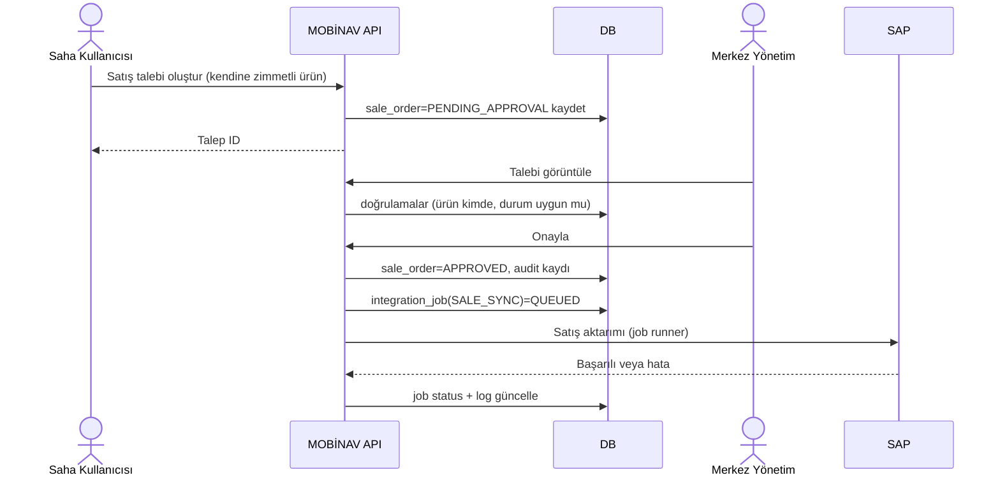
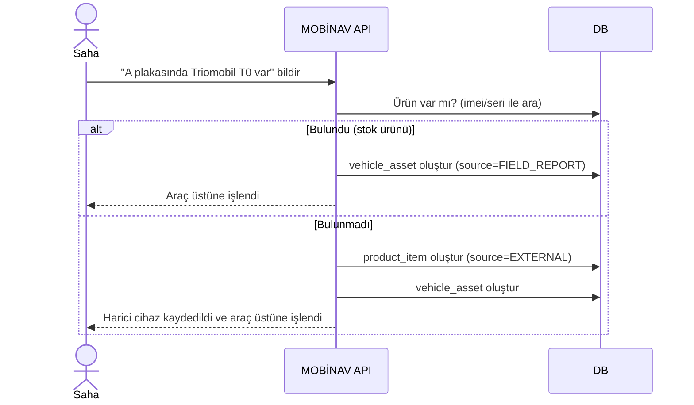
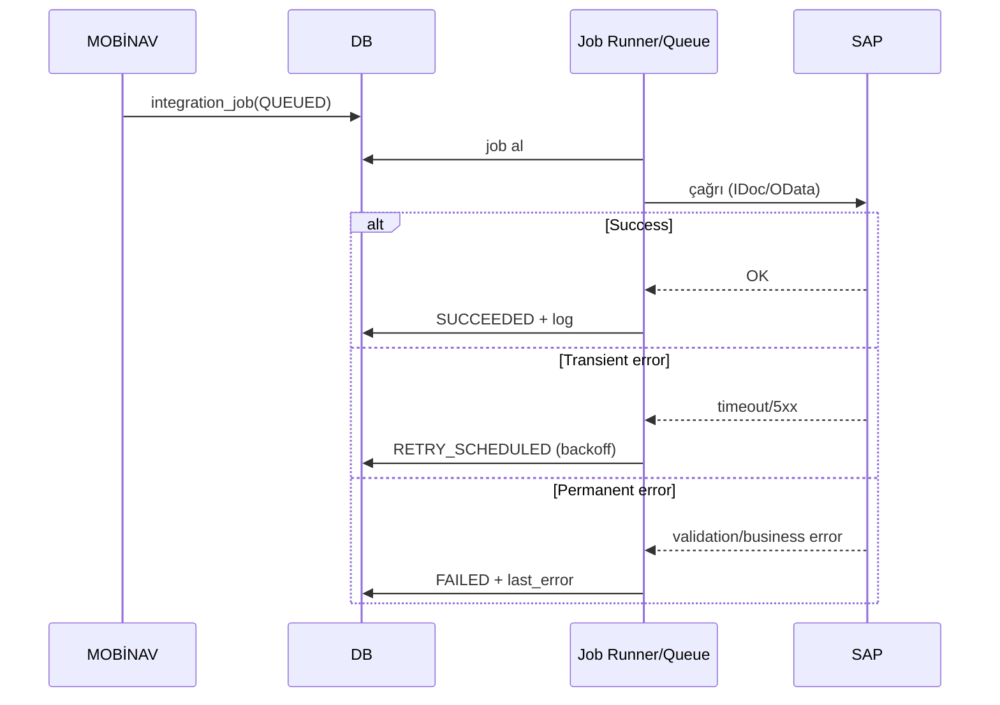
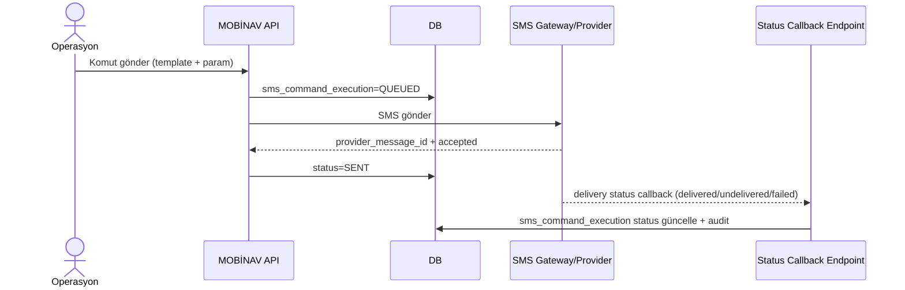

# MOBİNAV Stok Takip & Araç Takip Uygulama Dokümanı

> **Terminoloji Güncellemesi (AYSTEK CORE Uygulama Kararı):**  
> Bu dokümandaki iş adı **MOBİNAV** olarak geçmektedir. AYSTEK CORE implementasyonunda teknik bounded-context/modül adı **`stock`** olarak standardize edilecektir.  
> Özet: *Business label* = MOBİNAV, *Technical module root* = `internal/modules/stock/*`.

## Yönetici Özeti

Bu rapor, sağladığınız **MOBİNAV Stok Takip & Araç Takip hikâye/senaryo dokümanını**; geliştirme ekibinin doğrudan backlog’a dönüştürüp teslimat yapabileceği seviyede bir **Uygulama (Implementation) Dokümanı**na çevirmek için kapsamlı, araştırma temelli bir çerçeve sunar (tarih: **24 Şubat 2026**, Europe/Istanbul). Bu seviyede bir doküman; yalnızca “ne yapılacak” listesini değil, aynı zamanda **kabul kriterlerini**, **veri şemalarını**, **API sözleşmelerini**, **akışları**, **NFR’leri**, **test planını**, **migrasyon ve rollback yaklaşımını** içerir.

Dış kaynak araştırmasında özellikle şu alanlar referans alınmıştır:  
SAP entegrasyonlarında **IDoc/ALE** süreçleri ve IDoc’ların paketlenmesi (performans/operasyon açısından “collect IDocs” yaklaşımı) citeturn1search1turn9search0, SAP tarafında OData servislerinin tüketimi ve **$batch** kullanımı citeturn9search1, OAuth2 **Client Credentials** gibi sistemden-sisteme kimlik doğrulama yaklaşımları (IETF OAuth2 çerçevesi ve SAP ürün dokümantasyonu) citeturn7search0turn7search8turn9search2, telematik/araç takip sağlayıcılarında konum verisinin API ile alınması (Samsara, Geotab, Wialon, Webfleet, Verizon Connect) citeturn1search0turn2search0turn3search11turn4search8turn4search13, CSV format standardı (RFC 4180) citeturn5search11 ve CSV/ dosya yükleme güvenliği (OWASP) citeturn5search3turn5search1, API güvenliği ve kritik iş akışlarının korunması (OWASP API Security Top 10 – 2023) citeturn5search2turn5search0, loglama/audit gereksinimleri (OWASP Logging Cheat Sheet) citeturn6search2. Yeni eklenen **SMS Komut Modülü** için, SMS gönderiminde teslimat durumlarının webhook’larla izlenebilirliği ve “sent/delivered/undelivered/failed” gibi durumların yönetimi gibi endüstri standardı pratikler (örnek: Twilio dokümantasyonu) citeturn8search0turn8search8turn8search2 ve SMS’in teknik standardının 3GPP TS 23.040 kapsamında ele alındığı (referans olarak) citeturn8search3 temel alınmıştır.

Belirsiz (netleşmesi gereken) noktalar ve önerilen seçenekler:
- **SAP entegrasyon yöntemi** (IDoc mu OData mı?”): Hikâyede SAP ile satış/onay/araç-proje sync kesin; ama teknik kanalın tam adı belirsiz. Doküman hem “IDoc ağırlıklı (batch/collect)” hem “OData/REST ağırlıklı” iki opsiyonu da kapsar. citeturn1search1turn9search1  
- **Araç takip sağlayıcıları listesi**: Kurumda kullanılan vendor(lar) belirsiz; konnektör mimarisi bu yüzden “çoklu sağlayıcı” tasarlanır. Samsara/Geotab/Wialon/Webfleet/Verizon Connect örnekleri, endpoint/davranış çeşitliliğini ve rate-limit/polling farklarını göstermesi için referanslanmıştır. citeturn1search0turn2search0turn3search11turn4search8turn4search13  
- **Harici M2M (kendine ait hat)** için faturalama: “Sadece bilgi amaçlı” mı “tam abonelik/ücret geçmişi” mi belirsiz. Doküman iki seçenek sunar.  
- **İade sonrası otomatik zimmetin hedefi** (hangi kullanıcı/depoya): Belirsiz. Öneri: “İade Kabul Deposu” adlı sanal stok kullanıcısı + audit.  
- **SMS komutlarının cihaz bazlı formatları** (TRIO/T0 vb. komut stringleri): Belirsiz. Öneri: “Komut şablon kataloğu + marka/model bazlı varyant” yaklaşımı.

## Fonksiyonel Gereksinimler

Aşağıdaki gereksinimler modül bazında **User Story (US)** ve **Acceptance Criteria (AC)** formatında verilir. User story’ler doğrudan backlog’a taşınabilir; acceptance criteria’lar test senaryolarının çekirdeğidir. Güvenlik ve kritik iş akışları açısından, API’lar tasarlanırken OWASP API Security Top 10 (özellikle yetkilendirme, hassas iş akışlarının korunması ve kaynak tüketimi) referans alınmalıdır. citeturn5search2turn5search0

### Stok modülü

**US-STK-001 — Stok kalemi oluşturma (tekil ürün kayıt)**  
Stok kullanıcısı olarak Hat/GPS/Kamera gibi ürünleri tekil kalem olarak sisteme kaydetmek istiyorum; böylece sahaya çıkış, satış, iade, zimmet süreçlerinde izlenebilirlik sağlayayım.  
**AC**
- Ürün “tek kalem” kayıt edilir; her kayıt tek bir fiziksel/lojik varlığı temsil eder (Hat, GPS cihazı, kamera).  
- Ürün tipi zorunlu: `HAT | GPS | KAMERA | DİĞER`.  
- Marka/Model alanları ürün tipine göre zorunlu kurallara tabidir (aşağıda Ürün modülünde detay).  
- “Silme” işlemi fiziksel silme değil, **pasife düşürme** olmalıdır (soft delete).  

**US-STK-002 — Stok lokasyonu opsiyonel**  
Stok kullanıcısı olarak ürünün dolap/raf/lokasyon bilgisini girebilmek istiyorum; ancak operasyonu aksatmasın diye zorunlu olmasın.  
**AC**
- `location` alanı opsiyonel; boş bırakılabilir.  
- Lokasyon raporlarda filtre/kolon olarak kullanılabilir.  

**US-STK-003 — Stok durumu yaşam döngüsü**  
Yönetici olarak stok kalemlerinin “stokta/zimmetli/satışta/satıldı/iade/pasif” yaşam döngüsünü izlemek istiyorum.  
**AC**
- Durum geçişleri kurallıdır; örn. “Satıldı” ürünü tekrar “Stokta” yapmak yalnız iade süreciyle olur.  
- Durum değişiklikleri audit log’da tutulur (kim, ne zaman, eski/yeni). citeturn6search2  

### Ürün modülü (Hat/GPS/Kamera) ve marka/model

Bu modül “ürün tipleri”nin alan zorunluluklarını netleştirir. Marka/model standardizasyonu hem veri kalitesini hem rapor doğruluğunu belirler.

**US-UR-001 — Marka/Model kataloğu**  
Yönetici olarak marka ve model kataloglarını yönetmek istiyorum; böylece ürün girişinde standardizasyon sağlansın.  
**AC**
- `brand` ve `model` aktif/pasif yönetilebilir.  
- Model, ürün tipine göre sınıflanabilir (GPS model listesi, Hat “model” listesi vb.).  
- Harici cihaz/harici hat bildiriminde de aynı katalog kullanılabilir.

**US-UR-002 — Hat ürünü alan kuralları**  
Stok kullanıcısı olarak Hat ürününü kaydederken operatör ve hat türü gibi bilgileri tutmak istiyorum; böylece “M2M Turkcell aktif mi?” gibi sorular cevaplanabilsin.  
**AC**
- Hat için zorunlu alanlar: `operator` (ör. Turkcell), `hat_type` (ör. M2M).  
- Opsiyonel ama önerilen alanlar (net değil → seçenek): `msisdn` (hat no), `iccid` (SIM), `imsi`. (Belirsiz: kurumda hangisi “ana anahtar”?)  
- Hat “stoka ait” veya “harici” olabilir (Harici modül ile ortak kural).  

**US-UR-003 — GPS ürünü alan kuralları**  
Stok kullanıcısı olarak GPS cihazını kaydederken marka/modeli zorunlu girmek istiyorum; böylece “Triomobil T0 var mı?” sorusu net cevaplanabilsin.  
**AC**
- GPS için marka ve model zorunludur (ör. Triomobil / T0).  
- Opsiyonel ama pratikte kritik alanlar: `imei`, `serial_no` (Belirsiz: hangisi kurumda tekil anahtar?)  
- GPS’in ilişkilendiği hat varsa “ürün ilişki” veya “araç üstü kurulum” üzerinden gösterilebilir.

**US-UR-004 — Kamera ürünü alan kuralları**  
Stok kullanıcısı olarak kameraları toplu girip satışa çıkarabilmek istiyorum.  
**AC**
- Kamera için marka/model zorunluluğu (Belirsiz): Öneri = zorunlu (raporlama için).  
- Seri no zorunluluğu (Belirsiz): Öneri = üretici seri no varsa zorunlu.  

### Toplu CSV yükleme ve CSV ile toplu işlemler

CSV formatı ve uyumluluğu için RFC 4180 temel alınmalıdır (örn. header satırı opsiyonel, satırların kayıtları temsil etmesi, alanların virgülle ayrılması, tırnaklama kuralları). citeturn5search11turn5search13

**US-CSV-001 — CSV ile toplu ürün ekleme (tek resmi kanal)**  
Stok kullanıcısı olarak ürünleri yalnız CSV ile toplu yüklemek istiyorum (örn. 10 kamera), böylece manuel giriş azalır.  
**AC**
- Sistem yalnız `text/csv` kabul eder; dosya uzantısı ve içerik türü doğrulanır (dosya yükleme güvenliği). citeturn5search3  
- Şema doğrulama: zorunlu kolonlar, tip kontrolleri (imei format, boş olmaması vb.).  
- Hatalar satır bazında raporlanır; “kısmi başarı” desteklenir.  
- Duplicate politikası **belirsiz**: Öneri A = tamamını reddetme, Öneri B = satır bazında reddetme + rapor.

**US-CSV-002 — CSV ile toplu satışa çıkarma / dondurma**  
Yönetici veya stok kullanıcısı olarak CSV ile toplu “satışa çıkar” ve “dondur” işlemleri yapmak istiyorum.  
**AC**
- Toplu “satışa çıkarma” ürünleri `SALE_PENDING` benzeri statüye alır.  
- Toplu “dondurma” onaylanmış satıştaki ürünleri kilitler; satış/işlem yapılamaz.  
- Bu akışlar sırasında “SAP servisleri her zaman çalışır olmalı” gereksinimi için **pre-flight SAP health-check** yapılır (SAP down ise işlem ya kuyruklanır ya bloklanır; seçim belirsiz).  
- CSV çıktıları/raporları üretilirken **CSV injection** riskine karşı hücre başı sanitizasyon uygulanır. citeturn5search1  

### Zimmet modülü (yalnız stok kullanıcılarına)

**US-ZIM-001 — Zimmet sadece stok kullanıcılarına**  
Stok kullanıcısı olarak ürünleri yalnız “stok kullanıcısı” rolündeki kişilere zimmetlemek istiyorum.  
**AC**
- Hedef kullanıcı rolü doğrulanır; stok kullanıcısı olmayan kişiye zimmet verilemez.  
- Zimmet işlemi audit log’lanır. citeturn6search2  

**US-ZIM-002 — Çoklu zimmet ekranında sadece stokta olan ürünler**  
Stok kullanıcısı olarak toplu zimmet ekranında yalnız “stokta” ürünleri görmek istiyorum.  
**AC**
- Liste filtre varsayılanı `status=IN_STOCK`.  
- İşlem sırasında yarış koşullarına karşı “optimistic locking”/versiyon kontrolü uygulanır (Belirsiz yöntem; hedef: aynı ürün aynı anda iki işlem görmesin).

### Satış modülü (yönetici ve saha)

**US-SAT-001 — Yönetici panelinden satış: doğrudan ONAYLI → SAP’ye aktar**  
Yönetici olarak panelden satış yaptığımda satış doğrudan “ONAYLI” olsun ve SAP aktarımı otomatik başlasın.  
**AC**
- Yönetici akc. satış `APPROVED` durumunda oluşturulur.  
- SAP senkronizasyonu arka planda job olarak tetiklenir; durum izlenebilir. (SAP entegrasyon pratikleri için bölüm “Entegrasyon”da detay.) citeturn1search1turn9search1  
- SAP hatalarında otomatik retry + manuel müdahale ekranı olmalıdır.

**US-SAT-002 — Zimmet olmadan satış olabilir**  
Yönetici olarak zimmeti olmayan ürünü de satışa çıkarabilmek istiyorum.  
**AC**
- Ürün `IN_STOCK` durumundaysa zimmet aranmadan satışa çıkarılabilir.  
- Satış, ürünün araçla ilişki kurulmasını gerektiriyorsa araç bilgisi zorunludur (Belirsiz: satış “araçsız” olabilir mi?).

**US-SAT-003 — Saha satış talebi: telefondan form → merkez onay → SAP aktar**  
Saha kullanıcısı olarak yalnız kendime zimmetli ürünlerden satış talebi açmak istiyorum; merkez onaylasın, sonra SAP’ye aktarılsın.  
**AC**
- Saha arayüzü sadece kendine zimmetli ürünleri listeler.  
- Talep durumu: `PENDING_APPROVAL` → (onay) `APPROVED` → `SAP_SYNCED` veya `SAP_FAILED`.  
- Onay/ret gerekçesi zorunlu (ret için).  
- Tek ürün aynı anda birden fazla aktif satış talebinde olamaz.

### İade modülü (kısmi iade + araç üstü konfig güncelleme)

**US-IAD-001 — Kısmi iade destekle (sadece GPS veya sadece Hat)**  
Yönetici olarak satılan ürünlerden sadece bir kısmını iade alabilmek istiyorum; araç üzerindeki cihaz bilgisi güncellensin.  
**AC**
- Satış kalemleri içinden iade seçimi yapılır (GPS/hattı ayrı ayrı).  
- Araç üzerindeki ürün listesi/kurulum kaydı güncellenir (“GPS iade oldu” ise araçta artık GPS görünmemeli).  

**US-IAD-002 — İade alınca stoğa düşmeden otomatik zimmete düş**  
Yönetici olarak iade alınca ürünün stoğa değil otomatik zimmete düşmesini istiyorum.  
**AC**
- İade sonrası ürün, tanımlı “İade Kabul” stok kullanıcısına otomatik zimmetlenir. (Belirsiz hedef → opsiyon olarak konfigüre edilebilir.)  
- İade işlemi SAP’ye aktarılacaksa bir “return sync job” oluşur.  

### Harici cihaz / harici M2M (kendine ait hat dahil)

**US-HRC-001 — Harici cihaz kaydı (sistemde yoksa bilgi amaçlı oluştur)**  
Saha kullanıcısı olarak araçta gördüğüm ama sistemde olmayan cihazı bildirebilmek istiyorum; araç üstüne işlenebilsin.  
**AC**
- Cihaz sistemde yoksa `sourceType=EXTERNAL` ile kayıt açılır.  
- Marka/model zorunludur; seri/IMEI opsiyoneldir.  
- Harici cihaz stok sayımına dahil edilmez; satış/zimmet süreçlerine varsayılan olarak girmez.  
- Harici cihaz araç üzerinde görünür ve raporlanır.

**US-HRC-002 — Harici M2M hat (kendine ait) kaydı**  
Kullanıcı olarak kendime/tedarikçiye ait M2M hattı sisteme harici olarak kaydedebilmek ve raporlayabilmek istiyorum.  
**AC**
- Hat `sourceType=EXTERNAL` olabilir.  
- Hat aktif/pasif durumu tutulur.  
- Raporlarda “stok hattı mı harici mi?” ayrımı yapılır.

**US-HRC-003 — Araç-ürün sorgusunda “Triomobil GPS + M2M aktif mi?” sorusuna cevap**  
Kullanıcı olarak “Bu araçta Triomobil GPS cihazı ve M2M hat aktif mi?” sorusunu tek servis çağrısıyla cevaplamak istiyorum.  
**AC**
- Servis hem stok hem harici varlıkları dikkate alır.  
- “aktif” tanımı belirsiz: Öneri = araç üzerinde “installed” ve “status=ACTIVE_ON_VEHICLE”.  

### Abonelik modülü (tarih aralıklı ücretlendirme + geçmiş)

Abonelikler “iptal edilene kadar devam” edebilir. Ücretlendirme geçmişinin ve tarih aralığı çakışmalarının yönetimi kritik olacaktır.

**US-ABN-001 — Abonelik oluştur (hat/GPS/SMS paketi vb.)**  
Yönetici olarak her tür abonelik kaydı açmak istiyorum ve iptal edilene kadar devam edebilsin.  
**AC**
- `startDate` zorunlu; `cancelDate` opsiyonel.  
- Abonelik türleri konfigüre edilebilir katalogdan seçilir (Belirsiz liste).  

**US-ABN-002 — Tarih aralıklı ücret tanımla ve geçmişi sakla**  
Yönetici olarak aynı abonelik için farklı tarihlerde farklı ücretleri tarih aralığıyla tanımlamak istiyorum; geçmiş silinmemeli.  
**AC**
- Ücret satırları `validFrom/validTo` ile tutulur; çakışma engellenir (öneri).  
- Ücret geçmişi immutable: “düzeltme” yeni satırla yapılır.

### Konum servisleri (araç takip yazılımlarından çekme + servis etme)

Konnektör yaklaşımı; farklı vendor’ların “snapshot”, “feed”, “history” gibi farklı modelleri olabileceği için gereklidir. Örneğin Samsara “locations feed” ile cursor/pagination yaklaşımı sunar citeturn1search0; Geotab “DeviceStatusInfo” ile mevcut konum/sürüş durumunu nesne olarak sağlar ve rate-limit tanımlar citeturn2search0; Wialon ise session id tabanlı bir Remote API kullanım modeli ve “son konum” için flag’ler sunar citeturn3search11turn3search1.

**US-KON-001 — Tek araç anlık konum servisi**  
Kullanıcı olarak tek aracın anlık konumunu API ile almak istiyorum.  
**AC**
- Yanıt: lat/lon, hız, yön, timestamp, veri kaynağı, veri yaşı (lag).  
- Kaynak sistem erişilemiyorsa “son bilinen konum + yaş” veya “no data” (belirsiz tercih) döner.

**US-KON-002 — Çoklu araç anlık konum servisi**  
Kullanıcı olarak birden fazla aracın anlık konumunu toplu almak istiyorum.  
**AC**
- Maksimum plaka sayısı ve rate limit konur (OWASP “resource consumption” riski). citeturn5search2turn5search0  

**US-KON-003 — Konum geçmişi (tarih aralığı)**  
Kullanıcı olarak tarih aralığında konum geçmişi almak istiyorum (kaynak destekliyorsa).  
**AC**
- `start/end` zorunlu; maksimum aralık (belirsiz) tanımlanır.  
- Kaynağın “feed”/“history” yetenekleri konnektör meta verisinde tutulur (vendor bağımlılığı kaçınılmaz).

### GPS çetele kontrol sistemi

**US-CTE-001 — Çetele kaydı oluştur ve araç-ürünle ilişkilendir**  
Operasyon kullanıcısı olarak GPS çetele kaydı oluşturmak ve araç/ürünle ilişkilendirmek istiyorum.  
**AC**
- Çetele kaydı: araç, kontrol tarihi, sonuç, notlar.  
- İstenirse metrik bazlı detay (beklenen/gerçekleşen) kaydedilebilir (Belirsiz: metrik seti).  

### Raporlama

Raporların “kolay, detaylı, çıktı alınabilir” olması istenir. Ayrıca API envanteri ve raporlama için OWASP’in “improper inventory management” ve loglama önerileri dikkate alınmalıdır. citeturn5search2turn6search2

**US-RPR-001 — Aktif abonelikli hatlar raporu (plaka+proje ile)**  
Yönetici olarak aboneliği devam eden hatları plaka ve proje bilgisiyle raporlamak istiyorum.  
**AC**
- Filtre: proje, plaka, operatör, kaynak (stok/harici).  
- Çıktı: PDF + XLSX/CSV (format belirsiz; öneri: en az XLSX/CSV).  

**US-RPR-002 — Araç üzerinde hangi ürün var? (aktif / iade / harici)**  
Yönetici olarak tüm araçlarda üzerindeki ürünleri ve durumlarını raporlamak istiyorum.  
**AC**
- Kolonlar: ürün tipi, marka/model, kaynak, durum, kurulum tarihi, söküm/iade tarihi.  

### Eski ekran migrasyonu

Taşınacak ekranlar (verilen liste) aynı fonksiyonları yeni yapıya taşımayı gerektirir. SMS ile ilgili ekranlar (ör. `*_SMS.php`) yeni “SMS Komut Modülü” ile ilişkilendirilmelidir; `TRIO_ANLIK_KONUM.php` gibi ekranlar konum servisleriyle ilişkilendirilmelidir (parite analizi şart).

### SAP ve diğer platform entegrasyonları

SAP tarafında hem “IDoc interface / ALE” citeturn1search3 hem de “OData API tüketimi ve $batch” citeturn9search1 pratikleri büyük sistemlerde sık görülen yaklaşımlardır. Hikâyede “SAP servisleri her zaman çalışır olmalı” ve “SAP’den araç proje bilgisi değişince bize ulaşmalı” beklentisi, entegrasyon işlerinin **kuyruklanması + retry + izlenebilirlik** ile ele alınmasını zorunlu kılar (NFR bölümünde detay).

**US-INT-001 — SAP’den araç proje/güzergâh bilgisini al**  
Sistem olarak SAP’de araç proje bilgisi değişince MOBİNAV’da güncellemek istiyorum.  
**AC**
- “Push” mümkünse tercih; değilse periyodik pull + delta (belirsiz).  
- Her sync işlendiğinde audit/integration log kaydı tutulur.

**US-INT-002 — Satış/İade durumlarını SAP’ye aktar**  
Sistem olarak onaylanan satış ve iadeleri SAP’ye aktarmak istiyorum.  
**AC**
- Her kayıt için idempotency key ve tekrar deneme mekanizması (SAP down/timeout senaryoları).  
- SAP’den gelen hata mesajları job log’a yazılır.  

### Yeni modül: SMS Komut Modülü

Bu modül; cihazlara **şablon (template) SMS komutları** göndermek (yönlendirme/routing, reset, restart vb.) ve sonuçlarını izlemek içindir. SMS ile komut gönderimi, GSM/3GPP SMS standartlarının kapsamındadır (referans: 3GPP TS 23.040 “Technical realization of the Short Message Service (SMS)”). citeturn8search3

SMS gönderiminde “gönderildi/teslim edildi/teslim edilemedi/başarısız” gibi durumları izleme pratik olarak webhook/callback ile yapılır; örnek olarak Twilio “Outbound Message Status Callback” yaklaşımını dokümante eder. citeturn8search0turn8search8 Ayrıca SMS teslim “delivered” bilgisinin pratikte operatör/cihaz zincirinde sınırlı güvenilirliği olabileceği not edilmelidir. citeturn8search2

**US-SMS-001 — Komut şablonu tanımla (marka/model bazlı)**  
Yönetici olarak routing/reset/restart gibi komutları şablon olarak tanımlamak istiyorum; cihaz tipine göre farklı metinler yönetilebilsin.  
**AC**
- Şablon alanları: `commandType`, `brand/model targeting`, `messageTemplate`, `paramSchema`, `isActive`.  
- Parametre doğrulama: örn. routing için hedef/proje kodu zorunlu olabilir (belirsiz).  
- Şablonlar versiyonlanır (yanlış şablon geçmişi izlenebilmelidir).

**US-SMS-002 — Tek cihaz/araç için SMS komutu gönder**  
Operasyon kullanıcısı olarak bir araca takılı GPS cihazına “reset” veya “yönlendirme” komutu göndermek istiyorum.  
**AC**
- Hedef cihaz belirleme: araç → üzerindeki aktif GPS → bağlı hat/msisdn (Belirsiz: hat her zaman ilişikli mi?).  
- Gönderim sonucu “queued/sent/delivered/undelivered/failed” durumları ile izlenir. citeturn8search8turn8search2  
- Yetkilendirme: sadece belirli roller komut gönderebilir (kritik iş akışı). citeturn5search2turn5search0  

**US-SMS-003 — Çoklu SMS komutu gönder (bulk)**  
Operasyon kullanıcısı olarak çoklu cihaz için toplu komut göndermek istiyorum (örn. çoklu reset).  
**AC**
- Bulk istek job kuyruğuna alınır; rate limit uygulanır (operatör/gateway limitleri nedeniyle).  
- Her hedef için ayrı “command execution” kaydı oluşur; başarısızlıklar ayrı ayrı raporlanır.  
- CSV ile çoklu komut tetikleme opsiyoneldir (Belirsiz: isteniyor mu?; öneri: ikinci faz).

**US-SMS-004 — Komut sonucu callback/webhook ile güncelle**  
Sistem olarak SMS servis sağlayıcısından gelen teslimat durumlarını alıp komut kaydını güncellemek istiyorum.  
**AC**
- Bir “status callback endpoint” tanımlanır; sağlayıcı bu endpoint’e event gönderir. (Twilio örneği webhook mekanizmasına dayanır.) citeturn8search0turn8search8  
- Callback doğrulaması (imza/shared secret) yapılır (Belirsiz: sağlayıcı yetenekleri).  
- Durum geçişleri audit log’a işlenir.

## Veri Şemaları ve API Sözleşmeleri

Aşağıdaki şemalar; ilişkisel veritabanı (PostgreSQL vb.) için önerilen **minimum çekirdek model**dir. “Belirsiz” alanlarda opsiyonlar belirtilmiştir. API dokümantasyon standardı olarak OpenAPI 3.1.x önerilir (OAS 3.1.1 resmi metni). citeturn7search2turn7search3

### Çekirdek tablolar ve alanlar

Aşağıda tablolar “ana alan seti” ile verilmiştir (tam indeksler/constraint’ler ayrı teknik tasarımda netleşir).

**Tablo: `brand`**
- `id` (PK)
- `name`
- `status` (ACTIVE/PASSIVE)
- `created_at`

**Tablo: `model`**
- `id` (PK)
- `brand_id` (FK)
- `name`
- `product_type` (GPS/HAT/KAMERA/…)
- `status`

**Tablo: `supplier`**
- `id` (PK)
- `name`
- `status`

**Tablo: `product_item`** (stok ve harici varlıklar tek tabloda, `source_type` ile ayrılır)
- `id` (PK)
- `product_type` (GPS/HAT/KAMERA/…)
- `source_type` (STOCK/EXTERNAL)
- `ownership_type` (COMPANY/USER/SUPPLIER/UNKNOWN) **(yeni: “kendine ait M2M” için)**
- `brand_id`, `model_id` (FK; hatlarda model “M2M” gibi tutulabilir)
- `serial_no` (opsiyonel/kurala bağlı)
- `imei` (opsiyonel/kurala bağlı)
- Hat alanları (opsiyonel/kurala bağlı): `operator`, `msisdn`, `iccid`, `imsi`
- `status` (IN_STOCK/ASSIGNED/SALE_PENDING/SOLD/RETURNED/EXTERNAL_ACTIVE/PASSIVE/…)
- `location_text` (opsiyonel)
- `supplier_id` (opsiyonel)
- `created_at`

**Tablo: `vehicle`**
- `id` (PK)
- `current_plate`
- `project_code` (SAP’den gelir)
- `route_code` / `guzergah_code` (SAP’den gelir; belirsiz alan adı)
- `supplier_id` (opsiyonel)
- `created_at`

**Tablo: `vehicle_plate_history`**
- `id` (PK)
- `vehicle_id` (FK)
- `plate`
- `valid_from`
- `valid_to` (NULL ise halen geçerli)

**Tablo: `vehicle_asset`** (araç üstü kurulum ilişkisi)
- `id` (PK)
- `vehicle_id` (FK)
- `product_item_id` (FK)
- `installed_at`
- `removed_at` (NULL ise halen araç üzerinde)
- `install_source` (SALE/ASSIGNMENT/FIELD_REPORT/…)
- `status` (ACTIVE_ON_VEHICLE/REMOVED/RETURNED/…)

**Tablo: `assignment`** (zimmet)
- `id` (PK)
- `product_item_id` (FK)
- `assignee_user_id`
- `assigned_by_user_id`
- `assigned_at`
- `released_at`
- `status` (ACTIVE/RELEASED)

**Tablo: `sale_order`**
- `id` (PK)
- `sale_channel` (ADMIN/MOBILE)
- `requested_by_user_id`
- `approved_by_user_id` (nullable)
- `vehicle_id` (Belirsiz: satış araçsız olabilir mi? opsiyon)
- `status` (PENDING_APPROVAL/APPROVED/REJECTED/SAP_SYNCED/SAP_FAILED/…)
- `created_at`

**Tablo: `sale_order_item`**
- `id` (PK)
- `sale_order_id` (FK)
- `product_item_id` (FK)
- `status` (LINKED/…)

**Tablo: `return_order`**
- `id` (PK)
- `sale_order_id` (FK)
- `created_by_user_id`
- `status`
- `created_at`

**Tablo: `return_order_item`**
- `id` (PK)
- `return_order_id` (FK)
- `product_item_id` (FK)
- `status`

**Tablo: `subscription`**
- `id` (PK)
- `subscription_type` (HAT/GPS_SERVICE/SMS_PAKET/…)
- `vehicle_id` (FK)
- `product_item_id` (FK, opsiyonel: hat ile bağ)
- `status` (ACTIVE/CANCELED/SUSPENDED)
- `start_date`
- `cancel_date` (nullable)

**Tablo: `subscription_pricing`**
- `id` (PK)
- `subscription_id` (FK)
- `valid_from`
- `valid_to` (nullable)
- `amount`
- `currency`

**Tablo: `integration_job`** (SAP ve diğer platformlar için)
- `id` (PK)
- `target_system` (SAP/OTHER_PLATFORM_X/…)
- `job_type` (SALE_SYNC/RETURN_SYNC/VEHICLE_PROJECT_SYNC/…)
- `entity_type`, `entity_id`
- `status` (QUEUED/RUNNING/SUCCEEDED/RETRY_SCHEDULED/FAILED)
- `attempt_count`
- `next_retry_at`
- `last_error`
- `created_at`

**Tablo: `location_source`**
- `id` (PK)
- `name` (Samsara/Geotab/Wialon/Webfleet/…)
- `type` (POLL/FEED/WEBHOOK)
- `status`

**Tablo: `vehicle_location`** (cache/son bilinen konum)
- `id` (PK)
- `vehicle_id` (FK)
- `source_id` (FK)
- `lat`, `lon`, `speed`, `heading`
- `ts` (kaynak timestamp)
- `ingested_at` (sisteme giriş zamanı)

**Tablo: `sms_command_template`** (yeni)
- `id` (PK)
- `command_type` (ROUTING/RESET/RESTART/STATUS/…)
- `brand_id` / `model_id` (nullable → “genel şablon” için)
- `message_template` (örn. `"RST {PIN}"`)
- `param_schema_json` (opsiyonel; JSON Schema benzeri, OpenAPI ile uyumlu) citeturn7search2  
- `is_active`
- `version`
- `created_at`

**Tablo: `sms_command_execution`** (yeni)
- `id` (PK)
- `template_id` (FK)
- `vehicle_id` (nullable)
- `product_item_id` (FK: hedef cihaz veya hedef hat)
- `to_msisdn` (hedef numara; hangi alan baz alınacak belirsiz)
- `message_body` (render edilmiş)
- `status` (QUEUED/SENT/DELIVERED/UNDELIVERED/FAILED)
- `provider_message_id` (gateway id)
- `requested_by_user_id`
- `created_at`
- `last_status_at`

### Stok cihaz vs harici cihaz karşılaştırma tablosu

| Boyut | Stok Cihaz (source_type=STOCK) | Harici Cihaz (source_type=EXTERNAL) |
|---|---|---|
| Stok sayımı | Dahil | Hariç |
| Zimmet | Var | Varsayılan yok (opsiyonel) |
| Satış | Var | Varsayılan yok |
| Marka/Model | Zorunlu (GPS/Hat kurallarına göre) | Zorunlu (kalite için) |
| Kim bildirdi | Stok girişi (stok kullanıcısı) | Saha/merkez bildirimi (audit kritik) |
| Araç üzerinde gösterim | Evet | Evet (hikâyenin ana ihtiyacı) |
| Raporlarda ayrım | “Stok” olarak | “Harici / Kendine Ait” olarak |
| Sahiplik | Şirket | Şirket/tedarikçi/kullanıcı (ownership_type) |

### Ana servisler için örnek JSON API sözleşmeleri

Aşağıdaki sözleşmeler örnek niteliğindedir. Gerçek versiyonlama ve auth mekanizması (JWT/OAuth2) kurum standardına göre netleşmelidir. JWT formatı RFC 7519 kapsamında standardize edilmiştir. citeturn6search0 OAuth2 çerçevesi RFC 6749’dur. citeturn7search0turn7search8

**Araç-Ürün Sorgu Servisi**  
`GET /api/v1/vehicles/{plate}/assets/summary?asOf=2026-02-24`

```json
{
  "plate": "34ABC123",
  "vehicleId": "veh_10293",
  "project": { "code": "PRJ-BO01", "route": "GUZERGAH-7" },
  "assets": [
    {
      "productType": "GPS",
      "brand": "Triomobil",
      "model": "T0",
      "sourceType": "STOCK",
      "status": "ACTIVE_ON_VEHICLE",
      "serialNo": "TRIOT0-9981",
      "imei": "35xxxxxxxxxxxx",
      "installedAt": "2026-02-01T10:15:00Z"
    },
    {
      "productType": "HAT",
      "operator": "Turkcell",
      "hatType": "M2M",
      "sourceType": "EXTERNAL",
      "ownershipType": "USER",
      "status": "ACTIVE_ON_VEHICLE",
      "msisdn": "+90xxxxxxxxxx",
      "installedAt": "2026-02-01T10:20:00Z"
    }
  ],
  "queries": {
    "hasGpsActive": true,
    "hasM2mActive": true,
    "hasGpsAndM2mActive": true
  },
  "asOf": "2026-02-24"
}
```

**Konum API (anlık, çoklu)**  
`GET /api/v1/locations/current?plates=34ABC123,34XYZ987`

```json
{
  "items": [
    {
      "plate": "34ABC123",
      "ts": "2026-02-24T08:25:12Z",
      "lat": 40.9912,
      "lon": 29.0211,
      "speedKmh": 37,
      "headingDeg": 110,
      "source": "Geotab",
      "sourceLagSeconds": 12
    }
  ]
}
```

Bu API’nin “feed” ya da “cursor” tabanlı tasarımı, bazı sağlayıcılarda doğal olarak bulunur (örn. Samsara “locations feed” yaklaşımı cursor/pagination döndürür). citeturn1search0

**CSV import response**  
`POST /api/v1/bulk/products/import`

```json
{
  "importId": "imp_20260224_00041",
  "status": "COMPLETED_WITH_ERRORS",
  "summary": { "totalRows": 10, "created": 8, "updated": 0, "failed": 2 },
  "errors": [
    { "row": 4, "code": "MISSING_MODEL", "message": "GPS için model zorunludur." },
    { "row": 9, "code": "DUPLICATE_SERIAL", "message": "Seri numarası sistemde zaten var." }
  ],
  "createdProductIds": ["prd_1", "prd_2", "prd_3"]
}
```

**SAP sync (job bazlı)**  
`POST /api/v1/integrations/sap/jobs`

```json
{
  "jobType": "SALE_SYNC",
  "entity": { "type": "SALE_ORDER", "id": "so_8812" },
  "priority": "HIGH"
}
```

**SMS komutu gönderme**  
`POST /api/v1/sms/commands/send`

```json
{
  "target": {
    "plate": "34ABC123",
    "devicePreference": "GPS"
  },
  "command": {
    "templateId": "tpl_reset_triomobil_t0_v3",
    "params": { "pin": "1234" }
  },
  "options": {
    "dryRun": false,
    "requestDeliveryReceipt": true
  }
}
```

Yanıt:
```json
{
  "executionId": "smsx_55021",
  "status": "QUEUED",
  "resolvedTarget": {
    "productItemId": "prd_gps_991",
    "toMsisdn": "+90xxxxxxxxxx"
  }
}
```

Durum güncellemeleri bir “status callback” ile güncellenir; bu yaklaşım SMS sağlayıcılarında yaygındır (örnek olarak Twilio “Outbound Message Status Callback”). citeturn8search0turn8search8

## Süreç Akışları ve Mermaid Diyagramları

Aşağıdaki diyagramlar, geliştirme ekibinin gerçek iş akışlarını uçtan uca görmesini sağlar. Entegrasyon/retry gibi kritik konularda “iş (job) kaydı + durum yönetimi” önerilir.

### CSV toplu yükleme

```mermaid
flowchart TD
  A[CSV upload] --> B[Dosya doğrulama: boyut/uzantı/içerik]
  B --> C[CSV şema doğrulama: RFC 4180 uyum + kolonlar]
  C -->|Hatalı satırlar| D[Satır bazlı hata listesi üret]
  C -->|Geçerli| E[Duplicate kontrol + iş kuralları]
  E --> F[SAP health-check (opsiyonel zorunluluk)]
  F -->|SAP Down| G[İşlemi bloke et veya kuyruğa al]
  F -->|SAP Up| H[Ürünleri oluştur/güncelle]
  H --> I[Opsiyonel toplu durum: satışa çıkar/dondur]
  I --> J[Import özeti + hata raporu döndür]
```

CSV formatı ve tabular veri standardizasyonu için RFC 4180 referans alınmalıdır. citeturn5search11turn5search13 Dosya yükleme saldırılarına karşı OWASP’in file upload kontrolleri uygulanmalıdır. citeturn5search3

### Mobil satış onay akışı (saha → merkez → SAP)



SAP tarafında IDoc akışlarında “collect/bundle” yaklaşımı “yük altında performans” için önerilen bir pratik olarak dokümante edilmiştir. citeturn1search1turn9search0 OData tarafında ise tüketim ve $batch kullanımı gibi yaklaşımlar SAP dokümantasyonunda yer alır. citeturn9search1

### Sahadan cihaz bildirimi (stokta yoksa harici kayıt)



### İade akışı (stoğa düşmeden otomatik zimmet)

```mermaid
flowchart TD
  A[İade başlat] --> B[Satış kalemlerini seç (kısmi iade)]
  B --> C[return_order + item kayıtları]
  C --> D[Araç üstü kurulum kaydını güncelle]
  D --> E[Ürün status=RETURNED]
  E --> F[Otomatik zimmet: İade Kabul Deposu]
  F --> G[SAP return sync job (ops.)]
  G --> H[İade tamam]
```

### SAP senkronizasyonu ve retry



### SMS komut gönderimi ve teslimat durumları



SMS sağlayıcılarının “outbound status callback” mekanizması, mesajın teslimat durumlarını uygulamanıza bildirmek için kullanılan standart bir yaklaşımdır. citeturn8search0turn8search8

## Non-Functional Gereksinimler

### Erişilebilirlik ve SAP “always-on” kısıtı

- **Kritik operasyonlar**: satış onayı, SAP aktarımı, CSV toplu işlemler, iade kayıtları.  
- SAP servisleri “her zaman çalışır olmalı” beklentisi için, UI thread’inde bloklayıcı çağrı yerine entegrasyonun **job + kuyruk + retry** ile yürütülmesi önerilir. IDoc’larda paketleme/collect yaklaşımı performans için dokümante edilmiş bir pratiktir. citeturn1search1turn9search0  
- Takip edilebilirlik: SAP job’ları için dashboard (queued/running/succeeded/failed) zorunlu.

### Kuyruk, retry, idempotency

- Entegrasyon job’ları “idempotent” olmalıdır: aynı satış/iade job’ı tekrar işlense de hedef sistemde mükerrer kayıt üretmemelidir. (Belirsiz: SAP taraf idempotency anahtarı nasıl destekliyor?)  
- Retry politikası: exponential backoff, maksimum deneme sayısı, dead-letter kuyruğu.

### Audit, loglama, izlenebilirlik

Güvenlik ve operasyonel görünürlük için OWASP Logging önerileri doğrultusunda “güvenlik olayları dahil uygulama logları” düzenli tutulmalıdır. citeturn6search2  
Zorunlu audit olayları:
- Ürün durum geçişleri, zimmet, satış onayı/ret, iade, harici bildirimler
- Abonelik ücret satırı ekleme/değişim (geçmiş)
- SAP sync job sonuçları
- SMS komut gönderimi ve durum değişimleri

### Performans hedefleri (başlangıç önerisi)

Belirsiz: kullanıcı sayısı, araç sayısı, konum polling sıklığı. Sağlayıcı dokümanlarına göre polling stratejisi değişir; örn. Geotab DeviceStatusInfo rate limit’leri ve konum alanları (lat/long/speed/bearing) mevcuttur. citeturn2search0turn2search3 Samsara feed yaklaşımı cursor ile takip ve en az 5 saniye bekleme gibi öneriler içerir. citeturn1search0turn1search14  
Öneri ölçütler:
- Araç–ürün sorgu: p95 < 300ms (cache + indeks)
- Çoklu konum: p95 < 800ms (harici gecikme hariç)
- CSV import: async job; 10.000 satır < 5 dk hedef

### Güvenlik ve yetkilendirme

- API güvenliğinde OWASP API Top 10 riskleri (özellikle Broken Authorization ve Sensitive Business Flows) dikkate alınmalıdır. citeturn5search2turn5search0  
- Rol bazlı erişim:
  - Saha: sadece kendine zimmetli ürünler + saha bildirimi + satış talebi
  - Stok: stok/zimmet/csv
  - Yönetici: satış onayı, doğrudan satış, rapor, komut gönderimi
- API dokümantasyonu ve envanter yönetimi için OpenAPI kullanımı önerilir. citeturn7search2turn7search11  
- CSV upload ve export’larda:
  - File upload kontrolleri (boyut/uzantı/içerik türü) citeturn5search3  
  - CSV injection sanitizasyonu citeturn5search1  

## Test ve QA Planı

### Test katmanları

- **Unit test**: durum geçişleri, zorunlu alan kuralları, abonelik tarih aralığı çakışması, harici/stok ayrımı
- **Integration test**: DB + servisler + kuyruk; CSV import pipeline; konum konnektörleri (mock)
- **Contract test**: SAP (mock/OData mock service yaklaşımı; SAP ekosisteminde mock OData servis kavramı örnekleri bulunur) citeturn9search11
- **E2E**: yönetici satış, saha satış+onay, iade, harici cihaz/m2m bildirimi, SMS komut gönderimi
- **Security test**: rol ihlali, rate limit, hassas akışlara bot erişimi (OWASP API6: Sensitive Business Flows) citeturn5search0turn5search2

### Örnek test senaryoları

**CSV**
- Eksik kolon → import reddedilir; satır bazlı hata döner. (RFC 4180 uyumluluk) citeturn5search11  
- GPS satırında model yok → satır hatalı, diğer satırlar işlenebilir (kısmi başarı).  
- CSV export’ta “=cmd(…)” başlayan bir alan varsa sanitizasyon uygulanır. citeturn5search1  

**Satış**
- Yönetici doğrudan satış → `APPROVED`, SAP job `QUEUED`, sonra `SUCCEEDED`.  
- Saha satış → sadece kendine zimmetli ürün görünür; başka kullanıcı ürünü görünmez.  
- Aynı ürün iki talep → ikincisi engellenir.

**İade**
- Kısmi iade: sadece GPS iade → araç üstünde GPS kalkar; hat kalır.  
- İade sonrası otomatik zimmet: ürün “İade Kabul Deposu”na düşer.

**Konum**
- Samsara feed: cursor ile takip ve “hasNextPage” mantığına göre polling (doc’ta “endCursor/after” ve bekleme önerisi). citeturn1search0  
- Geotab: DeviceStatusInfo’dan lat/long/speed/bearing alanları normalize edilir; rate limit’e uyulur. citeturn2search0  
- Wialon: session süreleri/POST-only model ve “son konum” flag’leri ile entegrasyon doğrulanır. citeturn3search11turn3search10  

**SMS Komut**
- Komut şablonu parametre eksik → 400 + alan bazlı hata.  
- Gateway “accepted” → status=SENT; callback ile DELIVERED/UNDELIVERED güncellenir (webhook). citeturn8search0turn8search8  

## Migrasyon, Backlog ve Raporlama

### PHP ekran migrasyon planı

Taşınacak ekranlar:
- `BODRUM_YENI_MOBINAV_YONLENDIRME.php`
- `ESKI_COKLU_MOBINAV_YONLENDIRME.php`
- `ESKI_MOBINAV_YONLENDIRME.php`
- `GRSL_SMS.php`
- `KM_SMS.php`
- `MBSS_SMS.php`
- `TRIO_ANLIK_KONUM.php`
- `YENI_COKLU_SMS.php`
- `YENI_MOBINAV_YONLENDIRME.php`
- `YENI_P55_SURE.php`
- `YENI_T1_RESETLEME.php`
- `YENI_T2_T0_RESETLEME.php`

Verilen referans sayfa linkini kayıt altına almak için (URL’yi ham yazmamak adına kod bloğu içinde):  
```text
https://aysteknolojileri.com/mobinav/bilgi/
```

**Adım listesi (öneri)**
1. **Parity analizi**: Her ekranın iş kuralları + hangi cihaz/komut/rapor davranışını yaptığı çıkarılır (özellikle `_SMS.php` ve `*_RESETLEME.php` ekranları → SMS Komut Modülü’ne map edilir).  
2. **API-first çıkarım**: Önce read-only API’lar; sonra write akışları.  
3. **Kademeli geçiş**: Kritik akışlar (satış/iade/zimmet) feature-flag ile taşınır.  
4. **Shadow-mode**: Eski ve yeni paralel; veri tutarlılık raporu.  
5. **Cutover**: Eski ekranlar “read-only/redirect”.  
6. **Rollback planı**: Feature flag ile geri dönüş; entegrasyon job’larında idempotency (çift kayıt riski).  

**Riskler**
- Eski ekranlarda gömülü iş kuralları (özellikle SMS komut formatları) “dokümansız” olabilir → şablon kataloğu çıkarılmalı.  
- Konum ekranı (`TRIO_ANLIK_KONUM.php`) vendor bağımlılığı taşıyabilir; konnektör katmanı gerektirir (Samsara/Geotab/Wialon vb. örnekleri, endpoint çeşitliliğini gösterir). citeturn1search0turn2search0turn3search11  

### Öncelikli backlog (epic’ler) ve sprint planı

**Epic listesi (öncelik sırası önerisi)**
1. Ürün/Marka-Model/Araç temel master data
2. Stok + durum yönetimi + pasife düşürme
3. Zimmet (sadece stok kullanıcılarına) + çoklu zimmet filtreleri
4. CSV import + CSV ile toplu satışa çıkarma/dondurma
5. Satış modülü (yönetici doğrudan + saha talep/onay)
6. SAP entegrasyon altyapısı (job, retry, izleme) + araç proje sync
7. İade (kısmi iade + otomatik zimmet) + SAP return sync
8. Harici cihaz + harici M2M (ownership_type dahil)
9. Abonelik + ücret geçmişi (tarih aralıklı)
10. Konum konnektörleri + konum API
11. GPS çetele
12. Raporlama + export
13. SMS Komut Modülü (şablon + gönderim + callback)
14. PHP ekran migrasyonu (kademeli)

**Sprint faz önerisi (2 haftalık sprint varsayımı, belirsiz kapasite)**
- Faz A (Sprint 1–2): Epic 1–2  
- Faz B (Sprint 3–4): Epic 3–4  
- Faz C (Sprint 5–6): Epic 5 + temel SAP job altyapısı (Epic 6 çekirdeği)  
- Faz D (Sprint 7–8): Epic 6 tamam + Epic 7  
- Faz E (Sprint 9–10): Epic 8–9  
- Faz F (Sprint 11–12): Epic 10–11  
- Faz G (Sprint 13–14): Epic 12–13  
- Faz H (sürekli): Epic 14 (migrasyon)  

### Rapor gereksinimleri ve örnek şablonlar

Raporların çıktı alınabilir olması, CSV/XLSX export’ta güvenlik (CSV injection) nedeniyle sanitizasyon gerektirir. citeturn5search1 Ayrıca loglama/izleme ile rapor çıktılarının üretimi izlenebilir olmalıdır. citeturn6search2

**Rapor şablonu: “Aktif Abonelikli Hatlar (Plaka + Proje)”**
| Kolon | Açıklama |
|---|---|
| Plaka (güncel) | vehicle.current_plate |
| Proje Kodu/Güzergâh | SAP’den gelen alan |
| Hat Operatörü | Turkcell/Vodafone… |
| Hat Tipi | M2M |
| Kaynak | STOCK/EXTERNAL |
| Sahiplik | COMPANY/USER/SUPPLIER/UNKNOWN |
| Abonelik Başlangıç | start_date |
| İptal Tarihi | cancel_date |
| Mevcut Ücret | asOf tarihine göre subscription_pricing |

**Rapor şablonu: “Araç Üzerindeki Ürünler (Aktif/İade/Harici)”**
| Kolon | Açıklama |
|---|---|
| Plaka | güncel + opsiyonel geçmiş plaka |
| Proje | SAP proje |
| Ürün Tipi | GPS/HAT/KAMERA |
| Marka/Model | katalogdan |
| Kaynak | STOCK/EXTERNAL |
| Durum | ACTIVE_ON_VEHICLE/RETURNED/REMOVED |
| Kurulum Tarihi | vehicle_asset.installed_at |
| Söküm/İade Tarihi | vehicle_asset.removed_at veya return date |

### Önceliklendirilecek kaynaklar

- **SAP (resmi)**:  
  - IDoc ile çalışma ve “Collect/Bundle IDocs” gibi operasyonel pratikler citeturn1search1turn9search0  
  - OData servislerinin tüketimi ve $batch yaklaşımı citeturn9search1  
  - OAuth2 Client Credentials örnekleri (SAP Help Portal) citeturn9search2turn9search8  
  - SAP Business Accelerator Hub’ın API keşfi/testi için rolü citeturn1search4turn1search18  

- **Araç takip / telematik vendor API’leri (resmi)**:  
  - Samsara: locations feed ve gps/history örnekleri citeturn1search0turn1search2turn1search14  
  - Geotab: DeviceStatusInfo (lat/long/speed/bearing) ve rate-limit bilgisi; ayrıca data feed/adapter yaklaşımı citeturn2search0turn2search3turn2search7  
  - Wialon: API kullanım modeli (POST, sid, session), son konum/komut alanları citeturn3search11turn3search1turn3search10  
  - Webfleet: API erişimi için API key + dedicated account yaklaşımı citeturn4search8turn4search20  
  - Verizon Connect: API ve GPS webhook entegrasyonu citeturn4search13turn2search4  
  - (Risk notu) Bazı konum servisleri decommission/takvim riski taşıyabilir; örnek olarak TomTom Location History API için decommission duyurusu vardır. citeturn3search4  

- **CSV, dosya yükleme ve güvenlik**:  
  - CSV format standardı (RFC 4180) citeturn5search11  
  - File upload güvenliği (OWASP) citeturn5search3  
  - CSV injection (OWASP) citeturn5search1  
  - API güvenliği (OWASP API Security Top 10 2023) citeturn5search2turn5search0  
  - Loglama/audit (OWASP Logging) citeturn6search2  

- **SMS Komut Modülü için kaynaklar**:  
  - SMS standardının referansı (3GPP TS 23.040) citeturn8search3  
  - Teslimat durumlarının webhook/callback ile izlenmesi (örnek: Twilio messaging webhooks & outbound status tracking) citeturn8search0turn8search8turn8search2  

- **Türkçe kaynaklar (mevcutsa)**:  
  - Türkiye odaklı araç takip çözümlerinin konum/harita/raporlama gibi özellikleri genellikle “anlık takip” ve raporlama kabiliyetlerini vurgular; örnek Türkçe referans (Mobiliz mobil uygulama tanıtımı). citeturn3search14
