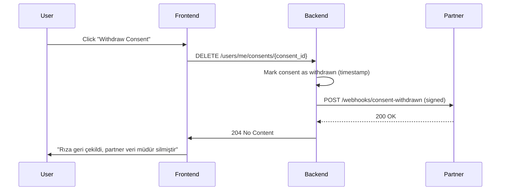

# KVKK Compliance Mapping - API Sharing System

**Kanun:** KVKK (6698)  
**Yürürlük Tarihi:** 07.04.2014  
**Yetkilendirici:** Kişisel Verileri Koruma Kurulu  

---

## 1. KVKK Kanun Maddeleri & Uygulanacak Tedbirler

### Madde 3 - Tanımlar
**Tanım:** Kişisel veri = kimliği belirlenmiş veya belirlenebilir gerçek kişiye ilişkin her türlü bilgi

**API Sharing'de kişisel veri örnekleri:**
- tenant_id, site_id (eğer gerçek kişiye bağlıysa)
- user_id, username, email
- client contact info (partner şirket ilgili kişi)
- IP addressler (SİRA'ya göre kişisel veri olabilir)
- audit log'lardaki istem/yanıt verileri (PII içerebilir)

**Uygulanacak tedbirler:**
- [ ] PII veri envanteri yap (veri kategorileri tanımla)
- [ ] Log'larda PII maskeleme (emails, phone numbers, IP'ler hash edilecek)
- [ ] Veri sınıflandırması (genel, hassas, gizli)

---

### Madde 5 - Kişisel Veri İşlenmesi Şartları

**Şart:** Herhangi bir yasal işlem veri işleme için gereklidir.

**API Sharing işleme şartları:**
1. **Rıza (Consent)** - Kullanıcı açıkça onaylanmalı
   - Scope'lar için açık rıza (consent form)
   - Her tercihli scopes için ayrı checkbox
   
2. **Sözleşme** - Partner entegrasyon (servis-servis)
   - API kullanım SLA + Terms of Service
   - Data Processing Agreement (DPA)

3. **Kanuni Yükümlülük** - İç audit/compliance
   - Finansal raporlama için veri tutma
   - Vergi belgelendirmesi

**Uygulanacak tedbirler:**
- [ ] Consent model + audit (madde 5 uyumu)
- [ ] DPA template oluştur (partner imzalması için)
- [ ] Processing basis enum: "consent", "contract", "legal_obligation"
- [ ] Her user grant'da işleme şartı kaydı

---

### Madde 8 - Verinin Aktarılması

**Madde 8/1:** İç transfer (aynı sorumlu içinde) = izin gerekmiyor  
**Madde 8/2:** Dış transfer (veri alıcısına) = rıza veya yasal işaret

**API Sharing bağlamında:**
- Dış API'ye çıkan veri = "veri alıcısına aktarım"
- Üçüncü taraf partner firma = veri alıcısı
- DPA ve rıza gerekli

**Uygulanacak tedbirler:**
- [ ] API paylaşımında transfer kaydı (auditable)
- [ ] DPA imzalı olmayan partner'e veri çıkışı BLOCK
- [ ] Veri alıcı tarafı privacy uyumu değerlendirmesi

---

### Madde 9 - Yurt Dışı Aktarım (Kritik!)

**Şart:** AB/EEA dışına veri gidiyorsa ek kontrol

**Ülke Kategorileri:**
- **Green (Yeterli Koruma):** AB/EEA, İsviçre, Japonya, Güney Kore, vb.
- **Amber (Standart Sözleşme Şart):** Çoğu ülke (SCC gerekli)
- **Red (Riskli):** Bazı ülkeler (ek tedbirler)

**API Sharing bağlamında:**
- Partner, yurt dışı sunucuda işleyebilir
- Veri nereye gidiyor? Kontrol etmek lazım

**Uygulanacak tedbirler:**
- [ ] Partner lokasyonu (ülke) bilgisi tutulmalı
- [ ] SCC (Standard Contractual Clauses) template oluştur
- [ ] Ülkeye göre risk assessment
- [ ] EU-US veri aktarımı: SCCs + Adequacy Decision
- [ ] Admin panel'de "data residence" seçeneği

---

### Madde 10 - Aydınlatma Yükümlülüğü

**Gereklilik:** Veri toplanırken ilgili kişiye bilgilendirme yapılmalı

**İçerik (Rehbere göre):**
1. Sorumlu kimdir (AYSTEK)
2. Hangi veriler toplanıyor
3. Ne amaçla (processing purpose)
4. Hangi hukuki dayana (consent/contract/etc)
5. Alıcılar kimler
6. Saklama süresi
7. Veri konusu kişinin hakları
8. Rıza çekilebilir

**API Sharing bağlamında:**
- Consent UI'da aydınlatma metni gösterilmeli
- API scope'ları açıklanmalı ("orders.write şu veriye erişir...")
- Partner privacy statements linki

**Uygulanacak tedbirler:**
- [ ] Aydınlatma metni template oluştur (Türkçe + İngilizce)
- [ ] Consent form'da aydınlatma metni göster (checkbox with Terms)
- [ ] API operations'ın "description" field'ında data flow belirt
- [ ] KVKK Kurumu rehberi referans olarak kaydet

---

### Madde 11 - Kişinin Hakları

**Haklar:**
1. **Bilgi Alma Hakkı** (SAR - Subject Access Request)
2. **Düzeltme Hakkı** (Correction)
3. **Silme Hakkı** (Erasure / "Right to be Forgotten")
4. **İşlemeyi Kısıtlama Hakkı** (Restriction)
5. **İtiraz Hakkı** (Objection)
6. **Veri Taşınabilirlik Hakkı** (Portability)

**API Sharing bağlamında:**
- User consent'i revoke edebilmeli (silme)
- API call history'si silinebilmeli (request/30 gün)
- Partner'den da veri silinecek (contractual)

**Uygulanacak tedbirler:**
- [ ] User SAR endpoint (/users/me/data-export)
- [ ] User revocation endpoint (/users/me/consents/{id}/revoke)
- [ ] Audit log silme job (TTL-based)
- [ ] Partner'a silme bildirimi (webhook)
- [ ] Veri portability: JSON export

---

### Madde 12 - Veri İşleme Yasakları

**Yasaklanmış veri türleri (hassas kişisel veri):**
- Irkı, etnik kökeni
- Siyasi görüşü
- Felsefi inancı
- Dini inancı
- Cinsel hayatı
- Suç/ceza kaydı
- Sendika üyeliği

**Uygulanacak tedbirler:**
- [ ] Data inventory'de "sensitive data" flag
- [ ] Hassas veri işleyen operations scopes daha kısıtlı
- [ ] Hassas veri extra encryption (AES-256)
- [ ] Audit: hassas veri erişimi daha detaylı loglanır

---

## 2. KVKK Kurumu Rehberleri & Direktifler

### Rehber 1: Aydınlatma Yükümlülüğü Rehberi
**Link:** https://www.kvkk.gov.tr/Sayfalar/default.aspx  
**Konusu:** Madde 10 detaylandırması

**İçeriği:**
- Açık, anlaşılır aydınlatma metni
- Kaydedilmiş kanıt (consent timestamp)
- Belirli yapılı form (checkbox, değil checkbox kutusu)

**API Sharing uygulaması:**
- [ ] Frontend consent form: açık aydınlatma metni
- [ ] Checkbox: "İlgili scope'lar için rıza veriyorum"
- [ ] Database: consent record with timestamp + IP + version

---

### Rehber 2: Veri Güvenliği Rehberi
**Konusu:** Teknik ve idari güvenlik tedbirleri

**Madde 12 uyumunda:**
- Kişisel veri şifrelenmiş halde saklanmalı
- Sunucuya erişim kontrol edilmeli (RBAC)
- Network segment edilmeli (veri veritabanı, işlem sunucusu)
- Yedek ve kurtarma mekanizması
- Düzenli güvenlik denetimleri

**API Sharing uygulaması:**
- [ ] MongoDB field-level encryption (PII fields)
- [ ] TLS 1.2+ transit encryption
- [ ] Network policy (K8s): api-sharing pod'lar sadece belirli namespace'den erişim
- [ ] mTLS bağlı client auth
- [ ] WAF (Web Application Firewall) gateway'de
- [ ] Regular penetration testing (yıllık)

---

### Rehber 3: Yurt Dışı Aktarım Rehberi
**Konusu:** Madde 9 detaylandırması

**Kriterler:**
- Alıcı ülkede veri koruma yeterli mi?
- Standart Sözleşmeler (SCCs) yeterli?
- SCCs + ek teknik tedbirler gerekli mi?

**Seviyeler:**
1. **Green countries** (AB, İsviçre, Japonya): otomatik izin
2. **Amber countries** (çoğu): SCC şart
3. **Red countries** (bazı): SCC + ek tedbirler (encryption, anonymization)

**API Sharing uygulaması:**
- [ ] Partner location enum (country code)
- [ ] Country risk assessment (green/amber/red)
- [ ] SCC template otomatik generate (risk leveline göre)
- [ ] Admin: transfer izni verene kadar BLOCK

---

### Rehber 4: Silme/Yok Etme/Anonimleştirme Yönetmeliği
**Konusu:** Madde 17 (silme hakkı) + periyodik imha

**Yükümlülükler:**
- On-demand silme (user request)
- Periyodik imha (retention policy)
- Anonimleştirme (kalıcı tutulacaksa)

**Tanımlar:**
- **Silme:** Veri tamamen yok edilir (unrecoverable)
- **Anonimleştirme:** PII/identifying info çıkarılır
- **Periyodik imha:** Saklama süresi dolduktan sonra otomatik sil

**API Sharing uygulaması:**
- [ ] Soft delete → hard delete job (30 gün geçtikten sonra)
- [ ] Audit log TTL: 90 gün (legal obligation bitince)
- [ ] Request/response payload maskeleme (30 gün)
- [ ] Consent record: 7 yıl (contract history)
- [ ] Anonimizedbatch export (analitik için)

---

## 3. Data Inventory & Classifications

### Veri Kategorileri

| Kategori | Örnekler | Hassas? | Saklama | Şifreleme |
|---|---|---|---|---|
| **Tehslif Veri** | tenant_id, site_id (EID) | Hayır | 7 yıl | AES-256 RT |
| **İşletme Veri** | order_id, product_id | Hayır | Kullanım süresi | AES-256 RT |
| **Kişi Verileri** | user.email, user.phone | Evet | Consent süresi | AES-256 RT + FLE |
| **İp Adresleri** | request.ip | Evet (lokasyon) | 90 gün | Hash/Mask |
| **Audit Log** | action, timestamp, result | Evet (PII içerebilir) | 90 gün | Mask PII |
| **Consent Record** | user_id, scope, timestamp | Evet | 7 yıl | AES-256+FLE |
| **Partner Info** | company_name, contact_email | Evet | Sözleşme süresi | AES-256 |

### Saklama Süreleri (TTL Policies)

```bash
# MongoDB TTL Indexes
db.api_audit_logs.createIndex({"created_at": 1}, {expireAfterSeconds: 7776000}) # 90 days
db.api_consents.createIndex({"created_at": 1}, {expireAfterSeconds: 220752000}) # 7 years
db.api_usage.createIndex({"created_at": 1}, {expireAfterSeconds: 7776000}) # 90 days
db.api_request_payloads.createIndex({"created_at": 1}, {expireAfterSeconds: 2592000}) # 30 days
```

---

## 4. Consent Model (RFC & KVKK Uyumlu)

### Consent Record Schema

```json
{
  "consent_id": "con_xxxxx",
  "tenant_id": "tenant_123",
  "user_id": "user_456",
  "client_id": "partner_acme",
  "scopes": ["orders.read", "shipments.write"],
  "processing_basis": "consent",
  "purpose": "Integration with ACME ERP System",
  "version": "1.0",
  "language": "tr_TR",
  "status": "active|withdrawn|expired",
  "issued_at": "2026-03-09T10:00:00Z",
  "expires_at": "2027-03-09T10:00:00Z",
  "withdrawn_at": null,
  "ip_address": "hash_of_ip",
  "user_agent_hash": "hash_of_ua",
  "consent_url": "/consents/con_xxxxx/details",
  "audit_trail": [
    {
      "action": "ISSUED",
      "timestamp": "2026-03-09T10:00:00Z",
      "ip": "hash_of_ip"
    },
    {
      "action": "WITHDRAWN",
      "timestamp": "2026-03-15T14:30:00Z",
      "reason": "User requested"
    }
  ]
}
```

### Consent Withdrawal Flow



---

## 5. Audit Trail & Compliance Reporting

### Audit Log Schema

```json
{
  "audit_id": "aud_xxxxx",
  "tenant_id": "tenant_123",
  "client_id": "partner_acme",
  "user_id": "user_456",
  "api_operation_id": "orders_list_v1",
  "method": "GET",
  "path": "/api/v1/orders",
  "query_params": "masked",
  "request_payload_hash": "sha256_...",
  "response_status": 200,
  "response_size_bytes": 4096,
  "latency_ms": 245,
  "result": "ALLOW",
  "denial_reason": null,
  "scopes_checked": ["orders.read"],
  "ip_address": "hash_203.0.113.x",
  "timestamp": "2026-03-09T10:00:00Z",
  "trace_id": "...W3C...",
  "deleted_at": null  // soft delete flag
}
```

### Compliance Report Queries

```go
// 1. User data access (SAR - Subject Access Request)
// Find all operations where user_id = X accessed in last 30 days

// 2. Partner data usage
// Find all operations for client_id = Y by scope in last month

// 3. Consent compliance check
// Verify all partner accesses have valid consent in `api_consents`

// 4. Deletion compliance
// Verify soft-deleted audit logs actually hard-deleted after TTL

// 5. PII masking check
// Verify no raw email/phone/IP in response_payload fields
```

---

## 6. Integration with AYSTEK CORE

### Existing Modules to Extend

**`internal/modules/users/`**
- [ ] Add: `api_clients_metadata.consents[]` (consent history)
- [ ] Add: `api_clients_metadata.processing_basis` enum
- [ ] Add: `api_clients_metadata.dpa_signed_at` (DPA acceptance date)

**`internal/modules/integrations/`** (new, this work)
- [ ] Create: `integrations/api_grants/` (grant management)
- [ ] Create: `integrations/api_consents/` (consent management)
- [ ] Create: `integrations/api_audit/` (audit logging)

**`internal/modules/audit_logs/`** (existing)
- [ ] Extend: PII masking rules
- [ ] Extend: TTL enforcement job

---

## 7. Checklist: Phase 1 Implementation (Sprint 1-2)

- [ ] Data inventory document (PII categories, sensitivity)
- [ ] Consent model design & schema
- [ ] Aydınlatma metni Turkish translation
- [ ] DPA template (SCC + standard terms)
- [ ] Country risk assessment table (green/amber/red)
- [ ] Audit log masking rules (PII fields)
- [ ] Retention policy & TTL configuration
- [ ] Deletion job skeleton (hard delete + anonymization)
- [ ] Compliance report SQL queries
- [ ] KVKK Kurumu referansları in code comments

---

**Document Version:** 1.0  
**Last Updated:** 2026-03-09  
**Status:** Draft - To be updated as implementation progresses  
**Owner:** Legal + Architecture Team
